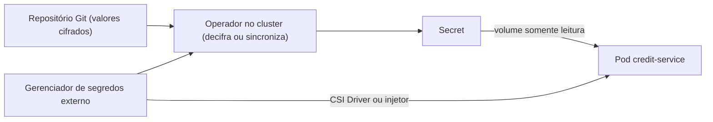

# Secure Configuration

## Descrição

O padrão Secure Configuration protege credenciais e outros dados confidenciais de uma aplicação mantendo-os criptografados fora do cluster ou em um gerenciador de segredos externo, e entregando-os ao Pod apenas no momento do uso. Isso importa porque um `Secret` do Kubernetes é apenas codificado em Base64, não criptografado: assim que ele sai do cluster, por exemplo para um repositório Git em um fluxo GitOps, fica exposto, e dentro do cluster qualquer administrador com acesso de leitura amplo consegue lê-lo.

O capítulo agrupa as soluções em duas categorias. Na **criptografia fora do cluster**, o dado cifrado fica em um lugar acessível (como o Git) e é convertido em `Secret` na entrada do cluster: o Sealed Secrets guarda o valor em um recurso `SealedSecret` que um operador decifra dentro do cluster (a cifragem é feita pela ferramenta `kubeseal`); o External Secrets Operator sincroniza segredos de um gerenciador externo para `Secret`s por meio dos recursos `SecretStore` e `ExternalSecret`; o Sops é uma ferramenta de linha de comando, sem componente no servidor, que criptografa os valores de arquivos YAML ou JSON, com chaves locais (age) ou em um serviço de gerenciamento de chaves.

No **gerenciamento centralizado de segredos**, os dados ficam em um serviço como HashiCorp Vault ou nos gerenciadores dos provedores de nuvem. O Secrets Store CSI Driver monta esses segredos como volumes sem gravá-los no etcd, e injetores como o Vault Agent Injector adicionam um init container ou sidecar ao Pod por meio de um mutating webhook.

## Problemas que resolve

- Segredos versionados em Git sem criptografia, em fluxos GitOps
- Administradores do cluster, ou quem tem leitura ampla de `Secret`s, que conseguem ler credenciais de todas as aplicações
- Acoplamento do código da aplicação a bibliotecas proprietárias de um gerenciador de segredos
- Falta de rotação e de auditoria centralizada de credenciais
- Mistura de responsabilidades entre quem implanta a aplicação e quem gerencia os segredos

## Quando usar

- Quando os manifestos, incluindo credenciais, são armazenados em repositórios compartilhados ou públicos
- Quando o nível de confiança nos administradores do cluster é limitado, ou há requisitos de confidencialidade e conformidade
- Quando a organização já mantém um gerenciador de segredos (Vault ou o do provedor de nuvem) e quer reaproveitá-lo
- Quando é importante que nenhum dado confidencial fique armazenado permanentemente no cluster

## Quando evitar

- Em cenários simples, de baixo risco, em que um `Secret` com RBAC restritivo e criptografia do etcd em repouso já bastam
- Quando a equipe não pode operar componentes extras (operador, driver CSI, injetor), pois cada um é mais uma peça a instalar e depurar
- Como garantia absoluta: quem obtiver acesso root ao cluster e aos contêineres sempre terá algum meio de chegar aos dados

## Trade-offs

| Ganho | Custo / Risco |
| --- | --- |
| Segredos podem ficar no Git de forma segura (Sealed Secrets, Sops) | Sealed Secrets exige um operador sempre ativo e o backup da chave privada |
| Gerenciador externo traz rotação, auditoria e controle de acesso refinado | External Secrets e CSI adicionam componentes e dependência de um serviço externo |
| Sops funciona só no cliente, sem componente no cluster | Depois de entregue ao cluster, o dado pode ser lido por quem tem acesso elevado à API |
| CSI Driver evita guardar o segredo no etcd | Configuração complexa e mais difícil de diagnosticar |
| Separação de papéis entre quem implanta e quem gerencia segredos | Anotações de segurança podem vazar para o deploy da aplicação (injetores) |

- **Escolha conforme o objetivo:** Sops para criptografar o que vai a repositórios; External Secrets para separar a obtenção da credencial do seu uso; CSI Driver para não manter segredos no cluster; injetores de sidecar para blindar a aplicação do acesso direto ao gerenciador.
- **Sem segredo no código:** decifrar dentro da aplicação funciona em qualquer lugar, mas acopla a lógica de negócio a esse aspecto; as soluções da plataforma são mais transparentes.
- **Rotação:** um sidecar pode atualizar o segredo localmente quando o gerenciador o rotaciona, enquanto um init container o busca uma única vez.
- **SMS versus KMS:** um gerenciador de segredos guarda os dados; um serviço de chaves guarda apenas as chaves usadas para cifrar dados em outro lugar.

## Diagrama



Os dados confidenciais chegam ao Pod por dois caminhos: convertidos em `Secret` por um operador a partir de dados cifrados ou sincronizados, ou montados direto de um gerenciador externo, sem passar pelo etcd.

## Exemplo

```yaml
apiVersion: apps/v1
kind: Deployment
metadata:
  name: credit-service
  namespace: fintech
spec:
  replicas: 2
  selector:
    matchLabels:
      app: credit-service
  template:
    metadata:
      labels:
        app: credit-service
    spec:
      containers:
        - name: credit-service
          image: registry.fintech.example/credit-service:1.4.2
          volumeMounts:
            - name: db-credentials
              mountPath: /etc/secrets
              readOnly: true
      volumes:
        - name: db-credentials
          secret:
            secretName: credit-db-credentials
            defaultMode: 0400
```

O Deployment consome o `Secret` `credit-db-credentials` como arquivos somente leitura, com permissão `0400`, em vez de variáveis de ambiente. Quem cria esse `Secret` é o mecanismo escolhido (Sealed Secrets, External Secrets, Sops), de modo que o valor nunca aparece em texto claro no Git; este manifesto não contém nenhum valor secreto.

## Padrões relacionados

- [Configuration Resource](/architecture/kubernetes-patterns/configuration/configuration-resource) — define o `Secret` que este padrão protege com técnicas adicionais
- [Access Control](/architecture/kubernetes-patterns/security/access-control) — regras de RBAC restringem quem lê os `Secret`s dentro do cluster
- [Init Container](/architecture/kubernetes-patterns/structural/init-container) — pode buscar o segredo de um gerenciador externo uma única vez, antes da aplicação iniciar
- [Sidecar](/architecture/cloud-design-patterns/integration-and-modernization/sidecar) — pode sincronizar e atualizar o segredo localmente quando ele é rotacionado
- [External Configuration Store](/architecture/cloud-design-patterns/deployment-and-topology/external-configuration-store) — mesma ideia de manter a configuração fora da aplicação, aqui com foco em confidencialidade
- [Operator](/architecture/kubernetes-patterns/advanced/operator) — Sealed Secrets e External Secrets são operadores que reconciliam recursos próprios em `Secret`s

## Referência

- [Kubernetes Patterns, capítulo 25: Secure Configuration](https://k8spatterns.com/)
- [Secrets](https://kubernetes.io/docs/concepts/configuration/secret/)
- [Good practices for Kubernetes Secrets](https://kubernetes.io/docs/concepts/security/secrets-good-practices/)
