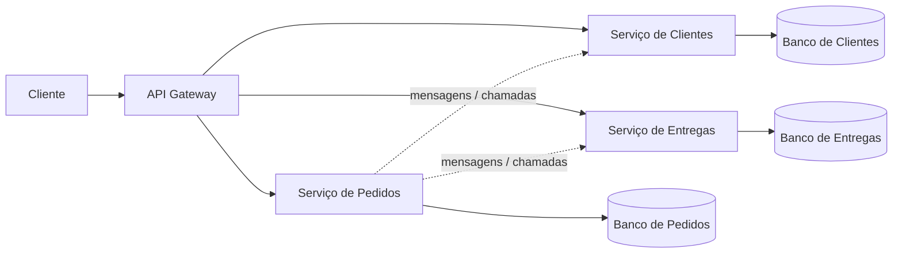

# Microservice Architecture

## Descrição

Microservice Architecture estrutura a aplicação como dois ou mais serviços implantáveis de forma independente e fracamente acoplados. Cada serviço contém um ou mais subdomínios, e cada subdomínio pertence a um único serviço (exceto bibliotecas compartilhadas).

Uma equipe é dona dos serviços que contêm seus subdomínios. Tipicamente cada serviço tem seu próprio repositório e pipeline de implantação, e um API Gateway serve como ponto de entrada para os clientes. Operações que atravessam serviços são implementadas com padrões de colaboração, como Saga e API Composition.

O estilo troca a simplicidade de um componente único por autonomia de equipes e flexibilidade, ao custo de lidar com os desafios de sistemas distribuídos.

## Problemas que resolve

- Como agrupar os subdomínios da aplicação em componentes implantáveis ou executáveis.
- Necessidade de componentes simples, fáceis de entender, com autonomia de equipe para desenvolver e implantar.
- Necessidade de pipelines rápidos, viabilizados por componentes pequenos.
- Suporte a múltiplas pilhas tecnológicas.
- Segregação de subdomínios por escalabilidade, disponibilidade ou segurança.

## Quando usar

- Aplicações críticas que precisam mudar de forma rápida, frequente e confiável.
- Organizações com várias equipes multifuncionais e entrega contínua automatizada.
- Quando subdomínios têm requisitos distintos de escala, disponibilidade, segurança ou tecnologia.

### Quando evitar

- Aplicações pequenas ou com domínio ainda instável, onde as fronteiras de serviço seriam adivinhadas.
- Equipes sem maturidade em automação, observabilidade e operação de sistemas distribuídos.
- Quando transações ACID entre subdomínios e baixa latência de interação são requisitos centrais.

## Trade-offs

| Ganho | Custo / Risco |
| --- | --- |
| Serviços pequenos e fáceis de entender | Operações distribuídas são complexas de entender e depurar |
| Equipes desenvolvem, testam e implantam de forma independente | Algumas operações distribuídas podem ser ineficientes |
| Build e testes rápidos por serviço | Banco por serviço costuma exigir consistência eventual |
| Pilhas tecnológicas diferentes por serviço | Acoplamento em tempo de execução pode reduzir a disponibilidade |
| Agrupamento por escalabilidade, segurança etc. | Acoplamento em tempo de projeto pode forçar mudanças coordenadas |

- Exige investimento em observabilidade, descoberta de serviços, resiliência e automação de implantação.
- Definir fronteiras corretas (por capacidade de negócio ou subdomínio) é decisivo para reduzir acoplamento.

## Diagrama

Cada serviço é implantado de forma independente, possui seu próprio banco e é acessado por um API Gateway; a colaboração entre serviços ocorre por mensagens ou chamadas remotas.

## Padrões relacionados

- [Monolithic Architecture](/architecture/microservices/architectural-style/monolithic-architecture) — estilo alternativo, com um único componente implantável.
- [Decompose by Business Capability](/architecture/microservices/service-boundaries/decompose-by-business-capability) — define as fronteiras dos serviços.
- [Decompose by Subdomain](/architecture/microservices/service-boundaries/decompose-by-subdomain) — define as fronteiras dos serviços a partir do DDD.
- [Database per Service](/architecture/microservices/service-collaboration/database-per-service) — cada serviço possui seus próprios dados.
- [Saga](/cloud/cloud-design-patterns/distributed-coordination/saga) — consistência em operações que atravessam serviços.
- [API Composition](/architecture/microservices/service-collaboration/api-composition) — consultas que combinam dados de vários serviços.
- [CQRS](/cloud/cloud-design-patterns/data-management/cqrs) — consultas eficientes sobre dados distribuídos.
- [Messaging](/architecture/microservices/communication-styles/messaging) — comunicação assíncrona entre serviços.
- [Remote Procedure Invocation](/architecture/microservices/communication-styles/remote-procedure-invocation) — comunicação síncrona entre serviços.
- [Transactional Outbox](/architecture/microservices/transactional-messaging/transactional-outbox) — publicação atômica de mensagens e atualizações de dados.
- [API Gateway](/architecture/microservices/external-api/api-gateway) — ponto de entrada para os clientes.
- [Client-side Discovery](/architecture/microservices/service-discovery/client-side-discovery) — localização de instâncias de serviço.
- [Server-side Discovery](/architecture/microservices/service-discovery/server-side-discovery) — localização de instâncias via roteador.
- [Circuit Breaker](/cloud/cloud-design-patterns/resiliency/circuit-breaker) — evita falhas em cascata entre serviços.
- [Access Token](/architecture/microservices/security/access-token) — propagação da identidade entre serviços.
- [Log Aggregation](/architecture/microservices/observability/log-aggregation) — observabilidade de sistemas distribuídos.
- [Distributed Tracing](/architecture/microservices/observability/distributed-tracing) — rastreamento de requisições entre serviços.
- [Health Check API](/cloud/cloud-design-patterns/resiliency/health-endpoint-monitoring) — verificação da saúde de cada serviço.
- [Service Component Test](/architecture/microservices/testing/service-component-test) — teste isolado de cada serviço.
- [Microservice Chassis](/architecture/microservices/cross-cutting-concerns/microservice-chassis) — preocupações transversais reutilizáveis.
- [Externalized Configuration](/cloud/cloud-design-patterns/deployment-and-topology/external-configuration-store) — configuração fora do artefato.

## Referência

- [Página do padrão no microservices.io](https://microservices.io/patterns/microservices.html)
