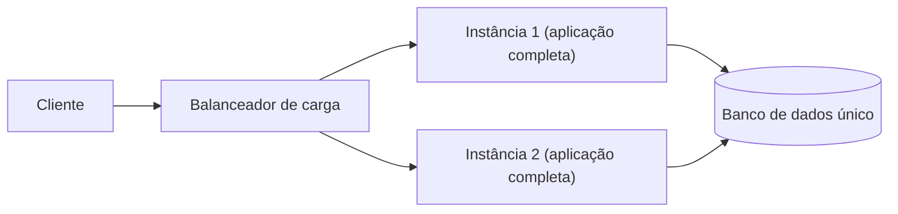

# Monolithic Architecture

## Descrição

Monolithic Architecture estrutura a aplicação como um único componente implantável, apoiado por um único banco de dados. Todos os subdomínios (capacidades de negócio compostas por lógica de negócio e adaptadores) ficam dentro desse componente, de modo que todas as operações são locais.

Para escalar, executam-se várias instâncias idênticas do componente atrás de um balanceador de carga. A implantação é feita como uma unidade só: qualquer mudança, pequena ou grande, gera um novo artefato completo.

O padrão é o ponto de partida natural de muitas aplicações e continua sendo uma boa escolha quando o tamanho da aplicação e o número de equipes são pequenos.

## Problemas que resolve

- Como organizar os subdomínios da aplicação em componentes implantáveis ou executáveis.
- Necessidade de interações simples e eficientes entre subdomínios, sem chamadas de rede.
- Necessidade de transações ACID em vez de consistência eventual.
- Desejo de minimizar o acoplamento em tempo de execução e em tempo de projeto entre componentes.

## Quando usar

- Aplicações novas ou pequenas, com poucas equipes e domínio ainda em descoberta.
- Quando transações ACID e interações locais eficientes são mais importantes que autonomia de equipes.
- Quando a organização não tem maturidade de automação e operação para sistemas distribuídos.

### Quando evitar

- Quando muitas equipes precisam desenvolver e implantar de forma independente e frequente.
- Quando subdomínios exigem escalabilidade, disponibilidade ou segurança distintas.
- Quando é necessário usar pilhas tecnológicas diferentes por subdomínio.
- Quando o tempo de build e teste do componente único trava o pipeline de entrega.

## Trade-offs

| Ganho | Custo / Risco |
| --- | --- |
| Interações locais, fáceis de entender, depurar e executar com eficiência | Componente grande, difícil de compreender e manter |
| Transações ACID na maioria das operações | Equipes compartilham a mesma base de código, reduzindo autonomia e exigindo coordenação |
| Sem acoplamento em tempo de execução ou de projeto entre componentes distribuídos | Builds e testes lentos tornam o pipeline mais demorado |
| Operação e implantação simples | Pilha tecnológica única; atualizações são caras |
| | Subdomínios não escalam, não são protegidos nem têm alta disponibilidade de forma independente |

- Os custos crescem com o tamanho da aplicação e o número de equipes.
- Mitigações: modularizar em fatias verticais (apresentação, negócio e persistência), aplicar princípios de design físico para reduzir acoplamento de build, e usar fila de merge automatizada, build incremental e execução paralela de build e testes.

## Diagrama

Todas as instâncias contêm todos os subdomínios e compartilham um único banco de dados; a escala é obtida replicando a aplicação inteira.

## Padrões relacionados

- [Microservice Architecture](./microservice-architecture.md) — alternativa que endereça as limitações do monólito dividindo a aplicação em serviços independentes.
- [Shared Database](../service-collaboration/shared-database.md) — o monólito naturalmente usa um banco único compartilhado por todos os módulos.
- [Strangler Application](../../../cloud/cloud-design-patterns/integration-and-modernization/strangler-fig.md) — estratégia para migrar gradualmente um monólito para serviços.

## Referência

- [Página do padrão no microservices.io](https://microservices.io/patterns/monolithic.html)
