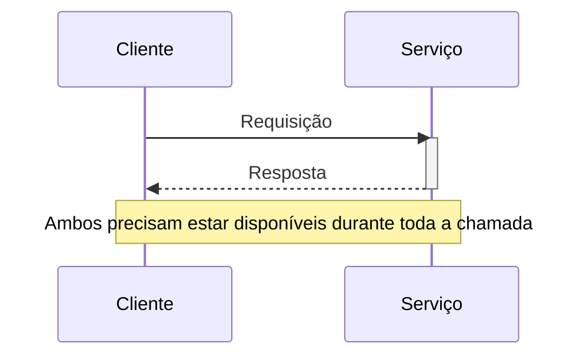

# Remote Procedure Invocation

## Descrição

Remote Procedure Invocation (RPI) é o estilo de comunicação em que um cliente envia uma requisição a um serviço usando um protocolo síncrono de requisição/resposta, como se estivesse invocando um procedimento remoto. O cliente envia a requisição, aguarda a resposta e só então prossegue com seu fluxo.

Em uma arquitetura de microsserviços, esse é o mecanismo de comunicação entre processos mais direto: o serviço expõe uma interface (por exemplo REST, gRPC ou Apache Thrift) e os demais serviços a consomem diretamente pela rede, sem intermediários. Como não há broker, a topologia é simples e o comportamento é fácil de entender e depurar.

A contrapartida é o acoplamento em tempo de execução: cliente e serviço precisam estar disponíveis durante toda a interação. Por isso o RPI costuma vir acompanhado de descoberta de serviços, configuração externalizada da localização e mecanismos de proteção contra falhas.

No Enterprise Integration Patterns, a Remote Procedure Invocation aplica o encapsulamento à integração: cada aplicação é tratada como um grande objeto ou componente com dados encapsulados e expõe uma interface em execução. Quem precisa de um dado pergunta ao dono, e quem precisa alterá-lo chama o dono, que preserva a integridade e pode mudar seus internos sem afetar os demais. Em contrapartida, as aplicações continuam bastante acopladas pelas chamadas, e a exigência de ordem e de tempo entre operações dificulta a evolução independente, pontos que parecem menores dentro de uma única aplicação mas pesam na integração.

## Problemas que resolve

- Serviços precisam colaborar entre si para atender requisições dos clientes e, para isso, precisam de um mecanismo de comunicação entre processos.
- Necessidade de uma interação simples de requisição/resposta, em que o chamador precisa do resultado para continuar.
- Desejo de evitar a operação de um message broker para casos em que a comunicação síncrona é suficiente.

## Quando usar

- A interação é naturalmente de requisição/resposta e o cliente precisa da resposta imediatamente.
- A equipe prioriza simplicidade e familiaridade com tecnologias como REST e gRPC.
- Não se deseja introduzir e operar um broker de mensagens.

### Quando evitar

- Quando é preciso notificações, requisição com resposta assíncrona ou publicação/assinatura; nesses casos prefira Messaging.
- Quando a alta disponibilidade exige que o cliente continue operando mesmo com o serviço fora do ar.
- Quando longas cadeias de chamadas síncronas fariam a disponibilidade combinada cair de forma inaceitável.

## Trade-offs

| Ganho | Custo / Risco |
| --- | --- |
| Simples e familiar para a maioria dos desenvolvedores | Suporta basicamente requisição/resposta; não oferece diretamente notificações nem publicação/assinatura |
| Sem necessidade de broker intermediário | Disponibilidade reduzida: cliente e serviço precisam estar no ar ao mesmo tempo |
| Fluxo de controle e depuração diretos | Acoplamento em tempo de execução e propagação de falhas e latência entre serviços |

Considerações adicionais:

- **Descoberta:** o cliente precisa descobrir a localização das instâncias do serviço (descoberta no cliente ou no servidor) e obter o endereço lógico por configuração externalizada.
- **Resiliência:** use *timeouts* e Circuit Breaker nas chamadas para evitar que falhas se espalhem em cascata.
- **Mapeamento de erros:** traduza respostas de erro do protocolo (por exemplo, HTTP 409) em erros de domínio no cliente.

## Diagrama

O cliente envia a requisição diretamente ao serviço e permanece aguardando a resposta, o que caracteriza o acoplamento em tempo de execução.

## Padrões relacionados

- [Messaging](./messaging.md) — alternativa assíncrona, baseada em broker, ao RPI.
- [Domain-specific Protocol](./domain-specific-protocol.md) — outra alternativa, usando um protocolo específico do domínio.
- [Externalized Configuration](../../../cloud/cloud-design-patterns/deployment-and-topology/external-configuration-store.md) — fornece a localização lógica (por exemplo, a URL) do serviço.
- [Client-side Discovery](../service-discovery/client-side-discovery.md) — o cliente localiza a instância do serviço consultando o registro.
- [Server-side Discovery](../service-discovery/server-side-discovery.md) — um roteador localiza a instância em nome do cliente.
- [Circuit Breaker](../../../cloud/cloud-design-patterns/resiliency/circuit-breaker.md) — melhora a confiabilidade das chamadas síncronas.
- [File Transfer](../../eip/integration-styles/file-transfer.md) — estilo de integração por arquivos, em lote e sem chamadas diretas.
- [Shared Database](../service-collaboration/shared-database.md) — estilo em que os dados ficam em um banco comum em vez de encapsulados.
- [Message Endpoint](../../eip/messaging-endpoints/message-endpoint.md) — ponto de acesso da aplicação à mensageria, análogo à interface exposta pela chamada remota.

## Referência

- [Página do padrão no microservices.io](https://microservices.io/patterns/communication-style/rpi.html)
- [Página do padrão no Enterprise Integration Patterns](https://www.enterpriseintegrationpatterns.com/EncapsulatedSynchronousIntegration.html)
