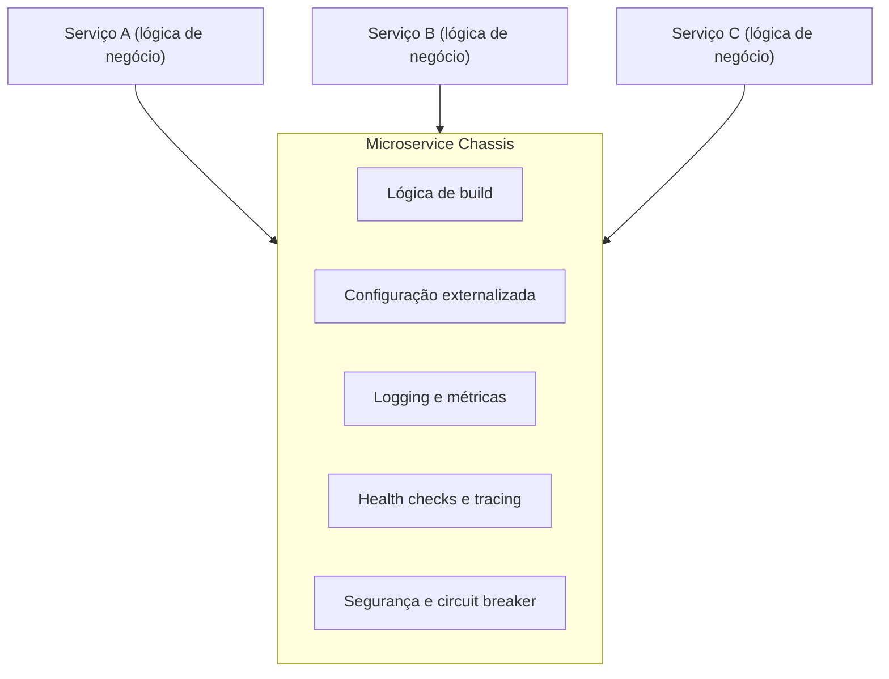

# Microservice Chassis

## Descrição

O Microservice Chassis é um framework compartilhado que serve de fundação para todos os serviços de uma organização. Ele reúne a lógica de build reutilizável (compilar, testar e empacotar, por exemplo em uma imagem de contêiner) e os mecanismos para preocupações transversais: segurança, configuração externalizada, logging, health checks, métricas, rastreamento distribuído, registro e descoberta de serviços e circuit breakers.

Na prática, o chassis costuma ser montado a partir da composição e configuração de frameworks e bibliotecas já existentes, expondo-os como uma única dependência versionada. Cada serviço passa a declarar essa dependência e concentra seu código na lógica de negócio.

Quando os requisitos transversais mudam, a equipe responsável publica uma nova versão do chassis e os serviços a adotam atualizando a dependência, em vez de alterar código repetido em dezenas de repositórios.

## Problemas que resolve

- Como criar rapidamente um serviço sustentável e pronto para produção, para que a equipe foque na lógica de negócio.
- Cada serviço precisa de lógica de build e de preocupações transversais, inclusive as específicas da tecnologia (como pools de conexão).
- Criar novos serviços deve ser rápido e fácil, pois em microsserviços eles são numerosos e nascem em dias ou semanas.
- Atualizar serviços existentes quando mudam os requisitos de build ou transversais deve ser rápido e simples.

## Quando usar

- Quando a organização mantém muitos serviços na mesma linguagem ou framework e precisa de comportamento consistente entre eles.
- Quando as preocupações transversais mudam com frequência e precisam ser propagadas de forma barata.
- Quando há uma equipe de plataforma capaz de manter o chassis como produto interno.

### Quando evitar

- Quando há poucos serviços ou uma única equipe; o custo de manter um framework próprio supera o ganho.
- Quando o ambiente é altamente poliglota e não há volume suficiente para justificar um chassis por linguagem.

## Trade-offs

| Ganho | Custo / Risco |
| --- | --- |
| Atualizar dependências, build e código transversal de forma rápida e centralizada | É preciso um chassis para cada linguagem ou framework |
| Consistência de logging, métricas, segurança e tracing entre serviços | Adotar uma nova tecnologia fica mais difícil, pois exige um novo chassis |
| Equipes focadas em lógica de negócio | Acoplamento dos serviços às versões e decisões do chassis |

- **Governança de versões:** mudanças incompatíveis no chassis forçam atualizações coordenadas; adote versionamento semântico e janelas de depreciação.
- **Escopo:** evite colocar lógica de negócio no chassis para não criar um monólito distribuído de dependências.
- **Alternativa sem código compartilhado:** parte das preocupações pode migrar para a infraestrutura (service mesh, sidecar).

## Diagrama

Os serviços contêm apenas lógica de negócio e dependem do chassis, que fornece build e preocupações transversais de forma compartilhada e versionada.

## Padrões relacionados

- [Service Template](./service-template.md) — alternativa ou complemento: contém o código e a configuração específicos do serviço, normalmente usando o chassis.
- [Externalized Configuration](../../../cloud/azure/deployment-and-topology/external-configuration-store.md) — preocupação transversal comumente provida pelo chassis.
- [Self Registration](../service-discovery/self-registration.md) — o chassis frequentemente registra o serviço no registro de serviços.
- [Client-side Discovery](../service-discovery/client-side-discovery.md) — também costuma ser tratado pelo chassis.
- [Distributed Tracing](../observability/distributed-tracing.md) — o chassis pode instrumentar o código automaticamente.
- [Health Check API](../../../cloud/azure/resiliency/health-endpoint-monitoring.md) — endpoint padrão fornecido pelo chassis.
- [Circuit Breaker](../../../cloud/azure/resiliency/circuit-breaker.md) — pode ser implementado pelo framework do chassis.
- [Sidecar](../../../cloud/azure/integration-and-modernization/sidecar.md) — move preocupações transversais para um processo separado, independente da linguagem.

## Referência

- [Página do padrão no microservices.io](https://microservices.io/patterns/microservice-chassis.html)
