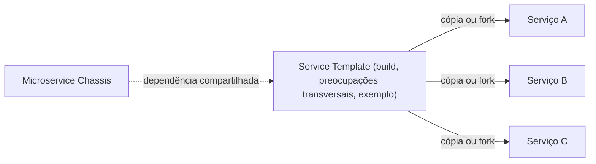

# Service Template

## Descrição

O Service Template é um modelo de código-fonte que os desenvolvedores copiam para iniciar um novo serviço. Trata-se de um serviço executável que já traz a lógica de build, as preocupações transversais (segurança, configuração externalizada, logging, health checks, métricas, rastreamento distribuído) e um exemplo de lógica de negócio.

Ao criar um serviço, a equipe copia ou faz fork do template e substitui o exemplo pela lógica real. O serviço nasce com as práticas da organização já aplicadas, o que reduz o tempo até produção e incentiva a consistência.

O template costuma usar um Microservice Chassis para o código de framework compartilhado e conter apenas o código e a configuração específicos do serviço.

## Problemas que resolve

- Como criar rapidamente um serviço sustentável e pronto para produção, para que a equipe foque na lógica de negócio.
- Cada serviço precisa de lógica de build e de preocupações transversais, inclusive as específicas da tecnologia.
- Criar um novo serviço deve ser rápido e fácil.
- Atualizar serviços existentes quando mudam requisitos de build ou transversais deve ser simples (ponto fraco do template isolado).

## Quando usar

- Quando novos serviços são criados com frequência e precisam seguir um padrão da organização.
- Quando se quer acelerar o início de projetos sem investir de imediato em um framework compartilhado.
- Em conjunto com um chassis, para fornecer o esqueleto específico do serviço.

### Quando evitar

- Quando as preocupações transversais mudam com frequência e é preciso propagar mudanças para muitos serviços existentes.
- Quando há poucos serviços, em que o template seria excessivo.

## Trade-offs

| Ganho | Custo / Risco |
| --- | --- |
| Início rápido de novos serviços | É reutilização por copia e cola: mudanças no template precisam ser aplicadas a cada serviço individualmente |
| Preocupações transversais implementadas de forma consistente, incentivando boas práticas | Mesmo com fork no Git, os serviços tendem a divergir do template ao longo do tempo |
| Sem dependência de runtime de um framework próprio | É preciso um template por linguagem ou framework, dificultando adotar novas tecnologias |

- **Manutenção:** mantenha o template atualizado e automatize a migração (por exemplo, scripts ou PRs automáticos).
- **Combinação:** usar o template com um chassis reduz a quantidade de código copiado e facilita atualizações.

## Diagrama

Cada novo serviço nasce de uma cópia do template, que pode depender de um chassis para o código compartilhado.

## Padrões relacionados

- [Microservice Chassis](./microservice-chassis.md) — alternativa ou complemento: concentra o código compartilhado, atualizável por versão.
- [Externalized Configuration](../../../cloud/cloud-design-patterns/deployment-and-topology/external-configuration-store.md) — preocupação transversal já resolvida no template.
- [Health Check API](../../../cloud/cloud-design-patterns/resiliency/health-endpoint-monitoring.md) — endpoint incluído no template.
- [Distributed Tracing](../observability/distributed-tracing.md) — instrumentação já configurada no template.

## Referência

- [Página do padrão no microservices.io](https://microservices.io/patterns/service-template.html)
