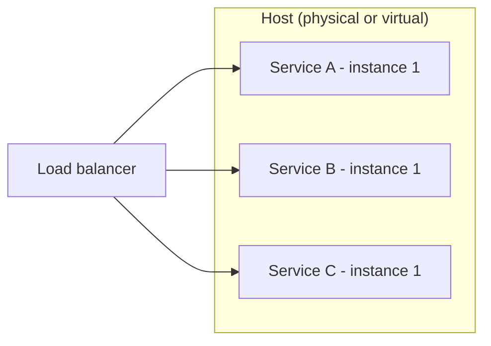

# Multiple Service Instances per Host

## Descrição

Neste padrão, instâncias de serviços diferentes são executadas no mesmo host, que pode ser físico ou virtual. O host é provisionado uma vez e várias instâncias são implantadas sobre ele, compartilhando sistema operacional, CPU, memória e disco.

Há duas variações comuns: cada instância roda como um processo independente (por exemplo, um servidor de aplicação por instância) ou várias instâncias rodam dentro do mesmo processo ou runtime (por exemplo, várias aplicações web no mesmo servidor de aplicação).

## Problemas que resolve

- Como empacotar e implantar serviços que usam linguagens, frameworks e versões diferentes.
- Como executar várias instâncias de cada serviço para vazão e disponibilidade.
- Como implantar a aplicação de forma econômica, aproveitando melhor cada host.
- Como manter implantações rápidas e instâncias monitoráveis.

## Quando usar

- Quando o custo de infraestrutura é a principal preocupação e os serviços têm baixo consumo de recursos.
- Quando há poucos serviços, com dependências compatíveis entre si.
- Em ambientes legados ou sem suporte a virtualização ou contêineres.

### Quando evitar

- Quando os serviços têm requisitos de recursos ou versões de dependências conflitantes.
- Quando é necessário isolamento forte e limites rígidos de CPU e memória por instância.
- Quando várias instâncias compartilham o mesmo processo e é preciso monitorá-las individualmente.

## Trade-offs

| Ganho | Custo / Risco |
| --- | --- |
| Uso mais eficiente dos recursos do host | Requisitos de recursos conflitantes entre serviços |
| Menos hosts para provisionar e pagar | Conflito de versões de dependências |
| Implantação simples em infraestrutura tradicional | Difícil limitar o consumo de cada instância |
| Início rápido de instâncias (sem criar novo host) | Falta de isolamento e monitoramento por instância quando compartilham a JVM/processo |

- Uma instância com defeito ou consumo excessivo pode afetar as vizinhas no mesmo host (efeito de vizinho barulhento).
- A observabilidade por instância exige instrumentação adicional.

## Diagrama

Vários serviços diferentes dividem os mesmos recursos de um único host.

## Padrões relacionados

- [Service Instance per Host](./service-instance-per-host.md) — alternativa que isola cada instância em seu próprio host.
- [Serverless Deployment](./serverless-deployment.md) — alternativa que esconde o conceito de servidor.
- [Compute Resource Consolidation](../../../cloud/cloud-design-patterns/deployment-and-topology/compute-resource-consolidation.md) — mesma ideia de consolidar cargas para reduzir custo.

## Referência

- [Página do padrão no microservices.io](https://microservices.io/patterns/deployment/multiple-services-per-host.html)
