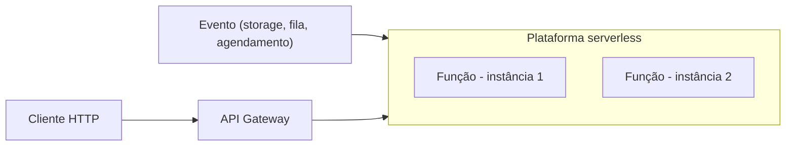

# Serverless Deployment

## Descrição

O serviço é implantado em uma infraestrutura que esconde qualquer conceito de servidor, seja físico, virtual ou contêiner. Você envia o código empacotado (por exemplo, um arquivo ZIP), descreve as características de desempenho desejadas e a plataforma executa o serviço, cobrando por requisição conforme os recursos consumidos.

Internamente o provedor usa contêineres ou VMs, mas isso não é gerenciado pelo usuário. As funções são sem estado e acionadas por eventos, requisições HTTP via gateway, chamadas explícitas à API da plataforma ou agendamentos. Exemplos: AWS Lambda, Google Cloud Functions e Azure Functions.

## Problemas que resolve

- Esforço de gerenciar servidores, sistema operacional e escala.
- Pagamento por capacidade ociosa ou subutilizada.
- Elasticidade automática diante de variações de carga.
- Implantação rápida, sem provisionamento de infraestrutura.

## Quando usar

- Cargas sem estado, orientadas a eventos ou requisições.
- Cargas intermitentes ou com picos imprevisíveis.
- Quando se quer reduzir ao mínimo a operação de infraestrutura.

### Quando evitar

- Serviços de longa duração ou com estado, como bancos de dados e brokers de mensagens.
- Serviços que assinam filas de um broker como RabbitMQ.
- Aplicações com inicialização lenta ou sensíveis a latência por causa de cold start.

## Trade-offs

| Ganho | Custo / Risco |
| --- | --- |
| Sem gerenciamento de infraestrutura de baixo nível | Restrições significativas, como poucas linguagens suportadas |
| Alta elasticidade com escala automática | Adequado apenas a serviços sem estado orientados a requisições |
| Pagamento por requisição, sem ocioso | Fontes de entrada limitadas |
| Implantação simples | Cold start e picos súbitos podem causar alta latência |

- Há risco de dependência do provedor (lock-in).
- Depuração e observabilidade distribuídas exigem ferramentas específicas.

## Diagrama

A plataforma cria e escala instâncias da função sob demanda, a partir de requisições e eventos.

## Padrões relacionados

- [Multiple Service Instances per Host](/architecture/microservices/deployment/multiple-service-instances-per-host) — abordagem alternativa de implantação.
- [Service Instance per Host](/architecture/microservices/deployment/service-instance-per-host) — alternativa; a plataforma serverless provavelmente a usa internamente.
- [Service Instance per Container](/architecture/microservices/deployment/service-instance-per-container) — alternativa em que o time gerencia os contêineres.
- [Service Instance per VM](/architecture/microservices/deployment/service-instance-per-vm) — alternativa em que o time gerencia as VMs.

## Referência

- [Página do padrão no microservices.io](https://microservices.io/patterns/deployment/serverless-deployment.html)
