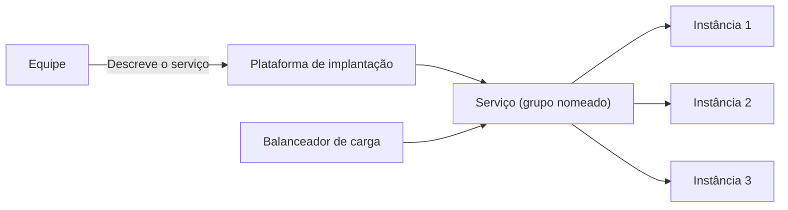

# Service Deployment Platform

## Descrição

O padrão propõe usar uma plataforma de implantação, isto é, uma infraestrutura automatizada para implantar aplicações. A plataforma oferece uma abstração de serviço: um grupo nomeado de instâncias altamente disponíveis, normalmente com balanceamento de carga.

Em vez de gerenciar manualmente hosts, VMs ou contêineres, a equipe descreve o serviço desejado e a plataforma cuida do posicionamento, da escala, da recuperação de falhas e da exposição das instâncias. Exemplos incluem orquestradores de contêineres como Kubernetes e plataformas PaaS.

## Problemas que resolve

- Esforço de implantar e operar manualmente muitas instâncias de muitos serviços.
- Necessidade de implantação e escala independentes por serviço.
- Isolamento, limites de CPU e memória e monitoramento de cada instância.
- Implantação confiável e econômica.

## Quando usar

- Quando há muitos serviços e instâncias a operar.
- Quando se quer automatizar implantação, escala, recuperação e balanceamento.
- Quando se busca padronizar a forma de implantar entre equipes.

### Quando evitar

- Quando há poucos serviços e a sobrecarga de operar ou aprender a plataforma não compensa.
- Quando a plataforma não atende a requisitos específicos de rede, conformidade ou latência.

## Trade-offs

| Ganho | Custo / Risco |
| --- | --- |
| Automação de implantação, escala e recuperação | Complexidade e curva de aprendizado da plataforma |
| Abstração de serviço com balanceamento e alta disponibilidade | Dependência da plataforma escolhida |
| Padronização entre serviços | Custo de operar ou contratar a plataforma |
| Menos trabalho manual de infraestrutura | Menos controle sobre detalhes de baixo nível |

- Algumas plataformas já incluem registro e descoberta de serviços.

## Diagrama

A equipe declara o serviço e a plataforma mantém as instâncias em execução e balanceadas.

## Padrões relacionados

- [Service Registry](../service-discovery/service-registry.md) — fornecido por algumas plataformas.
- [Server-Side Discovery](../service-discovery/server-side-discovery.md) — também oferecido por algumas plataformas.
- [Service Instance per Container](./service-instance-per-container.md) — modelo usado internamente por plataformas baseadas em contêineres.
- [Service Instance per VM](./service-instance-per-vm.md) — modelo que a plataforma pode usar internamente.

## Referência

- [Página do padrão no microservices.io](https://microservices.io/patterns/deployment/service-deployment-platform.html)
