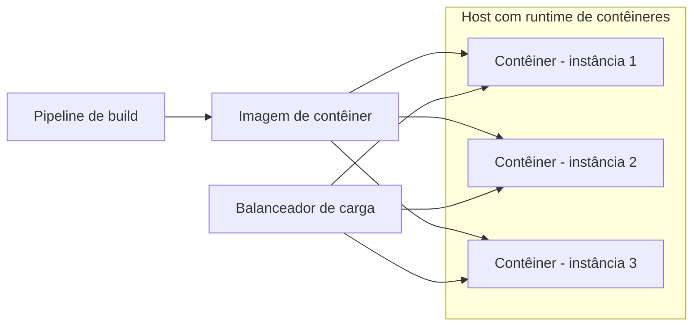

# Service Instance per Container

## Descrição

O serviço é empacotado como uma imagem de contêiner (por exemplo, Docker) e cada instância é executada como um contêiner. O contêiner é um mecanismo de virtualização em nível de sistema operacional, com isolamento de processos, sistema de arquivos e rede, além de limites de CPU e memória.

A escala é feita alterando o número de contêineres. Como apenas o processo da aplicação é iniciado, e não um sistema operacional completo, construir e iniciar contêineres é muito mais rápido do que com VMs.

## Problemas que resolve

- Isolamento entre instâncias de serviços com tecnologias diferentes.
- Limites de CPU e memória por instância.
- Builds e implantações rápidos.
- Uso eficiente de recursos, com alta densidade por host.

## Quando usar

- Quando se busca implantações frequentes e inicialização rápida.
- Quando há muitos serviços heterogêneos que precisam de isolamento e densidade.
- Quando se dispõe de um orquestrador ou de uma plataforma de implantação.

### Quando evitar

- Quando a organização não tem maturidade para operar infraestrutura de contêineres.
- Quando é exigido isolamento mais forte que o oferecido pelo kernel compartilhado.

## Trade-offs

| Ganho | Custo / Risco |
| --- | --- |
| Escala simples alterando o número de contêineres | Infraestrutura de contêineres menos madura que a de VMs |
| Tecnologia escondida; todos os serviços iniciam e param igual | Necessidade de orquestração e gerenciamento do cluster |
| Isolamento e limites de recursos por contêiner | Isolamento mais fraco que o de VMs (kernel compartilhado) |
| Build e inicialização muito rápidos | Complexidade de rede, armazenamento e segurança |

- Na prática, costuma ser combinado com um orquestrador (Service Deployment Platform).

## Diagrama

A imagem gera vários contêineres que compartilham o kernel do host.

## Padrões relacionados

- [Service Instance per Host](./service-instance-per-host.md) — padrão que esta abordagem refina.
- [Service Instance per VM](./service-instance-per-vm.md) — alternativa com isolamento mais forte, porém mais pesada.
- [Serverless Deployment](./serverless-deployment.md) — alternativa que esconde a infraestrutura.
- [Service Deployment Platform](./service-deployment-platform.md) — plataforma que orquestra contêineres.

## Referência

- [Página do padrão no microservices.io](https://microservices.io/patterns/deployment/service-per-container.html)
