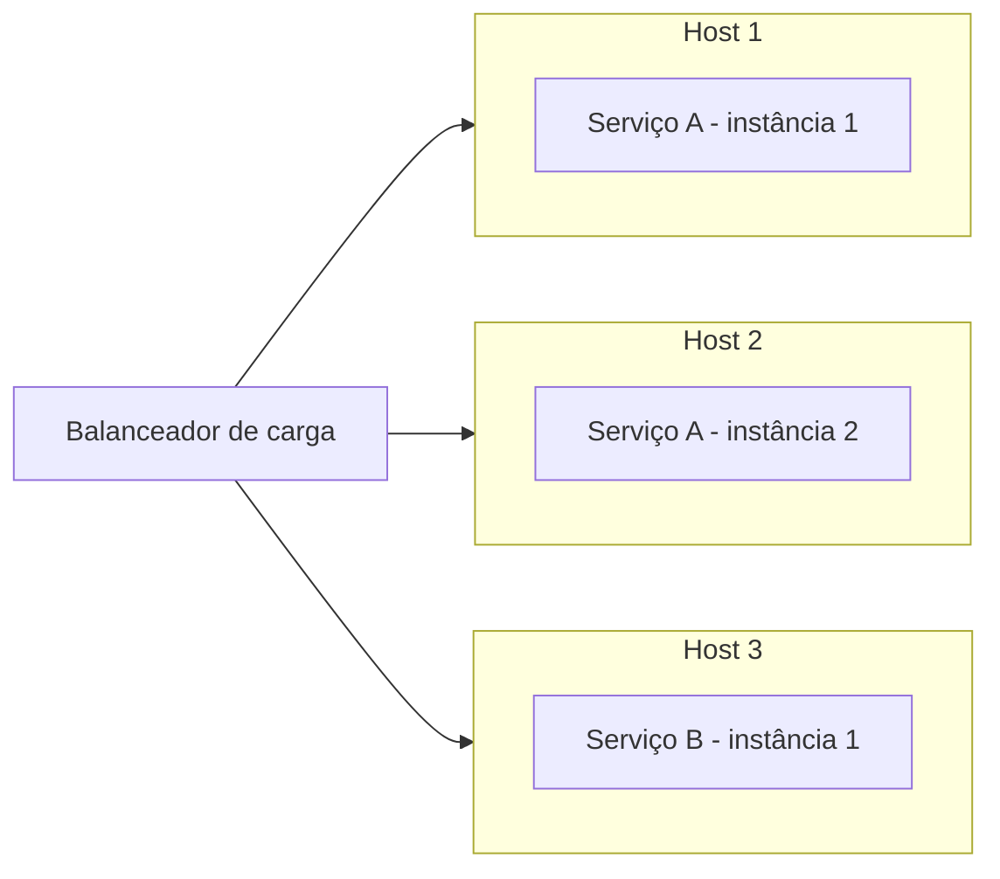

# Service Instance per Host

## Descrição

Cada instância de serviço é implantada em seu próprio host, que pode ser uma máquina física ou virtual. Nenhum outro serviço compartilha esse host, de modo que a instância pode consumir no máximo os recursos dele.

O padrão é um princípio geral de implantação e tem como refinamentos o uso de máquinas virtuais (Service Instance per VM) e de contêineres (Service Instance per Container).

## Problemas que resolve

- Isolamento entre instâncias de serviços.
- Conflitos de requisitos de recursos e de versões de dependências entre serviços.
- Limitação do consumo de CPU e memória de cada instância.
- Monitoramento, gerenciamento e reimplantação simples de cada instância.

## Quando usar

- Quando serviços têm pilhas tecnológicas e dependências diferentes.
- Quando isolamento e previsibilidade de recursos são prioritários.
- Como base conceitual para VMs, contêineres ou plataformas de implantação.

### Quando evitar

- Quando o custo de um host por instância é proibitivo.
- Quando os serviços são muito pequenos e deixariam hosts subutilizados.

## Trade-offs

| Ganho | Custo / Risco |
| --- | --- |
| Isolamento total entre instâncias | Uso menos eficiente dos recursos |
| Sem conflito de dependências ou de recursos | Mais hosts para provisionar e pagar |
| Cada instância consome no máximo os recursos de um host | Possível subutilização do host |
| Monitoramento e reimplantação simples | Maior overhead de provisionamento, dependendo do tipo de host |

- A eficiência real depende do tipo de host: VMs e contêineres reduzem o desperdício.

## Diagrama

Cada instância de serviço ocupa um host exclusivo.

## Padrões relacionados

- [Multiple Service Instances per Host](/architecture/microservices/deployment/multiple-service-instances-per-host) — alternativa que compartilha o host.
- [Service Instance per VM](/architecture/microservices/deployment/service-instance-per-vm) — refinamento que usa máquinas virtuais.
- [Service Instance per Container](/architecture/microservices/deployment/service-instance-per-container) — refinamento que usa contêineres.
- [Serverless Deployment](/architecture/microservices/deployment/serverless-deployment) — alternativa que abstrai o host.

## Referência

- [Página do padrão no microservices.io](https://microservices.io/patterns/deployment/single-service-per-host.html)
