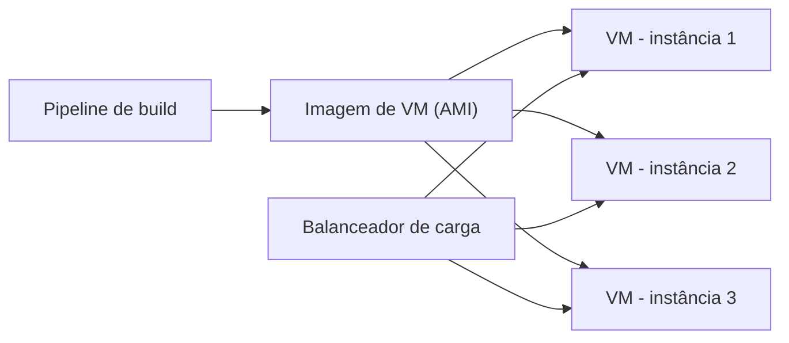

# Service Instance per VM

## Descrição

O serviço é empacotado como uma imagem de máquina virtual e cada instância é implantada como uma VM separada. A imagem contém o sistema operacional, o runtime e o código do serviço, e novas instâncias são criadas a partir dela.

A escala é feita aumentando ou diminuindo o número de VMs, o que plataformas IaaS automatizam com grupos de autoescala e balanceadores de carga. Um exemplo clássico é a Netflix, que empacota cada serviço como uma AMI e executa cada instância em uma instância EC2.

## Problemas que resolve

- Isolamento entre instâncias de diferentes serviços.
- Pilhas tecnológicas heterogêneas tratadas de modo uniforme.
- Limites de CPU e memória por instância.
- Implantação confiável com ferramentas maduras de infraestrutura.

## Quando usar

- Quando já se usa uma plataforma IaaS com autoescala e balanceamento maduros.
- Quando é necessário isolamento forte entre serviços.
- Quando a equipe prefere uma unidade de implantação imutável e uniforme.

### Quando evitar

- Quando é preciso construir e implantar com muita frequência e rapidez.
- Quando o custo e a lentidão da criação de imagens inviabilizam o ciclo de entrega.

## Trade-offs

| Ganho | Custo / Risco |
| --- | --- |
| Escala simples por número de instâncias, com autoescala | Construir imagens de VM é lento e demorado |
| A VM esconde a pilha tecnológica; todos os serviços iniciam e param igual | Imagens grandes, com sistema operacional completo |
| Isolamento entre instâncias | Menor densidade que contêineres |
| Limites de CPU e memória aplicados pela VM | Tempo de inicialização maior |
| Ferramentas maduras de IaaS (balanceadores, grupos de autoescala) | Custo de recursos por VM |

## Diagrama

Uma única imagem de VM gera várias instâncias, atrás de um balanceador de carga.

## Padrões relacionados

- [Service Instance per Host](./service-instance-per-host.md) — padrão que esta abordagem refina.
- [Service Instance per Container](./service-instance-per-container.md) — alternativa mais leve e rápida.
- [Serverless Deployment](./serverless-deployment.md) — alternativa que esconde a infraestrutura.

## Referência

- [Página do padrão no microservices.io](https://microservices.io/patterns/deployment/service-per-vm.html)
