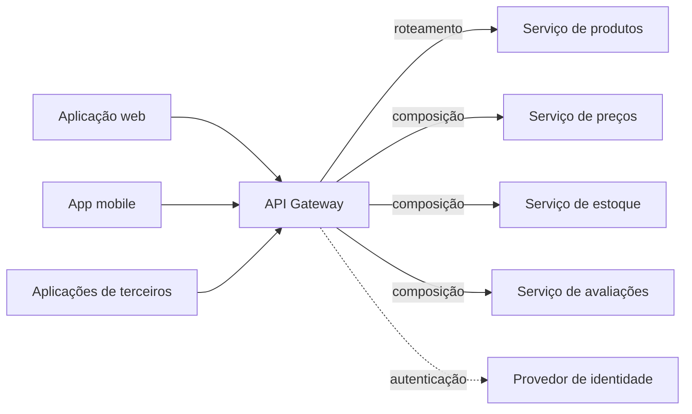

# API Gateway

## Descrição

O API Gateway é o ponto de entrada único entre os clientes e os microsserviços de uma aplicação. Em vez de cada cliente conhecer e chamar diretamente dezenas de serviços de granularidade fina, ele envia as requisições ao gateway, que decide o que fazer com cada uma.

O gateway trata as requisições de duas formas: algumas são simplesmente roteadas (proxy) para o serviço responsável; outras exigem um fan-out, em que o gateway chama vários serviços e combina os resultados em uma única resposta. Além disso, ele concentra responsabilidades transversais, como autenticação e autorização, e pode expor uma API sob medida para cada tipo de cliente, traduzindo protocolos públicos (por exemplo, HTTP/REST) para os usados internamente.

No catálogo de microservices.io, portanto, o API Gateway reúne em um só padrão o que o catálogo de nuvem separa em três: roteamento, composição de respostas e delegação de preocupações transversais.

## Problemas que resolve

- Os serviços expõem APIs de granularidade fina, mas os clientes precisam de dados de vários serviços para montar uma única tela.
- Clientes diferentes precisam de dados diferentes: uma página desktop é mais rica que a versão mobile.
- Redes móveis têm mais latência e menos banda; o cliente só consegue fazer poucas chamadas, ao contrário de uma aplicação web no servidor, dentro da LAN.
- Instâncias de serviço mudam de host e porta dinamicamente, e os clientes não deveriam precisar descobri-las.
- A divisão em serviços evolui com o tempo e não deve vazar para os clientes.
- Alguns serviços usam protocolos pouco amigáveis à web (por exemplo, mensageria ou RPC binário).

## Quando usar

- A aplicação segue a arquitetura de microsserviços e tem clientes externos (web, mobile, terceiros).
- Telas ou casos de uso dependem de dados de vários serviços e o número de round trips do cliente é um problema.
- Se quer ocultar do cliente a estrutura interna, a localização das instâncias e os protocolos internos.
- É necessário um ponto central para autenticar clientes e repassar informações de identidade aos serviços.

### Quando evitar

- A aplicação é um monólito ou possui poucos serviços e um só tipo de cliente, e o acesso direto é suficiente.
- A equipe não consegue operar mais um componente crítico de produção.
- O gateway tenderia a acumular lógica de negócio, virando um novo monólito centralizado e gargalo de times.

## Trade-offs

| Ganho | Custo / Risco |
| --- | --- |
| Clientes isolados da partição em serviços e da descoberta de instâncias | Mais um componente para desenvolver, implantar e operar |
| Menos round trips: uma requisição reúne dados de vários serviços | Salto de rede adicional e aumento de latência (geralmente pequeno) |
| API adequada a cada cliente e clientes mais simples | Ponto único de falha e possível gargalo se não for escalado e replicado |
| Tradução entre protocolo público e protocolos internos | Risco de concentrar lógica e virar gargalo de desenvolvimento entre times |
| Segurança e autenticação centralizadas | Mudanças em serviços exigem coordenação com o gateway |

- **Desempenho:** um gateway sob carga alta se beneficia de I/O não bloqueante e modelo orientado a eventos (por exemplo, Netty/Spring Reactor na JVM ou Node.js).
- **Resiliência:** as chamadas do gateway aos serviços devem ser protegidas por Circuit Breaker, com respostas degradadas quando um serviço falha.
- **Propriedade:** para evitar gargalo organizacional, considere um gateway por tipo de cliente (Backend for Front-end).

## Diagrama

Os clientes falam apenas com o gateway. Ele roteia algumas requisições diretamente ao serviço responsável, compõe respostas a partir de vários serviços em outras e aplica autenticação antes de encaminhar.

## Padrões relacionados

- [Backend for Front-end](../../../cloud/azure/gateways-and-edge/backends-for-frontends.md) — variação em que cada tipo de cliente tem seu próprio gateway.
- [Gateway Routing](../../../cloud/azure/gateways-and-edge/gateway-routing.md) — equivalente no catálogo de nuvem à função de roteamento/proxy do API Gateway.
- [Gateway Aggregation](../../../cloud/azure/gateways-and-edge/gateway-aggregation.md) — equivalente à função de composição (fan-out e combinação de respostas).
- [Gateway Offloading](../../../cloud/azure/gateways-and-edge/gateway-offloading.md) — equivalente à delegação de responsabilidades transversais (TLS, autenticação, monitoramento) ao gateway.
- [Microservice Architecture](../architectural-style/microservice-architecture.md) — o estilo arquitetural que cria a necessidade do gateway.
- [API Composition](../service-collaboration/api-composition.md) — o gateway costuma implementá-lo para combinar dados de vários serviços.
- [Client-side Discovery](../service-discovery/client-side-discovery.md) e [Server-side Discovery](../service-discovery/server-side-discovery.md) — o gateway usa um deles para localizar instâncias disponíveis.
- [Access Token](../security/access-token.md) — o gateway autentica usuários e repassa informações de identidade aos serviços.
- [Circuit Breaker](../../../cloud/azure/resiliency/circuit-breaker.md) — protege as chamadas do gateway aos serviços.

## Referência

- [Página do padrão no microservices.io](https://microservices.io/patterns/apigateway.html)
