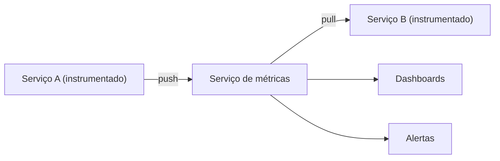

# Application Metrics

## Descrição

Cada serviço é instrumentado para coletar estatísticas sobre suas operações individuais, como contagem de requisições, taxa de erros, latências e uso de recursos. Esses números são enviados a um serviço central de métricas, responsável por relatórios e alertas.

A entrega pode seguir dois modelos: o serviço envia (push) as métricas ao serviço central, ou o serviço central as busca (pull) em um endpoint exposto pelo serviço. Bibliotecas de instrumentação e sistemas de agregação existem para ambos os modelos.

As métricas dão uma visão quantitativa e de baixo custo do comportamento do sistema ao longo do tempo, base de dashboards, SLOs e alertas.

## Problemas que resolve

- Entender o comportamento da aplicação e diagnosticar seus problemas
- Obter visão de operações individuais de cada serviço, além do tempo de resposta externo
- Fazê-lo com overhead mínimo em tempo de execução

## Quando usar

- Qualquer sistema em microsserviços em produção que precise de dashboards, alertas e análise de tendências
- Acompanhamento de SLIs e SLOs de latência, erros e saturação

## Quando evitar

- Sistemas muito pequenos em que o custo da infraestrutura de métricas supera o benefício
- Como único mecanismo de diagnóstico: métricas não explicam causas detalhadas, para isso use logs e traces

## Trade-offs

| Ganho | Custo / Risco |
| --- | --- |
| Visão profunda do comportamento da aplicação | O código de métricas se mistura à lógica de negócio, aumentando a complexidade |
| Alertas baseados em limiares e tendências | Agregar métricas pode exigir infraestrutura significativa |
| Baixo custo por ponto de dado | Alta cardinalidade de rótulos eleva custo e degrada consultas |

- Bibliotecas de instrumentação e um chassis reduzem o acoplamento do código de métricas.
- Escolha entre push e pull conforme o ambiente (instâncias efêmeras favorecem push ou descoberta de serviços).

## Diagrama

Os serviços expõem ou enviam métricas ao serviço central, que alimenta dashboards e alertas.

## Padrões relacionados

- [Log Aggregation](/architecture/microservices/observability/log-aggregation) — complementa as métricas com registros detalhados
- [Distributed Tracing](/architecture/microservices/observability/distributed-tracing) — mostra o caminho e o tempo de cada requisição
- [Health Check API](/architecture/cloud-design-patterns/resiliency/health-endpoint-monitoring) — outro sinal de saúde consumido por monitoramento
- [Log Deployments and Changes](/architecture/microservices/observability/log-deployments-and-changes) — uma pseudo-métrica de deploy pode ser exibida junto das demais métricas
- [Microservice Chassis](/architecture/microservices/cross-cutting-concerns/microservice-chassis) — pode embutir a instrumentação padrão

## Referência

- [Página do padrão no microservices.io](https://microservices.io/patterns/observability/application-metrics.html)
