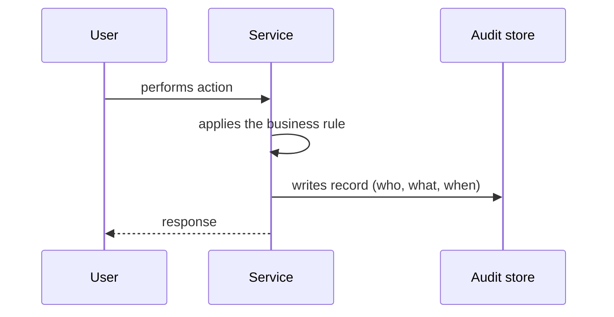

# Audit Logging

## Descrição

O padrão registra as ações dos usuários (quem fez o quê, quando e sobre qual recurso) em um armazenamento de dados próprio, como um banco de dados. Cada serviço grava registros de auditoria das operações relevantes que executa.

Ao contrário dos logs de aplicação, voltados a diagnóstico técnico, o registro de auditoria é um histórico de negócio confiável das atividades dos usuários. Saber as ações recentes de um usuário ajuda no suporte ao cliente, na conformidade regulatória e na segurança.

Uma forma confiável de implementar a auditoria é o Event Sourcing, em que cada mudança de estado já é registrada como evento.

## Problemas que resolve

- Entender o comportamento de usuários e da aplicação e investigar problemas
- Atender a requisitos de conformidade e investigação de segurança
- Dar ao suporte ao cliente o histórico de ações de um usuário

## Quando usar

- Domínios regulados ou sensíveis (financeiro, saúde, administração de acessos)
- Quando é preciso responder a perguntas sobre quem alterou um dado e quando

### Quando evitar

- Quando o rastro de ações não tem valor de negócio, de conformidade ou de segurança
- Para diagnóstico técnico puro, onde logs e traces são mais adequados

## Trade-offs

| Ganho | Custo / Risco |
| --- | --- |
| Histórico de ações dos usuários | O código de auditoria se mistura à lógica de negócio, aumentando a complexidade |
| Suporte a conformidade e segurança | Armazenamento e retenção de grandes volumes, com dados pessoais sujeitos a regras de privacidade |
| Investigação de incidentes | Gravar a auditoria e a mudança de estado de forma consistente pode exigir cuidados transacionais |

- Proteja os registros contra adulteração e restrinja o acesso.
- Considere aspectos, interceptadores ou eventos de domínio para reduzir o acoplamento com o negócio.

## Diagrama

O serviço executa a ação do usuário e grava um registro de auditoria em um armazenamento dedicado.

## Padrões relacionados

- [Event Sourcing](../../../cloud/cloud-design-patterns/data-management/event-sourcing.md) — forma confiável de obter auditoria, pois todas as mudanças são eventos
- [Domain Event](../service-collaboration/domain-event.md) — eventos de domínio podem alimentar o registro de auditoria
- [Log Aggregation](./log-aggregation.md) — logs técnicos centralizados, complementares à auditoria de negócio
- [Log Deployments and Changes](./log-deployments-and-changes.md) — auditoria de mudanças na infraestrutura e nos deploys

## Referência

- [Página do padrão no microservices.io](https://microservices.io/patterns/observability/audit-logging.html)
