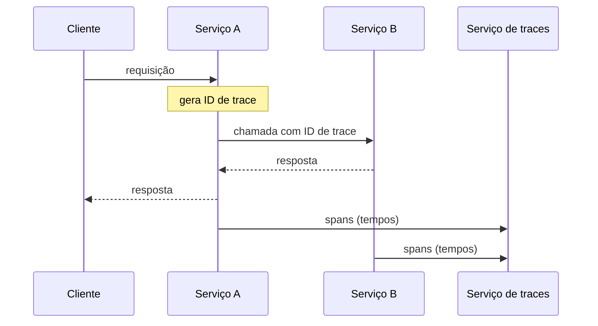

# Distributed Tracing

## Descrição

Em microsserviços, uma única requisição externa costuma percorrer vários serviços, cada um executando operações como consultas a banco de dados ou publicação de mensagens. O monitoramento externo mostra apenas o tempo de resposta total e a contagem de chamadas, sem detalhar as operações individuais.

No Distributed Tracing, cada serviço é instrumentado para atribuir um identificador único a cada requisição externa, repassá-lo a todos os serviços envolvidos, incluí-lo em todas as mensagens de log e enviar a um serviço central os dados de tempo (início e fim) da requisição e de suas operações. Cada operação vira um span, e o conjunto de spans forma o trace.

Essa instrumentação costuma vir de um microservice chassis ou de bibliotecas padronizadas (por exemplo, OpenTelemetry, Zipkin).

## Problemas que resolve

- Entender o comportamento e diagnosticar problemas que atravessam serviços
- Descobrir onde está a latência em uma cadeia de chamadas
- Localizar as entradas de log de uma mesma requisição, espalhadas por vários serviços
- Fazê-lo com overhead mínimo em tempo de execução

## Quando usar

- Requisições que envolvem vários serviços síncronos ou assíncronos
- Análise de latência e identificação de gargalos

### Quando evitar

- Sistemas com poucos serviços, em que logs correlacionados já bastam
- Quando o custo de coletar e armazenar todos os traces não se justifica (use amostragem)

## Trade-offs

| Ganho | Custo / Risco |
| --- | --- |
| Revela o comportamento do sistema e fontes de latência | Coletar e armazenar traces pode exigir infraestrutura significativa |
| Permite buscar uma requisição pelo ID nos logs agregados | Exige propagação consistente do contexto em todos os serviços e canais |
| Instrumentação reutilizável via chassis | Overhead de instrumentação, mitigado por amostragem |

- A amostragem reduz custo, mas pode perder traces raros.
- Propague o contexto também em mensagens assíncronas.

## Diagrama

O ID gerado na entrada é repassado entre os serviços, e cada um envia seus spans ao serviço central de traces.

## Padrões relacionados

- [Log Aggregation](./log-aggregation.md) — o ID da requisição aparece em cada mensagem de log agregada
- [Application Metrics](./application-metrics.md) — complementa o trace com métricas agregadas
- [Exception Tracking](./exception-tracking.md) — exceções podem carregar o ID do trace
- [Microservice Chassis](../cross-cutting-concerns/microservice-chassis.md) — pode fornecer a instrumentação de tracing

## Referência

- [Página do padrão no microservices.io](https://microservices.io/patterns/observability/distributed-tracing.html)
