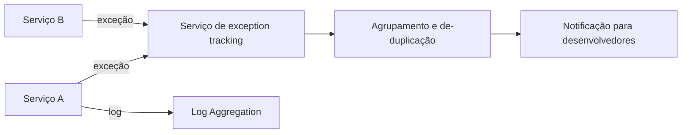

# Exception Tracking

## Descrição

Quando uma requisição falha, uma instância de serviço lança uma exceção com mensagem de erro e stack trace. Com muitas instâncias em várias máquinas, essas exceções ficam espalhadas e se repetem, o que dificulta saber quais são novas, quais são frequentes e quais já foram tratadas.

O padrão envia todas as exceções a um serviço central de rastreamento de exceções. Ele as agrupa (de-duplica), acompanha sua ocorrência, notifica as pessoas desenvolvedoras e permite registrar investigação e resolução.

As exceções devem continuar sendo registradas nos logs, além de reportadas ao serviço de rastreamento.

## Problemas que resolve

- Entender o comportamento da aplicação e diagnosticar problemas a partir de falhas
- De-duplicar, registrar, investigar e corrigir exceções espalhadas por instâncias
- Reportar com baixo overhead em tempo de execução

## Quando usar

- Muitos serviços e instâncias, onde ler logs para achar exceções é inviável
- Equipes que precisam priorizar e acompanhar a correção de erros

## Quando evitar

- Aplicações pequenas, em que os logs e alertas existentes dão conta
- Quando dados sensíveis em stack traces e contexto não puderem ser enviados a um serviço externo

## Trade-offs

| Ganho | Custo / Risco |
| --- | --- |
| Visualização e acompanhamento da resolução de exceções | O serviço de rastreamento é infraestrutura adicional para operar e manter |
| Agrupamento e notificação automática | Dados sensíveis podem vazar nos payloads de erro |
| Priorização por frequência e impacto | Tempestades de exceções exigem limitação de taxa e amostragem |

- Não deixe falhas do envio afetarem o serviço: reporte de forma assíncrona e tolerante a erros.

## Diagrama

Cada serviço reporta exceções ao serviço central, que as agrupa e notifica a equipe, enquanto os logs seguem para a agregação.

## Padrões relacionados

- [Log Aggregation](/architecture/microservices/observability/log-aggregation) — exceções devem ser registradas nos logs além de reportadas
- [Distributed Tracing](/architecture/microservices/observability/distributed-tracing) — correlaciona a exceção com a requisição que a originou
- [Application Metrics](/architecture/microservices/observability/application-metrics) — taxas de erro como métricas complementam o rastreamento

## Referência

- [Página do padrão no microservices.io](https://microservices.io/patterns/observability/exception-tracking.html)
