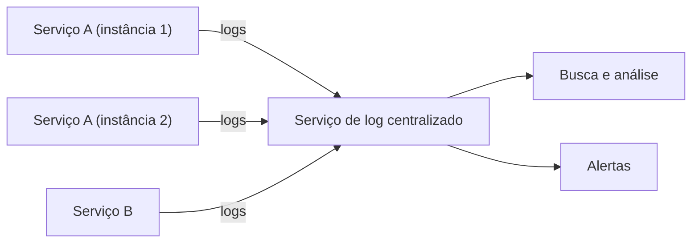

# Log Aggregation

## Descrição

Em uma arquitetura de microsserviços, cada instância de serviço escreve seus próprios logs (erros, avisos, informações e depuração) em um formato padronizado. Como o sistema roda em muitas instâncias e máquinas, esses registros ficam espalhados e uma única requisição de usuário pode passar por vários serviços.

O padrão envia os logs de todas as instâncias para um serviço central de logging, que os agrega. A partir dele, as pessoas desenvolvedoras e de operação pesquisam e analisam o conjunto completo e configuram alertas disparados quando certas mensagens aparecem.

Os agentes de coleta devem ser leves para não penalizar os serviços, e os logs costumam ser estruturados (por exemplo, JSON) com campos comuns como serviço, instância, nível e identificador de correlação.

## Problemas que resolve

- Entender o comportamento da aplicação e diagnosticar problemas quando os logs relevantes estão dispersos em muitas instâncias
- Acompanhar uma requisição que atravessa vários serviços
- Reduzir o impacto em tempo de execução da coleta de logs
- Disparar alertas a partir de mensagens específicas

## Quando usar

- Aplicações com várias instâncias de serviços em múltiplas máquinas ou contêineres
- Instâncias efêmeras, cujos arquivos locais desaparecem junto com elas
- Necessidade de busca, análise e alertas centralizados sobre mensagens de log

## Quando evitar

- Aplicações pequenas, com poucas instâncias, em que os logs locais bastam
- Quando o volume de logs e o custo da infraestrutura de agregação não se justificam

## Trade-offs

| Ganho | Custo / Risco |
| --- | --- |
| Visão única e pesquisável de todos os logs | Volume grande de dados exige infraestrutura considerável de ingestão, armazenamento e consulta |
| Alertas baseados em mensagens | Logs excessivos ou ruidosos aumentam custo e dificultam encontrar o que importa |
| Logs sobrevivem ao descarte das instâncias | Dados sensíveis nos logs exigem controle de acesso e mascaramento |

- Mantenha o overhead mínimo nos serviços, preferindo envio assíncrono com buffer.
- Defina política de retenção e amostragem para controlar custos.

## Diagrama

Todas as instâncias enviam seus logs para um serviço central, que oferece busca, análise e alertas.

## Padrões relacionados

- [Distributed Tracing](/architecture/microservices/observability/distributed-tracing) — inclui um identificador de requisição em cada mensagem de log para seguir uma requisição entre serviços
- [Exception Tracking](/architecture/microservices/observability/exception-tracking) — exceções também são reportadas a um serviço dedicado, além de registradas nos logs
- [Application Metrics](/architecture/microservices/observability/application-metrics) — complementa os logs com medições numéricas
- [Microservice Chassis](/architecture/microservices/cross-cutting-concerns/microservice-chassis) — pode padronizar formato e envio de logs
- [Sidecar](/architecture/cloud-design-patterns/integration-and-modernization/sidecar) — um sidecar pode coletar e encaminhar logs sem alterar o serviço

## Referência

- [Página do padrão no microservices.io](https://microservices.io/patterns/observability/application-logging.html)
