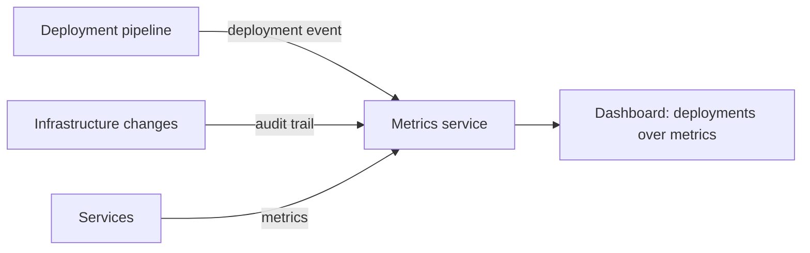

# Log Deployments and Changes

## Descrição

Problemas em produção costumam surgir logo depois de uma mudança. O padrão consiste em registrar cada deploy e cada alteração feita em produção (versões de serviços, configurações, infraestrutura), para que esses eventos possam ser correlacionados com mudanças de comportamento.

Uma técnica comum é a ferramenta de deploy publicar uma pseudo-métrica a cada implantação de um serviço. Exibida junto às demais métricas em dashboards, ela permite ligar uma alteração no comportamento da aplicação a um deploy específico. Também serve a esse fim o registro de chamadas de API da infraestrutura, como o AWS CloudTrail.

## Problemas que resolve

- Entender o comportamento da aplicação e diagnosticar problemas ligados a mudanças recentes
- Responder rapidamente à pergunta "o que mudou?" durante um incidente

## Quando usar

- Ambientes com deploys frequentes e várias equipes alterando produção
- Quando é preciso correlacionar incidentes com versões e mudanças de configuração

### Quando evitar

- Sistemas em que mudanças são raras e já documentadas por outros meios

## Trade-offs

| Ganho | Custo / Risco |
| --- | --- |
| Correlação fácil entre deploys, mudanças e problemas, acelerando a resolução | Exige integrar pipelines e ferramentas para emitir os eventos de forma consistente |
| Contexto visível nos dashboards | Mudanças feitas fora das ferramentas instrumentadas não são registradas |

- A página original não lista desvantagens relevantes. Na prática, o ganho depende de cobrir todos os caminhos de mudança.

## Diagrama

Eventos de deploy e de mudança são publicados junto das métricas, e o dashboard sobrepõe ambos para correlação.

## Padrões relacionados

- [Application Metrics](./application-metrics.md) — o deploy é publicado como pseudo-métrica ao lado das métricas
- [Audit Logging](./audit-logging.md) — registra ações de usuários, enquanto este registra mudanças no ambiente
- [Log Aggregation](./log-aggregation.md) — eventos de mudança também podem ser enviados aos logs centralizados
- [Service Deployment Platform](../deployment/service-deployment-platform.md) — a plataforma de deploy é uma fonte natural dos eventos

## Referência

- [Página do padrão no microservices.io](https://microservices.io/patterns/observability/log-deployments-and-changes.html)
