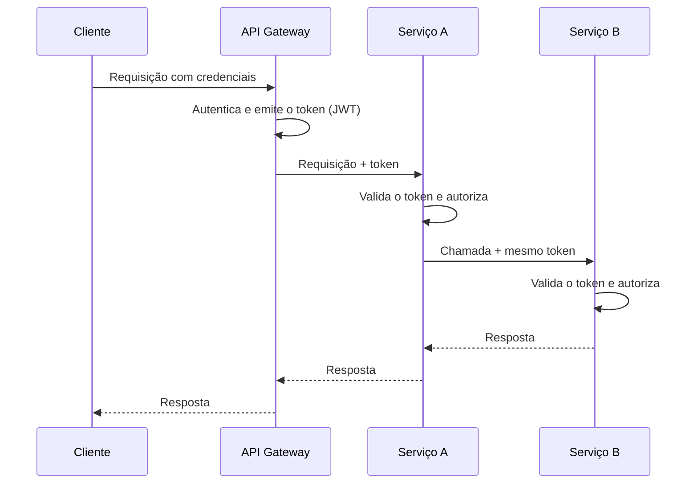

# Access Token

## Descrição

Access Token é o padrão em que a identidade de quem faz a requisição é transportada por um token seguro, em vez de cada serviço reautenticar o cliente. O API Gateway autentica a requisição na borda e emite (ou repassa) um token, tipicamente um JSON Web Token (JWT) assinado, contendo a identidade do requisitante e, geralmente, suas permissões ou escopos.

Esse token acompanha a requisição a cada serviço que a processa. Quando um serviço precisa chamar outro para completar a operação, ele propaga o mesmo token, de modo que toda a cadeia de chamadas conheça o requisitante original. Cada serviço valida a assinatura e a validade do token localmente e decide se a operação é permitida.

## Problemas que resolve

- Como comunicar a identidade do requisitante aos serviços que tratam a requisição, sem que cada um refaça a autenticação.
- Serviços precisam verificar se o usuário está autorizado a executar uma operação.
- Chamadas encadeadas entre serviços perdem o contexto do usuário original se a identidade não for propagada.

## Quando usar

- Arquitetura de microsserviços com um API Gateway como ponto único de entrada que autentica as requisições.
- Serviços que tomam decisões de autorização com base na identidade, nos papéis ou nos escopos do usuário.
- Chamadas entre serviços que precisam preservar o contexto do requisitante original.

### Quando evitar

- Sistemas pequenos ou monolíticos, nos quais a sessão tradicional no servidor é suficiente.
- Cenários que exigem revogação imediata e universal de acesso, se não houver mecanismo para isso (tokens de vida curta, lista de revogação ou introspecção).
- Quando não há infraestrutura confiável para gerenciar chaves de assinatura e rotacioná-las.

## Trade-offs

| Ganho | Custo / Risco |
| --- | --- |
| Identidade do requisitante propagada de forma segura por todo o sistema | Token roubado pode ser reutilizado até expirar |
| Serviços verificam autorização sem consultar um servidor de sessão a cada chamada | Revogação antes da expiração é difícil com tokens autocontidos |
| Serviços ficam sem estado de sessão, o que facilita a escala horizontal | Tokens com muitas permissões ficam grandes e aumentam o tamanho de cada requisição |
| Autenticação centralizada na borda | Gestão de chaves de assinatura, rotação e sincronização de relógios |

- Use tokens de vida curta e renovação (refresh) para limitar a janela de abuso.
- Valide assinatura, emissor, audiência e expiração em cada serviço; não confie apenas na rede interna.
- Evite colocar dados sensíveis no payload, pois o JWT é codificado, não cifrado.
- Registre o identificador do token ou do usuário nos logs para facilitar a rastreabilidade.

## Diagrama

O gateway autentica o cliente uma única vez e emite o token; cada serviço valida o token localmente e o repassa nas chamadas seguintes.

## Padrões relacionados

- [API Gateway](../external-api/api-gateway.md) — autentica a requisição na borda e emite o token que é repassado aos serviços
- [Federated Identity](../../../cloud/cloud-design-patterns/security-and-access/federated-identity.md) — delega a autenticação a um provedor de identidade externo, que normalmente emite o token usado aqui
- [Gatekeeper](../../../cloud/cloud-design-patterns/security-and-access/gatekeeper.md) — o gateway ou intermediário que valida as requisições antes de chegarem aos serviços protegidos
- [Valet Key](../../../cloud/cloud-design-patterns/security-and-access/valet-key.md) — também usa um token de acesso restrito, mas para conceder acesso limitado e temporário a um recurso específico

## Referência

- [Página do padrão no microservices.io](https://microservices.io/patterns/security/access-token.html)
