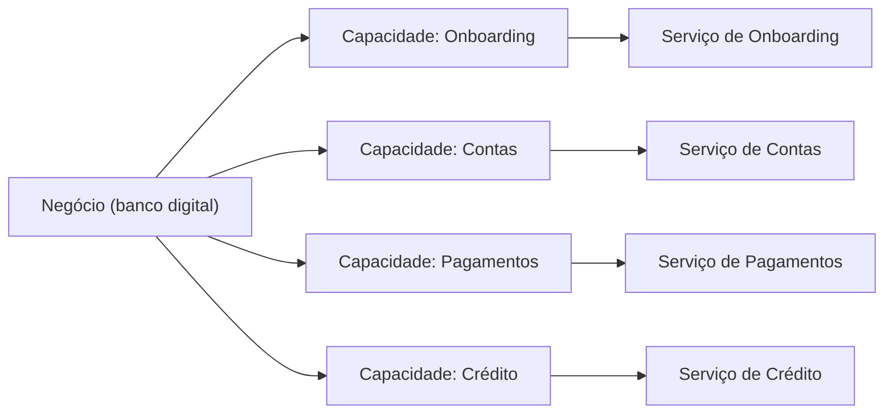

# Decompose by Business Capability

## Descrição

Decompose by Business Capability define os serviços a partir das capacidades de negócio, isto é, das coisas que a organização faz para gerar valor, como gestão de pedidos, catálogo, estoque ou entrega. Uma capacidade costuma corresponder a um objeto de negócio e pode ser organizada em hierarquias de vários níveis.

Como as capacidades mudam lentamente, a arquitetura resultante é estável. Cada serviço expõe uma API que esconde sua implementação, e a maioria das mudanças afeta apenas um serviço, o que permite equipes pequenas, autônomas e orientadas a valor de negócio. Um bom ponto de partida é a estrutura organizacional e o modelo de domínio de alto nível.

## Problemas que resolve

- Como decompor uma aplicação grande em serviços de forma estável ao longo do tempo
- Serviços precisam ser coesos e fracamente acoplados, com APIs que ocultam a implementação
- Mudanças devem tocar, em geral, um único serviço, evitando coordenação entre equipes
- Cada serviço deve ser testável e pequeno o bastante para uma equipe de cerca de 6 a 10 pessoas

## Quando usar

- Ao desenhar ou refatorar para uma arquitetura de microsserviços com equipes autônomas
- Quando a organização tem capacidades de negócio bem identificáveis e relativamente estáveis

## Quando evitar

- Em aplicações pequenas, em que a decomposição só adiciona complexidade
- Quando o entendimento do negócio ainda é superficial e não há como iterar sobre os limites

## Trade-offs

| Ganho | Custo / Risco |
| --- | --- |
| Arquitetura estável, pois capacidades mudam pouco | Exige entendimento real do negócio |
| Serviços coesos e fracamente acoplados | Identificar capacidades é um processo iterativo e sujeito a erros |
| Equipes multifuncionais voltadas a valor de negócio | Capacidades de granularidade errada geram serviços grandes demais ou acoplados |

- Os limites devem ser revistos conforme o entendimento do negócio evolui.
- Fluxos que cruzam capacidades exigem colaboração entre serviços (sagas, eventos).

## Diagrama

Cada capacidade de negócio dá origem a um serviço com responsabilidade própria. A fonte ilustra o padrão com uma loja online (catálogo, estoque, pedidos e entrega).

## Padrões relacionados

- [Decompose by Subdomain](/architecture/microservices/service-boundaries/decompose-by-subdomain) — abordagem alternativa baseada em subdomínios do DDD
- [Service per Team](/architecture/microservices/service-boundaries/service-per-team) — define a relação entre os serviços resultantes e as equipes
- [Microservice Architecture](/architecture/microservices/architectural-style/microservice-architecture) — o estilo arquitetural que cria a necessidade de decompor

## Referência

- [Página do padrão no microservices.io](https://microservices.io/patterns/decomposition/decompose-by-business-capability.html)
