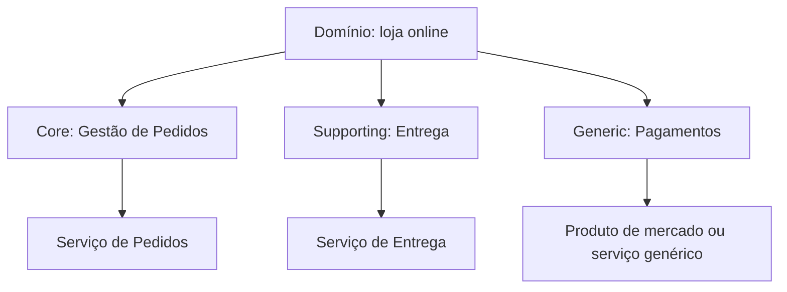

# Decompose by Subdomain

## Descrição

Decompose by Subdomain define os serviços a partir dos subdomínios do Domain-Driven Design (DDD), que representam as áreas distintas do negócio. Cada subdomínio tende a ter seu próprio modelo e vocabulário, o que dá limites naturais para os serviços.

Os subdomínios são classificados em três tipos: core (o diferencial competitivo e a parte mais valiosa), supporting (relacionado ao negócio, mas sem ser diferencial, podendo ser construído internamente ou terceirizado) e generic (não específico do negócio, idealmente atendido por software de prateleira). Essa classificação também orienta onde investir esforço de engenharia.

## Problemas que resolve

- Como decompor uma aplicação em serviços com uma arquitetura estável
- Agrupar o que muda junto (Common Closure Principle), de modo que uma mudança afete um só serviço
- Manter serviços coesos, fracamente acoplados, testáveis e com APIs que escondem a implementação
- Dimensionar serviços para equipes autônomas de cerca de 6 a 10 pessoas

## Quando usar

- Quando o domínio é complexo e se beneficia de modelagem com DDD
- Quando se quer distinguir o que construir (core) do que comprar ou terceirizar (generic)

### Quando evitar

- Em domínios simples, nos quais a modelagem de subdomínios é um esforço desproporcional
- Sem acesso a especialistas do domínio para validar os limites

## Trade-offs

| Ganho | Custo / Risco |
| --- | --- |
| Arquitetura estável, pois subdomínios mudam pouco | Requer entendimento profundo do negócio |
| Serviços coesos e alinhados a valor de negócio | Identificação de subdomínios é iterativa |
| Clareza sobre o que é core, supporting e generic | Fronteiras mal definidas levam a acoplamento entre serviços |

- O modelo de domínio de alto nível e a estrutura organizacional são bons pontos de partida.
- Integrações entre subdomínios podem exigir camadas de tradução.

## Diagrama

O domínio é dividido em subdomínios de tipos distintos, cada um mapeado para um serviço ou solução adequada.

## Padrões relacionados

- [Decompose by Business Capability](./decompose-by-business-capability.md) — abordagem alternativa baseada em capacidades de negócio
- [Service per Team](./service-per-team.md) — associa os serviços identificados a equipes
- [Anti-Corruption Layer](../../../cloud/cloud-design-patterns/integration-and-modernization/anti-corruption-layer.md) — protege o modelo de um subdomínio na integração com outros
- [Microservice Architecture](../architectural-style/microservice-architecture.md) — o estilo arquitetural que motiva a decomposição

## Referência

- [Página do padrão no microservices.io](https://microservices.io/patterns/decomposition/decompose-by-subdomain.html)
