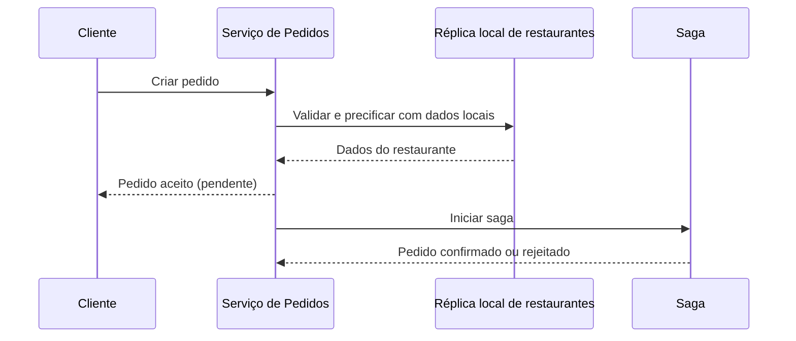

# Self-contained Service

## Descrição

Self-contained Service projeta um serviço para responder a uma requisição síncrona sem precisar esperar por nenhum outro serviço. Isso evita que a disponibilidade e a latência da operação dependam de uma cadeia de chamadas remotas.

Há duas formas de obter isso: absorver a funcionalidade necessária como um módulo dentro do próprio serviço (por exemplo, unir os serviços de pedidos e de restaurantes) ou colaborar de forma assíncrona, usando sagas para manter a consistência e CQRS para manter uma réplica local dos dados pertencentes a outros serviços. Assim, o serviço aceita a requisição, valida com dados locais e conclui o restante de forma assíncrona, deixando o pedido em estado pendente até a confirmação.

## Problemas que resolve

- Uma requisição frequentemente se espalha por vários serviços, tornando o tratamento dependente de todos eles
- Operações precisam de alta disponibilidade e baixo tempo de resposta
- A disponibilidade total cai a cada serviço invocado de forma síncrona, pois é aproximadamente o produto das disponibilidades individuais
- Retentativas aumentam a chance de sucesso, mas também a latência

## Quando usar

- Em operações críticas de alta disponibilidade e baixa latência que hoje dependem de várias chamadas síncronas
- Quando os dados de outros serviços podem ser replicados localmente e a consistência eventual é aceitável

### Quando evitar

- Quando a operação exige consistência forte e imediata com dados de outros serviços
- Quando o custo de CQRS e sagas supera o ganho de disponibilidade

## Trade-offs

| Ganho | Custo / Risco |
| --- | --- |
| Maior disponibilidade da operação | Custo e complexidade adicionais de CQRS e sagas |
| Menor tempo de resposta | API menos direta: o cliente pode precisar consultar o resultado final depois |
| Menos dependências em tempo de execução | Serviço maior, caso a funcionalidade seja absorvida |

- Consistência eventual entre réplicas e dados de origem.
- Observabilidade do fluxo assíncrono é essencial para acompanhar o estado das sagas.

## Diagrama

O serviço responde sem chamar outros serviços; a conclusão ocorre de forma assíncrona por meio da saga.

## Padrões relacionados

- [Saga](../../../cloud/azure/distributed-coordination/saga.md) — mantém a consistência dos dados de forma assíncrona
- [CQRS](../../../cloud/azure/data-management/cqrs.md) — mantém réplicas locais dos dados de outros serviços
- [Command-side Replica](../service-collaboration/command-side-replica.md) — réplica local usada para validar comandos sem chamadas remotas
- [Microservice Architecture](../architectural-style/microservice-architecture.md) — o contexto que cria a necessidade do padrão

## Referência

- [Página do padrão no microservices.io](https://microservices.io/patterns/decomposition/self-contained-service.html)
