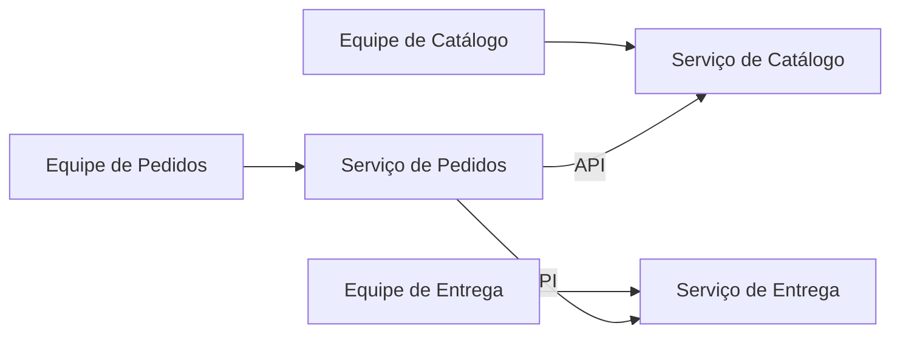

# Service per Team

## Descrição

Service per Team estabelece que cada serviço pertence a exatamente uma equipe, que tem a responsabilidade exclusiva de alterá-lo. Idealmente, uma equipe é dona de um único serviço, cujo código cabe na capacidade cognitiva de seus membros.

O padrão parte da lei de Conway: a arquitetura reflete a estrutura de comunicação da organização. Organizações de alto desempenho têm equipes pequenas (cerca de 5 a 9 pessoas), duradouras, autônomas, multifuncionais e fracamente acopladas, e isso pede uma arquitetura igualmente desacoplada. Uma equipe só deve manter vários serviços quando houver necessidade comprovada, como reduzir o lead time ou melhorar escalabilidade e tolerância a falhas.

## Problemas que resolve

- Qual é a relação entre equipes e serviços
- Manter equipes pequenas, autônomas e fracamente acopladas
- Manter o código de uma equipe dentro de sua capacidade cognitiva
- Equilibrar a granularidade fina (manutenção, testes, deploy) com a complexidade que ela traz

## Quando usar

- Ao adotar microsserviços em uma organização com equipes pequenas e de longa duração
- Quando se busca autonomia de entrega e responsabilidade clara de longo prazo sobre cada serviço

### Quando evitar

- Quando não há equipes estáveis o bastante para assumir propriedade duradoura
- Quando um mesmo serviço precisa ser alterado continuamente por várias equipes de forma inevitável

## Trade-offs

| Ganho | Custo / Risco |
| --- | --- |
| Autonomia e pouca coordenação entre equipes | Equipes podem não se alinhar às funcionalidades vistas pelo usuário final |
| Número mínimo de serviços necessário | Funcionalidades que cruzam serviços exigem colaboração entre equipes |
| Propriedade de longo prazo tende a elevar a qualidade do código | Risco de silos e de dependência de poucas pessoas |

- Defina contratos de API claros e versionados entre equipes.
- Revise a divisão quando a organização ou o domínio mudarem.

## Diagrama

Cada equipe é dona de um serviço e os serviços se comunicam por APIs, mantendo o acoplamento baixo.

## Padrões relacionados

- [Decompose by Business Capability](/architecture/microservices/service-boundaries/decompose-by-business-capability) — ajuda a identificar os serviços a atribuir às equipes
- [Decompose by Subdomain](/architecture/microservices/service-boundaries/decompose-by-subdomain) — outra forma de identificar serviços alinhados ao domínio
- [Microservice Architecture](/architecture/microservices/architectural-style/microservice-architecture) — o estilo arquitetural que cria a necessidade do padrão

## Referência

- [Página do padrão no microservices.io](https://microservices.io/patterns/decomposition/service-per-team.html)
