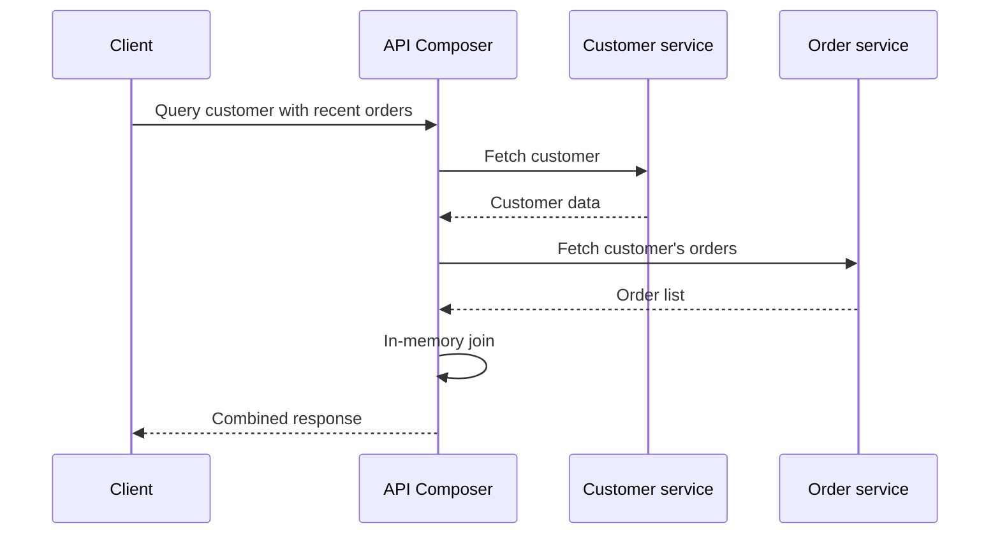

# API Composition

## Descrição

Em uma aplicação com microsserviços e Database per Service, os dados estão espalhados em bancos privados, e consultas que combinam informações de vários serviços deixam de ser um simples *join*. O API Composition resolve isso com um componente chamado *API Composer*, que invoca os serviços que detêm os dados e executa um *join* em memória sobre os resultados.

Em geral, o papel de compositor é assumido por um API Gateway, mas pode ser um serviço dedicado ou um *backend for frontend*. Por exemplo, para listar um cliente com os seus pedidos recentes, o compositor consulta o serviço de clientes, depois o serviço de pedidos, e monta a resposta combinada.

**Relação com Gateway Aggregation:** o Gateway Aggregation, do catálogo de padrões de nuvem, é essencialmente a mesma técnica aplicada no gateway: agregar várias chamadas de back-end em uma única requisição do cliente. A diferença está no enfoque. O Gateway Aggregation é um padrão de borda, focado em reduzir a "tagarelice" (*chattiness*) entre cliente e serviços, e não discute a origem da fragmentação dos dados. O API Composition é um padrão de dados de microsserviços, motivado por Database per Service, que trata especificamente de como implementar consultas e *joins* entre bancos privados, e pode ser executado dentro do gateway ou de qualquer outro serviço. Dizendo de outro modo: o gateway é um lugar onde a composição acontece; a composição é a estratégia de consulta.

## Problemas que resolve

- Como implementar consultas que precisam de dados de vários serviços quando cada serviço possui seu banco privado.
- Evitar acesso direto a bancos de outros serviços ou a criação de uma réplica dedicada para consultas simples.
- Reduzir o número de chamadas que o cliente precisa fazer para montar uma visão completa.

## Quando usar

- Consultas que combinam poucos serviços e conjuntos de dados pequenos ou paginados.
- Quando a consistência eventual de uma visão derivada (CQRS) seria um custo desnecessário.
- Quando se quer a abordagem mais simples para atender a consulta.

### Quando evitar

- Consultas que exigem *joins* sobre grandes volumes de dados, que se tornam ineficientes em memória.
- Quando a disponibilidade do compositor é afetada por vários serviços chamados em série ou em paralelo e não há tolerância a falhas parciais.
- Quando a mesma consulta é muito frequente e merece uma visão materializada com CQRS.

## Trade-offs

| Ganho | Custo / Risco |
| --- | --- |
| Abordagem simples para consultar dados entre serviços | *Joins* em memória podem ser ineficientes sobre grandes conjuntos |
| Dados sempre lidos da fonte, sem defasagem de réplicas | Latência da resposta depende do serviço mais lento |
| Nenhuma infraestrutura adicional de eventos e visões | A disponibilidade combinada é menor que a de cada serviço isolado |
| Reaproveita as APIs existentes dos serviços | Cada consulta gera várias chamadas, aumentando carga e tráfego de rede |

- **Falhas parciais:** defina o comportamento quando um dos serviços falha (resposta parcial, *fallback*, falha total) e use *circuit breaker* e *timeouts*.
- **Paralelismo:** chame os serviços independentes em paralelo para reduzir a latência total.
- **Fronteira:** mantenha a lógica de composição fina; regras de negócio devem permanecer nos serviços.

## Diagrama

O compositor chama cada serviço dono dos dados, une os resultados em memória e devolve uma resposta única ao cliente.

## Padrões relacionados

- [Database per Service](./database-per-service.md) — cria a necessidade deste padrão.
- [CQRS](../../../cloud/cloud-design-patterns/data-management/cqrs.md) — abordagem alternativa, com visões materializadas mantidas por eventos.
- [API Gateway](../external-api/api-gateway.md) — local onde a composição costuma ser executada.
- [Gateway Aggregation](../../../cloud/cloud-design-patterns/gateways-and-edge/gateway-aggregation.md) — padrão de nuvem equivalente na borda, focado em reduzir chamadas do cliente, sem tratar da origem da fragmentação dos dados.
- [Backend for Front-End](../../../cloud/cloud-design-patterns/gateways-and-edge/backends-for-frontends.md) — outro ponto comum para hospedar a composição.
- [Circuit Breaker](../../../cloud/cloud-design-patterns/resiliency/circuit-breaker.md) — protege o compositor contra serviços lentos ou indisponíveis.

## Referência

- [Página do padrão no microservices.io](https://microservices.io/patterns/data/api-composition.html)
