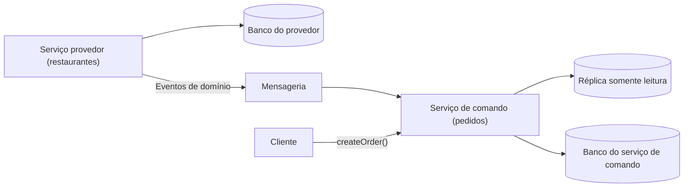

# Command-side Replica

## Descrição

Em uma arquitetura com Database per Service, um serviço que executa um comando muitas vezes precisa de dados que pertencem a outro serviço. Por exemplo, o serviço de pedidos, ao criar um pedido, precisa do cardápio do restaurante, mantido pelo serviço de restaurantes, para validar e precificar os itens. Consultar o outro serviço em tempo de execução, de forma síncrona ou como passo de uma saga, aumenta o tráfego de rede e cria dependência de runtime.

O Command-side Replica resolve isso mantendo, dentro do serviço do comando, uma réplica somente leitura dos dados do provedor. A réplica é atualizada pela assinatura de eventos de domínio publicados pelo serviço provedor. O padrão tem três elementos: o serviço de comando, o serviço provedor (dono dos dados) e o banco da réplica.

Estruturalmente, é o mesmo mecanismo do CQRS: uma cópia derivada alimentada por eventos. A diferença é o propósito, pois aqui a réplica serve ao lado de escrita (comando), e não a consultas de leitura.

## Problemas que resolve

- Como um serviço que implementa um comando obtém dados que pertencem a outro serviço sem chamá-lo a cada execução.
- Redução do acoplamento de runtime, que afeta disponibilidade e latência do comando.
- Redução de viagens de rede e de transferência de grandes volumes de dados por chamada.
- Possibilidade de usar ACID local no comando, em vez de depender de sagas ou de consistência distribuída, ao consultar a réplica local.

## Quando usar

- Quando o comando precisa de dados de referência de outro serviço com alta frequência (catálogos, cardápios, preços).
- Quando o provedor não deve estar no caminho crítico do comando por razões de disponibilidade ou desempenho.
- Quando a leitura de dados ligeiramente desatualizados é aceitável para a regra de negócio.

### Quando evitar

- Quando os dados precisam estar sempre atuais e a defasagem da réplica não é tolerável.
- Quando os dados replicados são regulados (por exemplo, dados pessoais), o que amplia as obrigações de segurança e conformidade do serviço de comando.
- Quando o provedor produziria um volume de eventos muito alto ou a estrutura dos dados é complexa e instável, gerando acoplamento de design.
- Quando uma consulta direta ao provedor, com cache, já atende bem.

## Trade-offs

| Ganho | Custo / Risco |
| --- | --- |
| Comando mais simples e eficiente, sem chamadas ao provedor | Complexidade: o serviço de comando mantém a réplica e o provedor precisa publicar eventos |
| Menor acoplamento de runtime e melhor disponibilidade | Maior acoplamento de design: o consumidor precisa entender a estrutura e o ciclo de vida dos dados |
| Réplica pode usar a stack de tecnologia mais adequada ao comando | A réplica pode estar desatualizada (consistência eventual) |
| O provedor pode ter requisitos de desempenho e disponibilidade menores | Pipeline do serviço de comando pode ficar mais lento por ter de testar a réplica |

- **Autonomia de equipes:** a necessidade de alinhar eventos e contratos aumenta a coordenação entre as equipes.
- **Regulação:** réplicas com dados pessoais ampliam a superfície de segurança e de conformidade.
- **Idempotência:** o consumo dos eventos deve tolerar duplicidade e reordenação.

## Diagrama

O serviço de comando assina os eventos do provedor para manter a réplica local, que usa para validar o comando sem chamar o provedor.

## Padrões relacionados

- [Database per Service](/architecture/microservices/service-collaboration/database-per-service) — cria a necessidade deste padrão.
- [Domain Event](/architecture/microservices/service-collaboration/domain-event) — gera os eventos que mantêm a réplica atualizada.
- [CQRS](/cloud/cloud-design-patterns/data-management/cqrs) — estruturalmente idêntico, mas com foco em leitura.
- [Saga](/cloud/cloud-design-patterns/distributed-coordination/saga) — alternativa quando o dado é obtido como um passo da saga.
- [Materialized View](/cloud/cloud-design-patterns/data-management/materialized-view) — visão pré-computada, conceito próximo ao da réplica.
- [Idempotent Consumer](/cloud/cloud-design-patterns/messaging/idempotent-consumer) — necessário para consumir eventos de forma segura.

## Referência

- [Página do padrão no microservices.io](https://microservices.io/patterns/data/command-side-replica.html)
