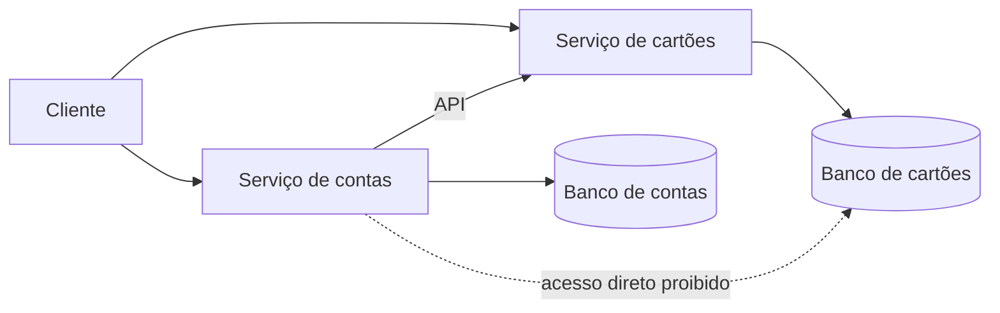

# Database per Service

## Descrição

No padrão Database per Service, os dados persistentes de cada serviço são privados a ele e só podem ser acessados por meio da sua API. As transações de um serviço envolvem apenas o seu próprio banco de dados, que passa a ser tratado como parte da implementação interna do serviço, invisível para os demais.

A privacidade pode ser obtida de formas diferentes, com sobrecarga crescente: tabelas privadas dentro de um banco compartilhado, um *schema* por serviço ou um servidor de banco de dados por serviço (indicado, por exemplo, para serviços de altíssima vazão). Independentemente da opção, é recomendável criar barreiras de enforcement, como um usuário de banco com permissões restritas por serviço, para impedir que desenvolvedores contornem a API e leiam dados de outro serviço diretamente.

Esse padrão é a base para a autonomia dos serviços, mas traz como consequência a perda das transações ACID e dos *joins* entre serviços. Por isso ele costuma vir acompanhado de Saga (para transações) e de API Composition ou CQRS (para consultas).

## Problemas que resolve

- Acoplamento entre serviços por meio do esquema de dados, que impede desenvolver, implantar e escalar de forma independente.
- Necessidade de escolher a tecnologia de armazenamento mais adequada a cada serviço (relacional, documentos, grafos, busca textual).
- Necessidade de replicar e particionar (*sharding*) o banco de cada serviço conforme a sua carga, sem afetar os demais.
- Interferência de runtime entre serviços, como bloqueios de longa duração que travam tabelas usadas por outros.

## Quando usar

- Em arquiteturas de microsserviços em que a autonomia de equipes e a implantação independente são prioridade.
- Quando serviços têm necessidades de armazenamento ou de escala bastante diferentes.
- Quando se aceita tratar consistência entre serviços de forma eventual, com sagas e visões derivadas.

## Quando evitar

- Sistemas pequenos ou monolíticos, em que uma única transação ACID resolve as regras de negócio com mais simplicidade.
- Quando as invariantes de negócio atravessam constantemente vários serviços, sinalizando que as fronteiras dos serviços talvez estejam mal definidas.
- Quando a equipe não tem maturidade para operar vários bancos e lidar com consistência eventual.

## Trade-offs

| Ganho | Custo / Risco |
| --- | --- |
| Baixo acoplamento: mudanças em um banco não afetam os outros serviços | Transações entre serviços ficam difíceis e exigem sagas |
| Liberdade para usar o tipo de banco certo para cada serviço (poliglota) | Consultas com *joins* entre serviços deixam de ser triviais |
| Escala, replicação e *sharding* independentes por serviço | Mais bancos, de tecnologias distintas, para operar, monitorar e fazer backup |
| Isolamento de falhas e de desempenho entre serviços | Dados duplicados e consistência eventual entre serviços |

- **Transações distribuídas:** costumam ser evitadas por limitações do teorema CAP e porque muitos bancos NoSQL não as suportam.
- **Enforcement:** sem barreiras técnicas (credenciais e permissões por serviço), a regra de privacidade tende a ser violada.
- **Observabilidade e governança:** é preciso padronizar backup, migração de esquema e monitoramento entre diferentes tecnologias.

## Diagrama

Cada serviço acessa apenas o seu próprio banco. Quando precisa de dados de outro serviço, o Serviço de contas usa a API do Serviço de cartões, nunca o banco dele. A fonte ilustra o padrão com pedidos e clientes.

## Padrões relacionados

- [Microservice Architecture](/architecture/microservices/architectural-style/microservice-architecture) — o estilo arquitetural que cria a necessidade deste padrão.
- [Saga](/architecture/cloud-design-patterns/distributed-coordination/saga) — fornece transações eventualmente consistentes entre serviços.
- [API Composition](/architecture/microservices/service-collaboration/api-composition) — forma simples de implementar consultas que cruzam serviços.
- [CQRS](/architecture/cloud-design-patterns/data-management/cqrs) — mantém visões que combinam dados de vários serviços.
- [Shared Database](/architecture/microservices/service-collaboration/shared-database) — a alternativa (e anti-padrão) de compartilhar um único banco.
- [Command-side Replica](/architecture/microservices/service-collaboration/command-side-replica) — replica localmente dados de outro serviço para comandos.

## Referência

- [Página do padrão no microservices.io](https://microservices.io/patterns/data/database-per-service.html)
