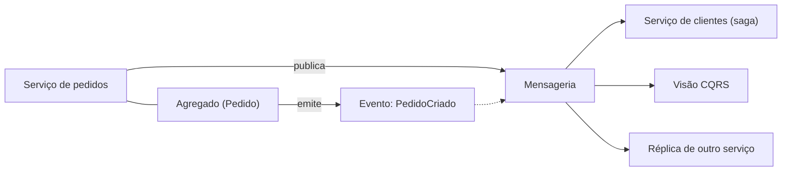

# Domain Event

## Descrição

Um evento de domínio (*Domain Event*), conceito vindo do Domain-Driven Design, é um fato relevante para o negócio que ocorreu no domínio, como `PedidoCriado` ou `CreditoReservado`. No padrão, a lógica de negócio de um serviço é estruturada em agregados (*aggregates*), e cada agregado emite um evento de domínio sempre que é criado ou alterado. O serviço publica esses eventos para que outros serviços possam consumi-los.

Os eventos são nomeados no passado, imutáveis e carregam os dados necessários para que os consumidores reajam sem precisar consultar o emissor. Eles são o insumo para atualizar visões CQRS, manter réplicas locais e conduzir sagas coreografadas.

No DDD, o Domain Event é antes de tudo um fato do domínio: algo que aconteceu e que os especialistas do negócio consideram relevante, nomeado com a linguagem ubíqua. Ele é produzido pelo [Aggregate](../../../application/ddd/building-blocks/aggregate.md) e pode ser tratado dentro do próprio contexto, para propagar consistência eventual entre agregados, ou publicado para outros contextos, como contrato de integração.

O padrão em si define o que publicar; a publicação confiável (atômica com a atualização do banco) é tratada por padrões como Transactional Outbox ou Event Sourcing.

## Problemas que resolve

- Como um serviço publica um evento quando atualiza seus dados.
- Como permitir que outros serviços reajam a mudanças sem acoplamento direto ao emissor.
- Como alimentar visões CQRS, réplicas e passos de sagas coreografadas com fatos confiáveis do domínio.

## Quando usar

- Quando outros serviços precisam reagir a mudanças de estado, como em sagas por coreografia.
- Quando é preciso manter visões ou réplicas derivadas atualizadas.
- Quando a lógica de negócio já é modelada com agregados.

### Quando evitar

- Quando nenhum outro componente precisa ser notificado das mudanças.
- Quando não há infraestrutura de mensageria nem como garantir a publicação atômica com a gravação no banco.
- Quando a granularidade dos eventos tende a expor detalhes internos do modelo, gerando acoplamento.

## Trade-offs

| Ganho | Custo / Risco |
| --- | --- |
| Baixo acoplamento entre emissor e consumidores | Os eventos viram contrato público que precisa ser versionado |
| Base para CQRS, réplicas e sagas coreografadas | Consistência eventual entre emissor e consumidores |
| Linguagem alinhada ao domínio de negócio | Publicação confiável exige Transactional Outbox ou Event Sourcing |
| Novos consumidores podem ser adicionados sem alterar o emissor | Fluxos baseados em eventos são mais difíceis de rastrear e depurar |

- **Atomicidade:** atualizar o banco e publicar o evento deve ser atômico; do contrário, dados e eventos divergem.
- **Duplicidade e ordem:** a entrega costuma ser *at least once*, exigindo consumidores idempotentes e atenção à ordenação por agregado.
- **Conteúdo:** eventos muito enxutos forçam consultas de volta ao emissor; muito gordos vazam detalhes internos.

## Diagrama



O agregado emite o evento, o serviço o publica e diferentes consumidores reagem a ele, cada um à sua maneira.

## Exemplo

Um pedido registra o evento `OrderCreated` ao ser criado; após persistir o agregado, o serviço publica os eventos acumulados.

```java
public record OrderCreated(String orderId, String customerId, Instant occurredAt) {}

public class Order {
    private final String id;
    private final String customerId;
    private final List<Object> events = new ArrayList<>();

    public Order(String id, String customerId) {
        this.id = id;
        this.customerId = customerId;
        events.add(new OrderCreated(id, customerId, Instant.now()));
    }

    public List<Object> pullEvents() {
        List<Object> copy = List.copyOf(events);
        events.clear();
        return copy;
    }
}

public class OrderService {
    @Transactional
    public void create(String id, String customerId) {
        Order order = new Order(id, customerId);
        orders.save(order);
        order.pullEvents().forEach(publisher::publish); // ex.: via Transactional Outbox
    }
}
```

## Padrões relacionados

- [Aggregate](../../../application/ddd/building-blocks/aggregate.md) — o agregado é a fonte natural dos eventos de domínio.
- [Saga](../../../cloud/azure/distributed-coordination/saga.md) — sagas coreografadas dependem de eventos de domínio.
- [CQRS](../../../cloud/azure/data-management/cqrs.md) — visões de leitura são atualizadas por esses eventos.
- [Command-side Replica](./command-side-replica.md) — réplicas locais são mantidas pelos eventos.
- [Event Sourcing](../../../cloud/azure/data-management/event-sourcing.md) — pode ser usado para gerar e publicar eventos de domínio.
- [Transactional Outbox](../transactional-messaging/transactional-outbox.md) — publica os eventos de forma atômica com a transação do banco.
- [Messaging](../communication-styles/messaging.md) — estilo de comunicação usado para distribuir os eventos.
- [Publisher-Subscriber](../../../cloud/azure/messaging/publisher-subscriber.md) — modelo de distribuição dos eventos a múltiplos consumidores.

## Referência

- [DDD Reference, Eric Evans (2015)](https://www.domainlanguage.com/ddd/reference/)
- [Página do padrão no microservices.io](https://microservices.io/patterns/data/domain-event.html)
- [Domain Event, Martin Fowler](https://martinfowler.com/eaaDev/DomainEvent.html)
