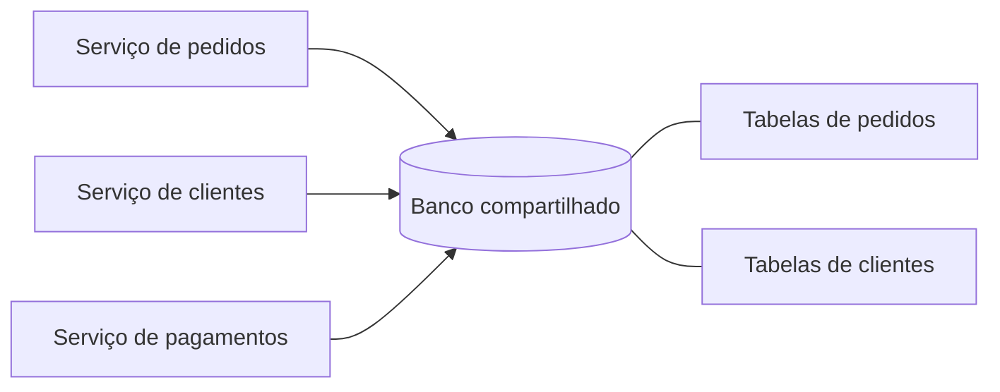

# Shared Database

## Descrição

No padrão Shared Database, todos os serviços utilizam um único banco de dados. Cada serviço pode ler e gravar diretamente em dados pertencentes a outros serviços, aproveitando transações ACID locais. Por exemplo, o serviço de pedidos pode executar uma única transação que lê o limite de crédito e o total de pedidos em aberto do cliente e, em seguida, insere o novo pedido, com o banco garantindo que o limite não seja ultrapassado, mesmo com pedidos concorrentes.

Em microsserviços, esta abordagem é geralmente considerada um anti-padrão, porque o esquema de dados se torna um contrato implícito entre todos os serviços. Ela é descrita no catálogo como a alternativa que contrasta com Database per Service e é útil sobretudo para entender o que se perde (e o que se ganha) ao adotar bancos privados.

Na visão do Enterprise Integration Patterns (Hohpe e Woolf), Shared Database é um dos quatro estilos de integração: as aplicações trocam informação gravando em um único banco. Como todas enxergam os mesmos dados quase ao mesmo tempo, a consistência é alta, o gerenciamento de transações lida com atualizações concorrentes e os erros são mais fáceis de rastrear. A maior dificuldade é projetar um esquema único que atenda bem a várias aplicações, e a pressão política de times que não querem esperar por um esquema unificado costuma levar à fragmentação.

## Problemas que resolve

- Invariantes de negócio que atravessam serviços (como respeitar o limite de crédito ao criar um pedido) exigem consistência forte, e transações ACID resolvem isso de forma simples.
- Consultas que cruzam dados de vários serviços (disponibilidade de crédito, clientes de uma região com seus pedidos recentes) são resolvidas com *joins* comuns.
- Operar um único banco é mais simples do que operar vários.

## Quando usar

- Em aplicações pequenas ou em transição a partir de um monólito, em que poucos times compartilham o mesmo domínio.
- Quando a consistência forte entre os dados é um requisito inegociável e a autonomia dos serviços é secundária.

## Quando evitar

- Quando a implantação e a evolução independentes dos serviços são objetivos da arquitetura.
- Quando serviços têm requisitos de armazenamento ou de escala muito diferentes.
- Quando várias equipes alteram o esquema com frequência.

## Trade-offs

| Ganho | Custo / Risco |
| --- | --- |
| Transações ACID familiares garantem consistência dos dados | Acoplamento em tempo de desenvolvimento: mudanças de esquema exigem coordenação entre todas as equipes que usam as tabelas |
| Um único banco é mais simples de operar | Acoplamento em tempo de execução: uma transação longa de um serviço pode bloquear tabelas e travar outro |
| Consultas com *joins* entre domínios são triviais | Um único banco pode não atender às necessidades de armazenamento de todos os serviços |

- **Escala:** o banco compartilhado vira ponto único de contenção e de falha; replicação e *sharding* afetam todos os serviços ao mesmo tempo.
- **Evolução:** o esquema se torna difícil de mudar, e a propriedade dos dados fica ambígua.

## Diagrama

Todos os serviços leem e gravam no mesmo banco, o que simplifica transações e consultas, mas cria acoplamento forte pelo esquema compartilhado.

## Padrões relacionados

- [Database per Service](/architecture/microservices/service-collaboration/database-per-service) — a alternativa principal, em que cada serviço possui seus dados de forma privada.
- [Microservice Architecture](/architecture/microservices/architectural-style/microservice-architecture) — o contexto arquitetural em que surge a decisão sobre o banco de dados.
- [Monolithic Architecture](/architecture/microservices/architectural-style/monolithic-architecture) — estilo em que um banco único é natural.
- [File Transfer](/architecture/eip/integration-styles/file-transfer) — estilo de integração em lote, que troca dados por arquivos em vez de um banco comum.
- [Remote Procedure Invocation](/architecture/microservices/communication-styles/remote-procedure-invocation) — estilo em que cada aplicação mantém seus dados e os expõe por chamadas.
- [Messaging](/architecture/microservices/communication-styles/messaging) — estilo assíncrono que evita o esquema compartilhado.

## Referência

- [Página do padrão no microservices.io](https://microservices.io/patterns/data/shared-database.html)
- [Página do padrão no Enterprise Integration Patterns](https://www.enterpriseintegrationpatterns.com/SharedDataBaseIntegration.html)
