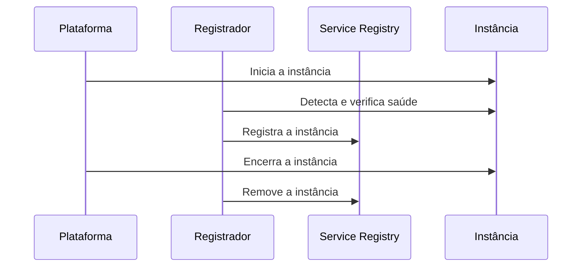

# 3rd Party Registration

## Descrição

No 3rd Party Registration, um componente separado, o registrador (registrar), cuida de registrar cada instância no Service Registry quando ela inicia e de removê-la quando desliga. O serviço não gerencia a própria entrada no registro.

O registrador pode observar a plataforma de implantação ou executar health checks e registrar ou remover instâncias conforme o resultado.

## Problemas que resolve

- Registrar instâncias na inicialização e removê-las no desligamento.
- Remover instâncias que falharam (crash) do registro.
- Remover instâncias em execução que não conseguem atender requisições.

## Quando usar

- Quando se quer manter o código do serviço livre de lógica de registro.
- Ambientes poliglotas ou plataformas de implantação que já oferecem o registrador.

### Quando evitar

- Quando é preciso conhecer o estado fino da instância e o registrador só enxerga se está rodando.
- Quando operar um componente crítico extra não é viável.

## Trade-offs

| Ganho | Custo / Risco |
| --- | --- |
| Código do serviço mais simples e desacoplado do registro | Registrador pode conhecer só o estado grosseiro (rodando ou não) |
| Registrador pode executar health checks e agir sobre o resultado | Mais um componente para instalar e manter, salvo se for parte da infraestrutura |

- O registrador é crítico e precisa de alta disponibilidade.
- Alguns registradores, como o Netflix Prana, mitigam a limitação com health checks.

## Diagrama

Um registrador externo observa as instâncias e mantém o registro.

## Padrões relacionados

- [Service Registry](/architecture/microservices/service-discovery/service-registry) — onde o registrador mantém as instâncias
- [Self Registration](/architecture/microservices/service-discovery/self-registration) — alternativa em que a instância se registra
- [Client-side Discovery](/architecture/microservices/service-discovery/client-side-discovery) e [Server-side Discovery](/architecture/microservices/service-discovery/server-side-discovery) — consumidores do registro
- [Health Check API](/architecture/cloud-design-patterns/resiliency/health-endpoint-monitoring) — usada pelo registrador para verificar saúde

## Referência

- [Página do padrão no microservices.io](https://microservices.io/patterns/3rd-party-registration.html)
