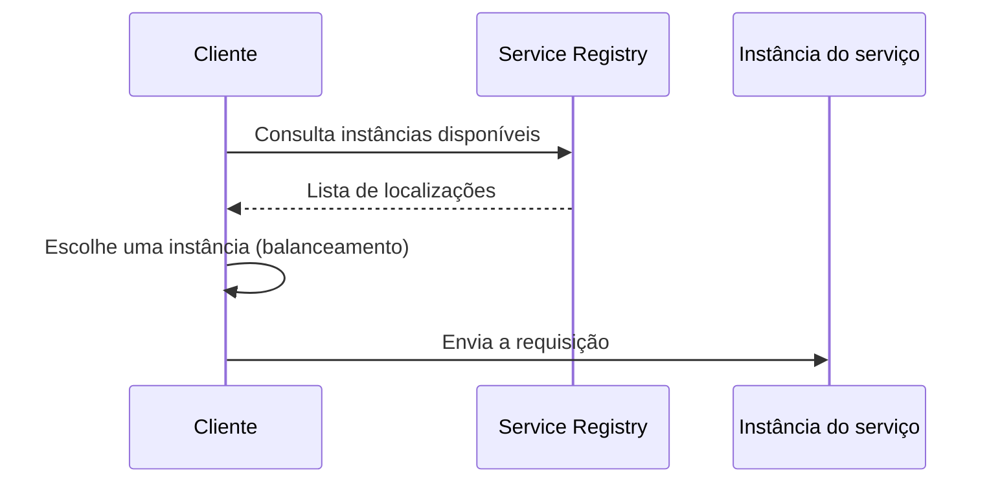

# Client-side Discovery

## Descrição

No Client-side Discovery, o cliente de um serviço (outro serviço ou um API gateway) é responsável por descobrir onde estão as instâncias disponíveis. Antes de enviar uma requisição, ele consulta o Service Registry, que mantém a localização de todas as instâncias, e escolhe uma delas, normalmente aplicando um algoritmo de balanceamento de carga como round-robin.

Em geral essa lógica é fornecida por um microservice chassis ou biblioteca cliente, de modo que o código de negócio não precisa conhecê-la. O cliente costuma manter um cache local da lista de instâncias para reduzir consultas ao registro.

## Problemas que resolve

- Cada instância expõe uma API remota (HTTP/REST, Thrift etc.) em um host e porta específicos.
- O número e a localização das instâncias mudam dinamicamente.
- VMs e contêineres costumam receber endereços IP dinâmicos.
- O número de instâncias varia com a carga, por exemplo em grupos de autoscaling.
- Clientes precisam encontrar instâncias efêmeras sem endereços fixos conhecidos.

## Quando usar

- Ambientes dinâmicos (contêineres, VMs, autoscaling) em que as instâncias mudam com frequência.
- Quando se deseja menos saltos de rede e controle fino do balanceamento no cliente.
- Quando já existe um chassis ou biblioteca padronizada para a(s) linguagem(ns) usada(s).

### Quando evitar

- Ambientes poliglotas em que implementar a descoberta em cada linguagem é caro.
- Quando a plataforma já oferece descoberta e roteamento transparentes (use Server-side Discovery).

## Trade-offs

| Ganho | Custo / Risco |
| --- | --- |
| Menos componentes e menos saltos de rede que na descoberta no servidor | Cliente acoplado ao Service Registry |
| Balanceamento flexível decidido pelo cliente | Lógica de descoberta precisa ser implementada para cada linguagem/framework |

- Dados em cache podem ficar obsoletos se o registro falhar ou demorar a refletir mudanças.
- Proxies auxiliares (como o Netflix Prana) podem atender clientes não JVM via HTTP.

## Diagrama

O cliente consulta o registro, escolhe uma instância e a chama diretamente.

## Padrões relacionados

- [Service Registry](/architecture/microservices/service-discovery/service-registry) — fonte das localizações consultadas pelo cliente
- [Server-side Discovery](/architecture/microservices/service-discovery/server-side-discovery) — alternativa em que um roteador faz a descoberta
- [Microservice Chassis](/architecture/microservices/cross-cutting-concerns/microservice-chassis) — costuma embutir a lógica de descoberta
- [Self Registration](/architecture/microservices/service-discovery/self-registration) e [3rd Party Registration](/architecture/microservices/service-discovery/3rd-party-registration) — formas de popular o registro

## Referência

- [Página do padrão no microservices.io](https://microservices.io/patterns/client-side-discovery.html)
