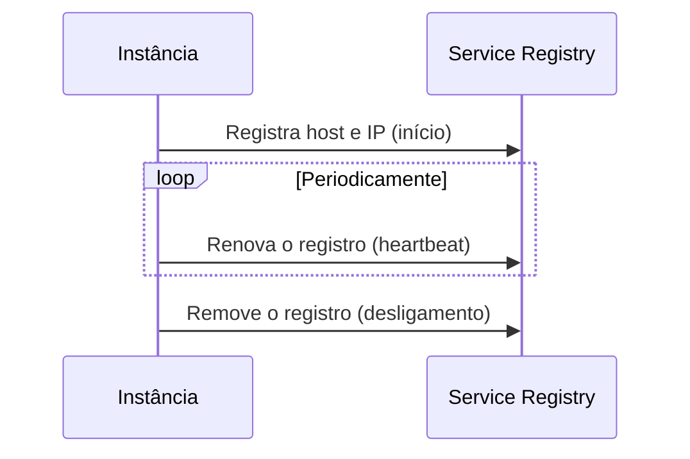

# Self Registration

## Descrição

No Self Registration, cada instância de serviço é responsável por se registrar no Service Registry, informando seu host e endereço IP ao iniciar. Depois, renova o registro periodicamente (heartbeat) para mostrar que está viva e, ao desligar, remove a si mesma.

Normalmente um microservice chassis ou biblioteca cliente (por exemplo, o cliente do Netflix Eureka) implementa esse comportamento.

## Problemas que resolve

- Registrar instâncias na inicialização e removê-las no desligamento.
- Remover instâncias que falharam (crash) do registro.
- Remover instâncias em execução que não conseguem atender requisições.

## Quando usar

- Quando o serviço já usa um chassis que implementa o registro.
- Quando a instância precisa expor estados mais ricos que UP/DOWN, como STARTING ou AVAILABLE.

## Quando evitar

- Ambientes poliglotas em que replicar a lógica em cada linguagem é custoso.
- Quando se quer manter os serviços desacoplados do registro (prefira 3rd Party Registration).

## Trade-offs

| Ganho | Custo / Risco |
| --- | --- |
| A instância conhece seu estado e pode usar um modelo mais rico que UP/DOWN | Acopla o serviço ao Service Registry |
| Sem componente extra de registro | Lógica de registro em cada linguagem/framework |

- Uma instância viva mas incapaz de atender muitas vezes não consegue se remover sozinha; é preciso expiração por heartbeat.

## Diagrama

A própria instância gerencia seu ciclo de vida no registro.

## Padrões relacionados

- [Service Registry](/architecture/microservices/service-discovery/service-registry) — onde a instância se registra
- [3rd Party Registration](/architecture/microservices/service-discovery/3rd-party-registration) — alternativa com registrador externo
- [Client-side Discovery](/architecture/microservices/service-discovery/client-side-discovery) e [Server-side Discovery](/architecture/microservices/service-discovery/server-side-discovery) — consumidores do registro
- [Microservice Chassis](/architecture/microservices/cross-cutting-concerns/microservice-chassis) — costuma implementar o registro

## Referência

- [Página do padrão no microservices.io](https://microservices.io/patterns/self-registration.html)
