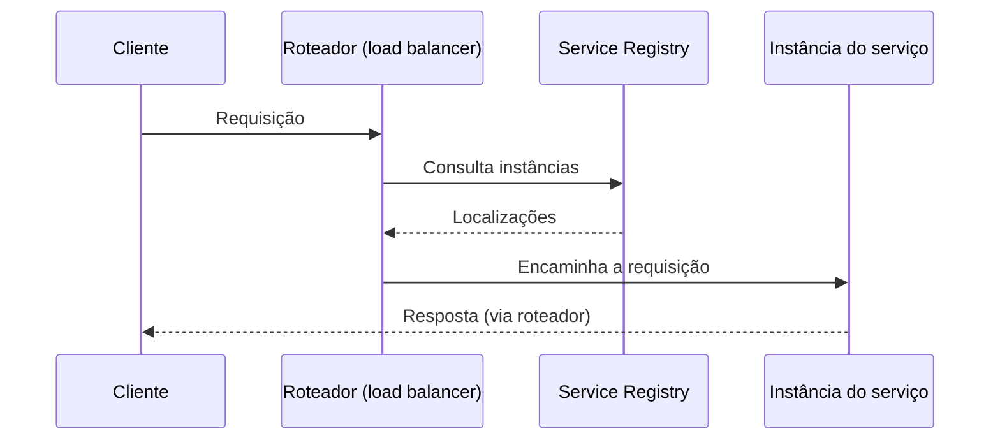

# Server-side Discovery

## Descrição

No Server-side Discovery, o cliente envia suas requisições a um roteador (também chamado de load balancer) em um endereço bem conhecido. O roteador consulta o Service Registry, que pode estar embutido nele, e encaminha cada requisição a uma instância disponível.

Assim, a lógica de descoberta sai do cliente e fica na infraestrutura. Exemplos são o AWS Elastic Load Balancer e os proxies por host do Kubernetes e do Marathon.

## Problemas que resolve

- Cada instância expõe uma API remota (HTTP/REST, Thrift etc.) em um host e porta específicos.
- O número e a localização das instâncias mudam dinamicamente.
- VMs e contêineres costumam receber endereços IP dinâmicos.
- O número de instâncias varia com a carga, por exemplo em grupos de autoscaling.
- Clientes não devem precisar conhecer a topologia dinâmica das instâncias.

## Quando usar

- Quando se quer clientes simples, sem lógica de descoberta, em várias linguagens.
- Quando a plataforma de nuvem ou de orquestração já oferece o roteador.

### Quando evitar

- Quando não há infraestrutura pronta e operar mais um componente replicado não compensa.
- Quando o roteador não suporta o protocolo necessário (além de TCP).

## Trade-offs

| Ganho | Custo / Risco |
| --- | --- |
| Código do cliente mais simples, sem descoberta | Mais um componente para instalar, configurar e replicar (fora de plataformas que o fornecem) |
| Fornecido pronto por várias plataformas | Mais saltos de rede que na descoberta no cliente |

- O roteador é ponto crítico e precisa de alta disponibilidade e capacidade.
- Deve suportar os protocolos usados pelos serviços.

## Diagrama

O cliente conhece apenas o roteador; ele consulta o registro e escolhe a instância.

## Padrões relacionados

- [Service Registry](./service-registry.md) — usado pelo roteador para localizar instâncias
- [Client-side Discovery](./client-side-discovery.md) — principal alternativa
- [Circuit Breaker](../../../cloud/azure/resiliency/circuit-breaker.md) — o roteador pode usá-lo ao invocar serviços
- [API Gateway](../external-api/api-gateway.md) — frequentemente atua como roteador de entrada
- [Gateway Routing](../../../cloud/azure/gateways-and-edge/gateway-routing.md) — roteamento de requisições a serviços de backend

## Referência

- [Página do padrão no microservices.io](https://microservices.io/patterns/server-side-discovery.html)
