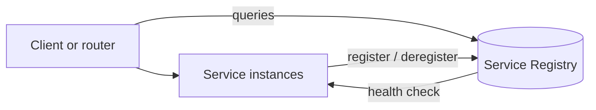

# Service Registry

## Descrição

O Service Registry é um banco de dados de serviços, suas instâncias e suas localizações. As instâncias se registram na inicialização e se removem no desligamento; clientes ou roteadores consultam o registro para saber quais instâncias estão disponíveis.

Opcionalmente, o registro chama a API de health check de cada instância para confirmar que ela pode atender requisições. É o componente central tanto da descoberta no cliente quanto da descoberta no servidor.

## Problemas que resolve

- Clientes e roteadores precisam saber quais instâncias de um serviço existem e onde estão.
- Cada instância expõe uma API remota (HTTP/REST, Thrift etc.) em um host e porta específicos.
- O número e a localização das instâncias mudam dinamicamente.
- VMs e contêineres costumam receber endereços IP dinâmicos.
- O número de instâncias varia com a carga, por exemplo em grupos de autoscaling.

## Quando usar

- Sempre que se adota Client-side ou Server-side Discovery em ambientes dinâmicos.
- Quando instâncias escalam automaticamente e mudam de endereço.

### Quando evitar

- Quando a infraestrutura já fornece um registro embutido, sendo desnecessário operar outro.
- Em sistemas com poucos serviços de endereços estáticos.

## Trade-offs

| Ganho | Custo / Risco |
| --- | --- |
| Clientes e roteadores descobrem as instâncias dinamicamente | Mais um componente para configurar e operar, salvo se a infraestrutura o fornecer |
| Visão central de saúde e localização | Componente crítico: exige alta disponibilidade |

- Dados em cache nos clientes ficam obsoletos se o registro falhar.
- É preciso decidir entre Self Registration e 3rd Party Registration.
- Os clientes precisam de endereços fixos e conhecidos do registro, normalmente configurados.

## Diagrama

As instâncias mantêm o registro atualizado e clientes ou roteadores o consultam.

## Padrões relacionados

- [Client-side Discovery](./client-side-discovery.md) — cliente consulta o registro
- [Server-side Discovery](./server-side-discovery.md) — roteador consulta o registro
- [Self Registration](./self-registration.md) — instâncias se registram sozinhas
- [3rd Party Registration](./3rd-party-registration.md) — um registrador externo cuida do registro
- [Health Check API](../../../cloud/cloud-design-patterns/resiliency/health-endpoint-monitoring.md) — usada para verificar a saúde das instâncias
- [Health Endpoint Monitoring](../../../cloud/cloud-design-patterns/resiliency/health-endpoint-monitoring.md) — verificação de saúde por endpoints

## Referência

- [Página do padrão no microservices.io](https://microservices.io/patterns/service-registry.html)
