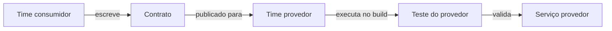

# Consumer-driven Contract Test

## Descrição

No Consumer-driven Contract Test, os desenvolvedores de cada serviço consumidor escrevem um conjunto de testes (contratos) que descreve o que esperam da API de um serviço provedor. Esses contratos são entregues ao time do provedor, que os executa contra o seu próprio serviço, de forma isolada, como parte do pipeline de build.

A ênfase está no **lado do provedor**: é o provedor que é validado contra os contratos definidos pelos consumidores. Se uma mudança no provedor quebrar alguma expectativa registrada, o teste falha antes do deploy, sem a necessidade de subir os dois serviços juntos. O padrão complementar, que valida o consumidor contra o mesmo contrato, é o [Consumer-side Contract Test](/architecture/microservices/testing/consumer-side-contract-test).

## Problemas que resolve

- Como verificar de forma simples que um serviço oferece a API que seus clientes esperam
- Testes end-to-end que sobem vários serviços são difíceis, lentos, frágeis e caros
- Mudanças no provedor podem quebrar consumidores sem que o time do provedor perceba

## Quando usar

- Há vários serviços que se chamam e o provedor precisa saber quais partes da API são realmente usadas
- Times diferentes são donos de provedor e consumidores e precisam de um acordo executável
- Se deseja evoluir a API do provedor com segurança, sem testes end-to-end

### Quando evitar

- Há um único consumidor sob o mesmo time, em que um teste de integração simples basta
- Os consumidores não conseguem ou não querem manter seus contratos atualizados

## Trade-offs

| Ganho | Custo / Risco |
| --- | --- |
| Teste do provedor isolado, mais rápido, confiável e barato | Testes podem passar e a aplicação ainda falhar em produção |
| Feedback antecipado sobre quebras de compatibilidade | Difícil garantir que os contratos escritos refletem o que o consumidor realmente precisa |
| Contratos documentam o uso real da API | Exige processo para compartilhar e versionar contratos entre times |

- Funciona melhor combinado com testes do lado do consumidor, para que ambos os lados usem o mesmo contrato.
- Ferramentas como Spring Cloud Contract e Pact dão suporte a esse estilo.

## Diagrama

O consumidor define o contrato e o provedor o executa contra o próprio serviço, validando-o isoladamente.

## Padrões relacionados

- [Consumer-side Contract Test](/architecture/microservices/testing/consumer-side-contract-test) — valida o consumidor contra o mesmo contrato
- [Service Component Test](/architecture/microservices/testing/service-component-test) — testa um serviço isolado, com dublês dos serviços que ele chama
- [Microservice Architecture](/architecture/microservices/architectural-style/microservice-architecture) — contexto em que serviços dependem uns dos outros
- [Remote Procedure Invocation](/architecture/microservices/communication-styles/remote-procedure-invocation) — estilo de comunicação cujas APIs são cobertas pelos contratos
- [Messaging](/architecture/microservices/communication-styles/messaging) — contratos também podem descrever mensagens trocadas

## Referência

- [Página do padrão no microservices.io](https://microservices.io/patterns/testing/service-integration-contract-test.html)
