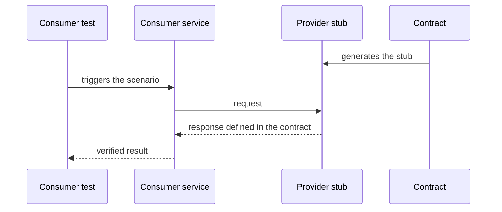

# Consumer-side Contract Test

## Descrição

O Consumer-side Contract Test verifica que o cliente de um serviço consegue se comunicar com ele. O teste roda no **lado do consumidor**: o serviço provedor é substituído por um stub gerado a partir do contrato, e o consumidor é exercitado contra esse stub para confirmar que envia requisições válidas e interpreta corretamente as respostas previstas.

É o espelho do [Consumer-driven Contract Test](./consumer-driven-contract-test.md). Nele, o provedor é validado contra os contratos dos consumidores. Aqui, o consumidor é validado contra os mesmos contratos. Como os dois lados usam o mesmo contrato, ele funciona como ponto de acordo entre os times, sem subir os dois serviços juntos.

## Problemas que resolve

- Como saber que o consumidor realmente fala a língua do provedor (formato de requisição e de resposta)
- Stubs escritos à mão pelo consumidor podem divergir do comportamento real do provedor
- Testes end-to-end para detectar incompatibilidades são lentos, frágeis e caros

## Quando usar

- Um serviço depende da API de outro e precisa de testes rápidos e determinísticos
- Existe um contrato compartilhado, usado também para validar o provedor
- Se quer detectar cedo mudanças de contrato que quebram o cliente

### Quando evitar

- Não há contrato mantido pelo provedor, tornando o stub só uma suposição do consumidor
- A integração é trivial ou ambos pertencem ao mesmo time e já têm testes de integração suficientes

## Trade-offs

| Ganho | Custo / Risco |
| --- | --- |
| Testes do consumidor rápidos, isolados e confiáveis | O stub pode divergir do provedor real se o contrato não for verificado nele |
| Falha cedo quando o consumidor viola ou o contrato muda | Exige gerenciar e versionar contratos compartilhados |
| Mesmo contrato dos dois lados reduz mal-entendidos | Passar nos testes não garante o funcionamento em produção |

- O valor só se completa quando o provedor também executa o contrato (Consumer-driven Contract Test).
- Ferramentas como Pact e Spring Cloud Contract geram stubs a partir do contrato.

## Diagrama

O consumidor é testado contra um stub derivado do contrato, sem depender do provedor real.

## Padrões relacionados

- [Consumer-driven Contract Test](./consumer-driven-contract-test.md) — valida o provedor contra os contratos dos consumidores
- [Service Component Test](./service-component-test.md) — testa um serviço isolado usando dublês das dependências
- [Remote Procedure Invocation](../communication-styles/remote-procedure-invocation.md) — estilo de comunicação coberto pelos contratos
- [Messaging](../communication-styles/messaging.md) — contratos também podem descrever mensagens

## Referência

- [Página do padrão no microservices.io](https://microservices.io/patterns/testing/consumer-side-contract-test.html)
