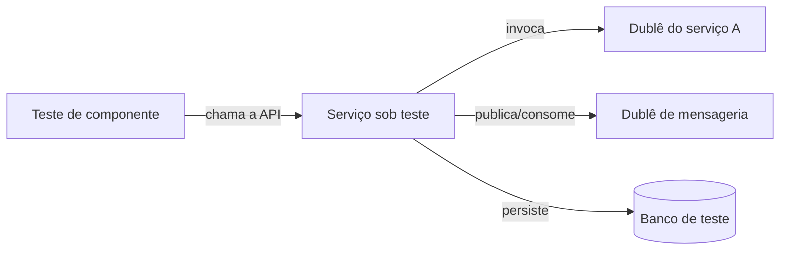

# Service Component Test

## Descrição

O Service Component Test é um conjunto de testes que exercita um único serviço em isolamento, tratando-o como uma caixa-preta acessada por sua API. Os serviços que ele invoca, e muitas vezes infraestrutura como mensageria, são substituídos por dublês de teste (stubs ou mocks), de modo que o teste não dependa de outros serviços.

Assim, valida-se o comportamento do serviço de ponta a ponta dentro de sua fronteira, de forma mais rápida e estável do que subir vários serviços. A fidelidade dos dublês pode ser garantida com contratos, como nos padrões de Contract Test.

## Problemas que resolve

- Como testar um serviço de forma simples
- Testes end-to-end que sobem vários serviços são difíceis, lentos, frágeis e caros

## Quando usar

- Se quer validar o comportamento de um serviço sem depender dos demais
- O pipeline de build precisa de feedback rápido e determinístico
- O serviço tem dependências remotas que podem ser simuladas

## Quando evitar

- Os dublês são mantidos à mão e divergem do comportamento real das dependências
- O serviço é tão simples que testes unitários já oferecem confiança suficiente

## Trade-offs

| Ganho | Custo / Risco |
| --- | --- |
| Testes mais fáceis, rápidos, confiáveis e baratos | Testes podem passar e a aplicação ainda falhar em produção |
| Isolamento permite rodar sem os outros serviços | Garantir que os dublês refletem os serviços reais é um problema em aberto |
| Falhas apontam direto para o serviço testado | Mais código de teste e dublês para manter |

- Combinar com Contract Tests reduz o risco de dublês desatualizados.
- Ainda é recomendável um número pequeno de testes de ponta a ponta.

## Diagrama

O serviço é exercitado pela sua API e suas dependências remotas são substituídas por dublês.

## Padrões relacionados

- [Consumer-driven Contract Test](/architecture/microservices/testing/consumer-driven-contract-test) — valida o provedor contra contratos dos consumidores
- [Consumer-side Contract Test](/architecture/microservices/testing/consumer-side-contract-test) — contratos ajudam a manter os dublês fiéis
- [Database per Service](/architecture/microservices/service-collaboration/database-per-service) — cada serviço tem seu banco, facilitando o teste isolado
- [Microservice Architecture](/architecture/microservices/architectural-style/microservice-architecture) — contexto de serviços que se chamam

## Referência

- [Página do padrão no microservices.io](https://microservices.io/patterns/testing/service-component-test.html)
