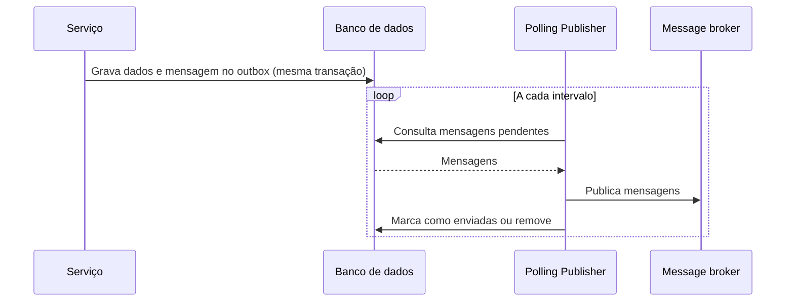

# Polling Publisher

## Descrição

O Polling Publisher é uma forma de implementar o message relay do Transactional Outbox. Um processo consulta repetidamente a tabela de outbox no banco de dados, lê as mensagens pendentes e as publica no message broker, marcando-as como enviadas ou removendo-as em seguida.

É a abordagem mais simples de adotar, pois usa apenas consultas comuns ao banco e não depende de recursos específicos de log de transações.

## Problemas que resolve

- Mover mensagens e eventos da tabela de outbox para o broker depois que o Transactional Outbox foi aplicado.
- Obter um relay que funciona com qualquer banco SQL, sem ferramentas específicas.

## Quando usar

- O banco é SQL e não há acesso fácil ao log de transações.
- Simplicidade e portabilidade pesam mais que latência mínima.
- O volume de mensagens é moderado.

### Quando evitar

- Latência muito baixa ou volume alto, pois o polling gera carga e atraso.
- O banco é NoSQL sem suporte adequado a esse tipo de consulta.
- Ordem estrita é crítica e não se consegue garantir com múltiplos publicadores concorrentes.

## Trade-offs

| Ganho | Custo / Risco |
| --- | --- |
| Funciona com qualquer banco SQL | Publicar eventos em ordem é complicado |
| Implementação simples e sem dependências específicas | Nem todos os bancos NoSQL suportam o padrão |
| Fácil de operar e depurar | Carga extra de consultas e latência igual ao intervalo de polling |

- Consistência eventual com atraso limitado pelo intervalo de polling.
- Múltiplas instâncias do publicador exigem coordenação (por exemplo, bloqueio de linhas) para evitar duplicatas e quebra de ordem.
- Consumidores devem ser idempotentes.

## Diagrama

O publicador consulta o outbox periodicamente, envia as mensagens ao broker e atualiza o estado no banco.

## Padrões relacionados

- [Transactional Outbox](./transactional-outbox.md) — cria a necessidade deste padrão
- [Transaction Log Tailing](./transaction-log-tailing.md) — alternativa que lê o log de transações do banco
- [Idempotent Consumer](../../../cloud/cloud-design-patterns/messaging/idempotent-consumer.md) — necessário para tolerar mensagens duplicadas
- [Messaging](../communication-styles/messaging.md) — estilo de comunicação que usa o broker

## Referência

- [Página do padrão no microservices.io](https://microservices.io/patterns/data/polling-publisher.html)
