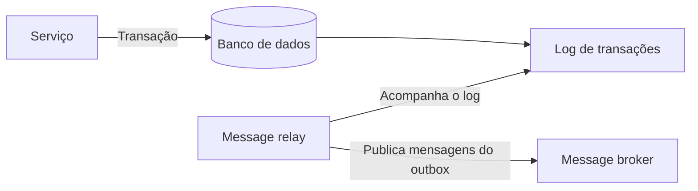

# Transaction Log Tailing

## Descrição

O Transaction Log Tailing é uma forma de implementar o message relay do Transactional Outbox. Em vez de consultar a tabela de outbox, o relay acompanha ("tail") o log de transações do banco de dados e publica no message broker cada mensagem inserida no outbox.

O mecanismo depende do banco: o binlog do MySQL, o WAL do PostgreSQL ou os streams de tabela do DynamoDB, por exemplo. Como o log registra apenas transações confirmadas e em ordem, o relay enxerga exatamente o que foi efetivado, sem precisar de two-phase commit.

## Problemas que resolve

- Levar as mensagens da tabela de outbox até o broker depois que o Transactional Outbox foi aplicado.
- Evitar a carga e a latência de consultas periódicas ao banco.
- Publicar somente o que foi realmente confirmado, preservando a ordem do log.

## Quando usar

- O banco expõe um log de transações ou stream de mudanças acessível (binlog, WAL, streams).
- Baixa latência e ordem estrita de publicação são importantes.
- O volume de mensagens torna o polling custoso para o banco.

### Quando evitar

- O banco não oferece acesso ao log, ou o time não tem familiaridade com essa tecnologia.
- Uma solução simples e portável entre bancos é preferível.
- Não há capacidade operacional para manter um conector específico por banco.

## Trade-offs

| Ganho | Custo / Risco |
| --- | --- |
| Sem 2PC e com leitura fiel do que foi confirmado | Implementação específica para cada banco de dados |
| Baixa latência e pouca carga de leitura sobre o banco | Técnica relativamente obscura, embora cada vez mais comum |
| Ordem preservada pelo log | Evitar publicação duplicada é difícil |

- Consistência eventual: a mensagem é publicada logo após o commit, mas de forma assíncrona.
- Operação: é preciso gerenciar posição/offset de leitura do log e retenção do log.
- Consumidores ainda devem ser idempotentes.

## Diagrama

O relay lê o log de transações do banco, filtra as inserções no outbox e as publica no broker.

## Padrões relacionados

- [Transactional Outbox](/architecture/microservices/transactional-messaging/transactional-outbox) — cria a necessidade deste padrão
- [Polling Publisher](/architecture/microservices/transactional-messaging/polling-publisher) — alternativa que consulta o outbox periodicamente
- [Idempotent Consumer](/cloud/cloud-design-patterns/messaging/idempotent-consumer) — protege contra duplicatas na publicação
- [Messaging](/architecture/microservices/communication-styles/messaging) — estilo de comunicação que usa o broker

## Referência

- [Página do padrão no microservices.io](https://microservices.io/patterns/data/transaction-log-tailing.html)
