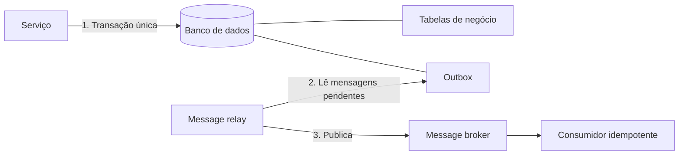

# Transactional Outbox

## Descrição

O Transactional Outbox resolve o problema de atualizar o banco de dados de um serviço e, ao mesmo tempo, enviar uma mensagem ou evento a um message broker de forma atômica. Em vez de publicar diretamente no broker, o serviço grava a mensagem em uma tabela de "outbox" (ou em uma propriedade do próprio registro, em bancos NoSQL) dentro da mesma transação local que altera os dados de negócio.

Um componente separado, o message relay, lê as mensagens pendentes do outbox e as publica no broker. Como a gravação da mensagem e a alteração dos dados acontecem na mesma transação, a mensagem existe se, e somente se, a transação foi confirmada, e a ordem em que foi produzida é preservada.

A entrega do relay é "pelo menos uma vez": ele pode publicar a mesma mensagem mais de uma vez (por exemplo, se falhar após publicar e antes de marcar a mensagem como enviada). Por isso os consumidores precisam ser idempotentes.

## Problemas que resolve

- Atualizar o banco e publicar no broker sem two-phase commit (2PC), que muitas vezes não é suportado ou é indesejável.
- Evitar mensagens perdidas ou "fantasmas" quando a publicação ocorre dentro ou depois da transação e algo falha no meio.
- Enviar a mensagem somente se a transação de banco for confirmada.
- Preservar a ordem das mensagens, inclusive com várias instâncias atualizando o mesmo agregado.

## Quando usar

- Sagas e eventos de domínio exigem que a mudança de estado e a publicação sejam consistentes.
- O banco ou o broker não suportam transações distribuídas.
- É necessário garantir que nenhum evento seja perdido nem emitido sem a respectiva alteração de dados.

### Quando evitar

- O serviço usa Event Sourcing, em que o event store já cumpre o papel de log de eventos publicável.
- A perda ocasional de mensagens é aceitável e a complexidade extra não se justifica.
- Os consumidores não podem ser tornados idempotentes e duplicatas são inaceitáveis.

## Trade-offs

| Ganho | Custo / Risco |
| --- | --- |
| Atomicidade entre dados e mensagem sem 2PC | Necessidade de um message relay e de uma tabela/estrutura extra |
| Ordem das mensagens preservada | Possibilidade de duplicatas exigindo consumidores idempotentes |
| Nenhuma mensagem perdida ou emitida sem commit | Fácil esquecer de gravar o evento ao alterar os dados |

- Consistência eventual: a mensagem chega ao broker com algum atraso após o commit.
- Complexidade operacional: o relay deve ser monitorado, e o outbox precisa de limpeza periódica.
- Acoplamento do esquema de mensagens ao banco do serviço.

## Diagrama

O serviço grava dados e mensagem na mesma transação; o relay lê o outbox e publica no broker, e o consumidor trata possíveis duplicatas.

## Padrões relacionados

- [Transaction Log Tailing](./transaction-log-tailing.md) — implementação do relay lendo o log de transações do banco
- [Polling Publisher](./polling-publisher.md) — implementação do relay consultando periodicamente o outbox
- [Saga](../../../cloud/cloud-design-patterns/distributed-coordination/saga.md) — gera a necessidade de enviar mensagens atomicamente com a atualização do banco
- [Event Sourcing](../../../cloud/cloud-design-patterns/data-management/event-sourcing.md) — abordagem alternativa para publicar eventos de forma confiável
- [Idempotent Consumer](../../../cloud/cloud-design-patterns/messaging/idempotent-consumer.md) — necessário para tolerar mensagens duplicadas do relay
- [Messaging](../communication-styles/messaging.md) — estilo de comunicação que usa o broker

## Referência

- [Página do padrão no microservices.io](https://microservices.io/patterns/data/transactional-outbox.html)
