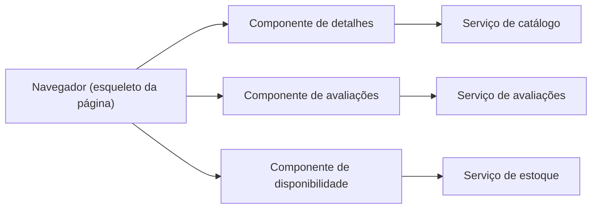

# Client-side UI Composition

## Descrição

Em uma arquitetura de microsserviços com equipes organizadas por capacidade de negócio ou subdomínio, cada equipe também é responsável pela experiência do usuário do seu serviço. Quando uma tela precisa exibir dados de vários serviços, como uma página de produto com detalhes, histórico de compras, disponibilidade e avaliações, é preciso decidir onde a composição acontece.

Neste padrão, cada equipe desenvolve um componente de UI no lado do cliente, como uma diretiva do AngularJS ou um web component, para a região da tela referente ao seu serviço. Cada componente busca os dados no seu próprio serviço. Uma equipe de UI cria os esqueletos das páginas, que compõem os componentes específicos de cada serviço diretamente no navegador.

## Problemas que resolve

- Como implementar uma tela que exibe dados provenientes de vários serviços
- Alinhar a propriedade de cada parte da interface com a propriedade do serviço
- Permitir que regiões da página carreguem e falhem de forma independente

## Quando usar

- Aplicações ricas e interativas, como SPAs
- Quando se quer carregamento progressivo de regiões da página
- Quando as equipes desejam publicar seus componentes de forma independente

### Quando evitar

- Quando SEO ou renderização inicial rápida em dispositivos fracos são críticos
- Quando muitas chamadas do navegador a vários serviços seriam um problema de rede
- Quando não há convenção de design system para manter a consistência visual

## Trade-offs

| Ganho | Custo / Risco |
| --- | --- |
| Componentes independentes por equipe | Risco de inconsistência visual e de dependências duplicadas |
| Falha isolada por componente | Mais requisições do cliente e exposição dos serviços |
| Interface rica e dinâmica | Maior carga de JavaScript no navegador |

- Normalmente exige um API Gateway ou BFF para expor os serviços ao cliente.
- Um design system compartilhado ajuda a manter a consistência.
- É preciso tratar estados de carregamento e erro em cada componente.

## Diagrama

O esqueleto da página no navegador compõe componentes de UI, e cada um consulta o serviço correspondente.

## Padrões relacionados

- [Server-side Page Fragment Composition](./server-side-page-fragment-composition.md) — alternativa em que a composição ocorre no servidor
- [API Gateway](../external-api/api-gateway.md) — expõe os serviços aos componentes do cliente
- [API Composition](../service-collaboration/api-composition.md) — agregação de dados no backend
- [Backends for Frontends](../../../cloud/azure/gateways-and-edge/backends-for-frontends.md) — backend dedicado ao cliente

## Referência

- [Página do padrão no microservices.io](https://microservices.io/patterns/ui/client-side-ui-composition.html)
