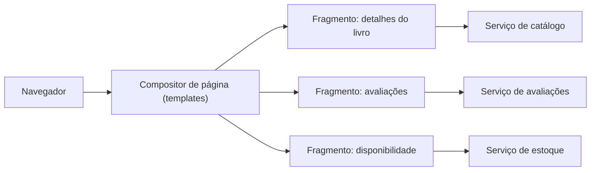

# Server-side Page Fragment Composition

## Descrição

Em uma arquitetura de microsserviços com equipes organizadas por capacidade de negócio ou subdomínio, cada equipe também é dona da experiência do usuário relacionada ao seu serviço. O problema surge quando uma única tela precisa exibir dados de vários serviços, como uma página de produto que mostra detalhes, disponibilidade, avaliações e itens relacionados.

Neste padrão, cada equipe desenvolve uma aplicação web que gera o fragmento HTML da região da página sob sua responsabilidade. Uma equipe de UI mantém os templates de página, que montam a página final no servidor agregando os fragmentos de cada serviço, por exemplo por meio de um mecanismo de server-side include. O navegador recebe a página já composta.

## Problemas que resolve

- Como implementar uma tela que exibe dados provenientes de vários serviços
- Manter a propriedade de cada região da UI com a equipe dona do respectivo serviço
- Evitar que uma única equipe ou aplicação de front-end centralize toda a lógica de apresentação

## Quando usar

- Páginas renderizadas no servidor, com HTML como formato principal
- Quando SEO e tempo de primeira renderização são importantes
- Quando as equipes de serviço querem entregar seus fragmentos de forma independente

### Quando evitar

- Interfaces altamente interativas, que dependem de componentes ricos no cliente
- Quando a latência de montar muitos fragmentos em série no servidor é inaceitável
- Quando não há uma equipe ou convenção para manter os templates de página e o estilo consistente

## Trade-offs

| Ganho | Custo / Risco |
| --- | --- |
| Cada equipe controla o fragmento do seu serviço | Necessidade de coordenar layout, estilos e contratos de fragmento |
| Página chega pronta ao navegador | Latência da página depende do fragmento mais lento |
| Deploy independente dos fragmentos | Falha de um fragmento pode degradar a página inteira |

- Convém definir timeouts e conteúdo de fallback para cada fragmento.
- A observabilidade deve correlacionar a requisição da página com as chamadas a cada fragmento.
- Um cache de fragmentos reduz a carga e a latência.

## Diagrama

O compositor de página monta no servidor os fragmentos HTML gerados por cada serviço e devolve a página completa ao navegador.

## Padrões relacionados

- [Client-side UI Composition](/architecture/microservices/ui-design/client-side-ui-composition) — alternativa em que a composição ocorre no cliente
- [API Composition](/architecture/microservices/service-collaboration/api-composition) — agrega dados de vários serviços, mas no nível de API e não de UI
- [API Gateway](/architecture/microservices/external-api/api-gateway) — ponto de entrada que pode rotear a requisição da página
- [Backends for Frontends](/architecture/cloud-design-patterns/gateways-and-edge/backends-for-frontends) — backend dedicado a cada tipo de cliente

## Referência

- [Página do padrão no microservices.io](https://microservices.io/patterns/ui/server-side-page-fragment-composition.html)
