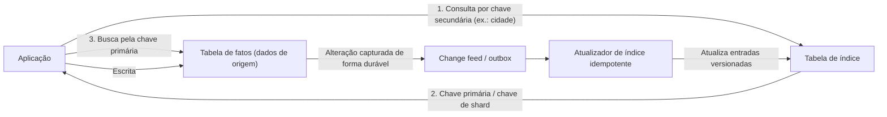

# Index Table

## Descrição

Muitos armazenamentos de dados organizam as entidades apenas pela chave primária (ou pela chave de partição/shard). Quando a aplicação precisa consultar por outro atributo, como cidade ou sobrenome do cliente, e o armazenamento não oferece índices secundários adequados, a alternativa seria varrer todos os registros. O padrão Index Table resolve isso criando e mantendo tabelas de índice separadas, organizadas pelas chaves secundárias usadas com frequência nas consultas.

Existem três estratégias principais de estruturação: **desnormalização completa** (cada tabela de índice duplica o registro inteiro, organizado por outra chave), **índice normalizado** (o índice guarda apenas a referência à chave primária na tabela de origem, a "tabela de fatos", exigindo duas leituras) e **desnormalização parcial** (o índice duplica só os campos mais consultados e referencia a origem para o restante). Também é possível usar **chaves compostas** (por exemplo, cidade + sobrenome), com codificação que preserve os limites entre componentes e a ordenação desejada.

Em dados particionados com chave de shard baseada em hash, a tabela de índice pode organizar as entradas por valores não-hash e armazenar a chave de shard de cada registro. Isso permite consultas por faixa e ordenadas, além de rotear cada leitura diretamente para o shard correto. Quando a origem e os índices não podem ser atualizados na mesma transação, a manutenção dos índices costuma ser assíncrona e eventualmente consistente.

## Problemas que resolve

- Consultas por atributos que não são a chave primária exigem varreduras completas, lentas e caras.
- O armazenamento de dados não oferece índices secundários, ou os índices nativos não atendem aos requisitos de consulta, particionamento ou desempenho.
- Em dados fragmentados por hash, não é possível fazer consultas por faixa ou ordenadas sem consultar todos os shards.
- Consultas frequentes por combinações de atributos (por exemplo, "clientes de uma cidade com determinado sobrenome") não têm caminho de acesso eficiente.

## Quando usar

- A aplicação recupera dados com frequência por uma chave diferente da chave primária ou da chave de shard.
- O armazenamento não suporta índices secundários nativamente, ou os índices existentes não atendem à carga de trabalho.
- A carga é predominantemente de leitura e os dados indexados mudam com pouca frequência.
- É aceitável uma breve defasagem (consistência eventual) entre a origem e o índice.

### Quando evitar

- Os dados são muito voláteis: a taxa de escrita supera a capacidade de atualizar os índices, que ficam permanentemente desatualizados.
- A chave secundária é pouco discriminante (por exemplo, um campo booleano), oferecendo pouca seletividade pelo custo total de armazenamento e throughput.
- A distribuição dos valores é muito desbalanceada (por exemplo, 90% dos registros com o mesmo valor), a menos que as consultas mirem justamente os valores raros.
- As consultas por esse atributo são raras ou especulativas; o custo de manter o índice não compensa.

## Trade-offs

| Ganho | Custo / Risco |
| --- | --- |
| Buscas rápidas por campos não-chave, sem varredura completa | Sobrecarga de manutenção de cada tabela de índice adicional |
| Consultas por faixa e ordenadas sobre dados fragmentados por hash | Maior consumo de armazenamento e de throughput de escrita |
| Desnormalização permite responder consultas comuns com uma única leitura | Índices normalizados exigem duas leituras (índice e depois origem) |
| Manutenção assíncrona evita que falhas no índice bloqueiem escritas na origem | Consistência eventual: o índice pode retornar referências obsoletas ou omitir registros recentes |

- **Consistência:** capture cada alteração da origem de forma durável antes de confirmar a escrita (change feed, outbox transacional ou comando enfileirado); não atualize a origem e publique a mensagem de índice de forma independente.
- **Idempotência e ordenação:** o consumidor que atualiza os índices deve ser idempotente e usar versão ou número de sequência para descartar atualizações antigas; mantenha tombstones versionados para exclusões.
- **Particionamento dos índices:** as próprias tabelas de índice podem precisar ser particionadas, alinhadas aos padrões de consulta que atendem.
- **Observabilidade e governança:** monitore defasagem, mensagens em dead-letter e execute reconciliações periódicas; revise e remova índices que não são mais consultados.

## Diagrama

A aplicação consulta a tabela de índice pela chave secundária, obtém a chave primária (ou de shard) e busca o registro completo na tabela de fatos. As escritas na origem são capturadas de forma durável e propagadas de modo assíncrono por um atualizador idempotente que mantém os índices.

## Padrões relacionados

- [Sharding](./sharding.md) — tabelas de índice permitem localizar registros e fazer consultas por faixa sobre dados fragmentados.
- [Materialized View](./materialized-view.md) — outra forma de pré-organizar dados derivados para atender consultas específicas.
- [Idempotent Consumer](../messaging/idempotent-consumer.md) — o atualizador assíncrono de índices deve tolerar mensagens duplicadas.
- [CQRS](./cqrs.md) — separa modelos de leitura e escrita, frequentemente com índices desnormalizados no lado de leitura.
- [Event Sourcing](./event-sourcing.md) — os eventos podem alimentar a construção e a reconstrução das tabelas de índice.

## Referência

- [Documentação no Azure Architecture Center](https://learn.microsoft.com/en-us/azure/architecture/patterns/index-table)
