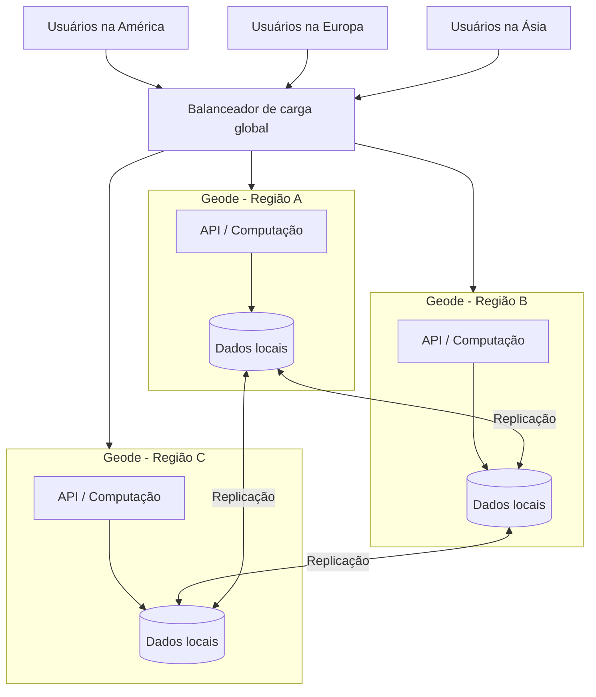

# Geode

## Descrição

O padrão Geode (de **ge**ographical n**ode**) consiste em implantar o mesmo conjunto de serviços de backend em vários nós geográficos espalhados pelo mundo, em que cada nó consegue atender qualquer requisição de qualquer cliente, em qualquer região. É uma abordagem *ativo-ativo*: em vez de levar os dados até um ponto central de processamento, o padrão *leva o processamento até os dados*, colocando computação e armazenamento lado a lado em cada região.

Cada geode é autocontido: reúne todos os recursos de que precisa (computação, API, armazenamento, segredos), normalmente definidos por um template de infraestrutura, e não depende de nenhum outro geode para operar. Os geodes ficam atrás de um balanceador de carga global, que encaminha o cliente para o nó mais próximo ou mais saudável, e compartilham um *backplane* de replicação de dados (um banco de dados distribuído com escrita em múltiplas regiões, como o Azure Cosmos DB) que mantém os dados consistentes entre todos eles.

Diferentemente de um deployment stamp, um geode nunca existe isoladamente: um ambiente de produção sempre tem mais de um. A resiliência da solução cresce a cada geode adicionado, já que qualquer nó pode assumir o tráfego quando uma ou mais regiões ficam indisponíveis.

## Problemas que resolve

- Latência alta para usuários geograficamente distantes do único ponto de hospedagem do serviço
- Picos de demanda que sobrecarregam os serviços de uma única região
- Indisponibilidade total do serviço quando uma região inteira falha
- Dependência de *scale-up* de um banco de dados central como única forma de crescer
- Complexidade e custo de manter cópias de infraestrutura em várias regiões sem um modelo padronizado e replicável

## Quando usar

- Plataformas de grande escala com usuários distribuídos por uma área geográfica ampla
- Serviços que exigem disponibilidade e resiliência extremas, capazes de sobreviver à perda simultânea de várias regiões
- Aplicações cloud-native que podem tratar todos os nós como equivalentes para leitura e escrita de dados
- Cenários de computação próxima à borda (near-edge), em que reduzir o tempo de resposta é prioridade

### Quando evitar

- Quando nem todos os geodes podem ser iguais em relação aos dados, por exemplo por exigências de residência de dados, estado de sessão temporário preso a uma região ou tráfego fortemente concentrado em uma única região (nesse caso, prefira deployment stamps com um roteamento global ciente da localização dos dados)
- Quando não há necessidade real de distribuição geográfica; zonas de disponibilidade e regiões pareadas podem bastar
- Na adaptação de plataformas legadas, pois o padrão é pensado para desenvolvimento cloud-native e é difícil de retroadaptar
- Em arquiteturas simples, em que redundância e distribuição geográfica não trazem vantagem

## Trade-offs

| Ganho | Custo / Risco |
| --- | --- |
| Menor latência, com o cliente atendido pelo nó mais próximo | Custo de infraestrutura e de replicação multiplicado pelo número de geodes |
| Alta disponibilidade: o serviço sobrevive à perda de uma ou mais regiões | Consistência de dados entre regiões depende do backplane de replicação e de seu modelo de consistência |
| Escalabilidade horizontal: cada geode escala de forma independente | Arquitetura altamente distribuída e desacoplada, mais difícil de depurar e rastrear |
| Absorção de picos regionais redistribuindo carga entre geodes | Mais segredos e pontos de entrada, aumentando a superfície de ataque |
| Implantação padronizada e repetível via templates | Exige automação de DevOps madura para manter todos os geodes idênticos |

Considerações adicionais:

- **Consistência:** decida se cada região processa seus dados localmente ou se agregações são feitas em um único geode e o resultado é replicado globalmente; cada opção tem vantagens e desvantagens.
- **Custo:** prefira tecnologias serverless ou com cobrança por consumo para reduzir o custo de manter muitos geodes sempre ligados; faça testes de carga comparando "mais geodes" com "nós mais potentes".
- **Observabilidade:** partes de uma mesma requisição podem executar de forma assíncrona em geodes diferentes; use rastreamento distribuído e monitoramento centralizado.
- **Segurança:** garanta que o único ponto de entrada seja o front-end global, restrinja o acesso ao armazenamento apenas à camada de computação do próprio geode e centralize a gestão de segredos.
- **Disponibilidade dos dados:** recursos como escrita multirregião e zonas de disponibilidade no banco aumentam a resiliência, mas também o custo.

## Diagrama

O balanceador de carga global encaminha cada usuário ao geode mais próximo ou disponível; cada geode é autocontido e processa a requisição com seus próprios dados, enquanto o backplane de replicação mantém os dados idênticos entre todas as regiões, permitindo que qualquer geode atenda qualquer requisição.

## Padrões relacionados

- [Deployment Stamp](./deployment-stamp.md) — também replica unidades de implantação, mas cada stamp pode atender um subconjunto isolado de clientes; é a alternativa quando os geodes não podem ser equivalentes quanto aos dados
- [Gateway Routing](../gateways-and-edge/gateway-routing.md) — o roteamento global na frente dos geodes aplica a mesma ideia de encaminhar requisições ao backend adequado
- [Sharding](../data-management/sharding.md) — alternativa para distribuir dados por região quando não é possível replicar tudo para todos os nós
- [Health Endpoint Monitoring](../resiliency/health-endpoint-monitoring.md) — o balanceador global depende de verificações de saúde para tirar de rotação geodes indisponíveis
- [Static Content Hosting](./static-content-hosting.md) — complementa o padrão ao servir conteúdo estático pela borda, perto dos usuários
- [Rate Limiting](../resiliency/rate-limiting-pattern.md) — pode ser aplicado na camada de API de cada geode para proteger os recursos compartilhados do backplane

## Referência

- [Documentação no Azure Architecture Center](https://learn.microsoft.com/en-us/azure/architecture/patterns/geodes)
