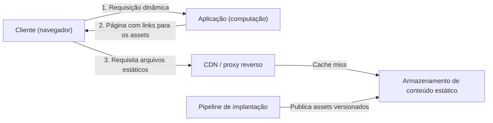

# Static Content Hosting

## Descrição

O padrão Static Content Hosting consiste em publicar o conteúdo estático de uma aplicação (páginas HTML, imagens, folhas de estilo, JavaScript do lado do cliente, documentos, pacotes de software) em um serviço de armazenamento em nuvem capaz de entregá-lo diretamente ao cliente via HTTP(S), sem passar pelos servidores de aplicação.

A aplicação continua responsável pelas requisições dinâmicas e apenas devolve páginas que referenciam os arquivos hospedados no armazenamento. O navegador ou cliente busca esses arquivos diretamente na origem de armazenamento, muitas vezes por meio de uma CDN ou de um proxy reverso que faz cache próximo aos usuários.

Como armazenamento costuma ser muito mais barato que capacidade de computação, o padrão reduz custo e libera recursos de computação para a lógica de negócio. O ganho real depende de quanto computação deixa de ser cobrada em comparação com o custo de armazenar e trafegar o conteúdo.

## Problemas que resolve

- Servidores de aplicação consomem CPU, memória e conexões atendendo downloads de arquivos que não exigem processamento por requisição.
- Custo elevado de escalar instâncias de computação apenas para suportar tráfego de conteúdo estático.
- Latência alta para usuários distantes da região onde a aplicação está hospedada.
- Dificuldade de separar e acompanhar os custos de banda e entrega de conteúdo dos custos de execução da aplicação.
- Necessidade de distribuir artefatos pré-gerados (instaladores, pacotes, documentos) em grande escala.

## Quando usar

- Sites e aplicações que contêm uma parcela relevante de recursos estáticos e querem reduzir custo de hospedagem.
- Sites totalmente estáticos, que podem ser hospedados inteiramente no serviço de armazenamento (por exemplo, o recurso de site estático do Azure Blob Storage).
- Expor recursos estáticos para aplicações hospedadas em outros ambientes ou em servidores on-premises.
- Distribuir artefatos pré-construídos, como pacotes de software, permitindo que os clientes verifiquem autenticidade e integridade (por exemplo, assinaturas digitais).
- Distribuir conteúdo em várias regiões geográficas com uma CDN que faz cache a partir da origem de armazenamento.
- Monitorar custos e consumo de banda de forma separada dos custos de execução da aplicação.

### Quando evitar

- Quando o conteúdo precisa ser processado ou personalizado a cada requisição (por exemplo, inserir dados específicos do usuário em um documento).
- Quando o volume de conteúdo estático é muito pequeno e a sobrecarga de mantê-lo em um armazenamento separado supera o benefício.
- Quando o conteúdo é privado e não há mecanismo adequado de autorização na camada de entrega.

## Trade-offs

| Ganho | Custo / Risco |
| --- | --- |
| Menor custo de computação e de escalabilidade dos servidores de aplicação | Custos de armazenamento, transferência de dados e CDN precisam ser estimados; a economia só existe se a capacidade de computação for de fato reduzida |
| Menor latência com cache na borda (CDN) | Cache pode servir versões antigas; invalidação leva tempo e purgas na CDN não limpam o cache do navegador |
| Escalabilidade e disponibilidade delegadas ao serviço de armazenamento | Nova dependência de entrega (armazenamento, CDN, proxy) a ser monitorada; replicação entre regiões pode ser assíncrona |
| Separação clara entre conteúdo estático e lógica dinâmica | Implantações de aplicação e de assets precisam ser coordenadas e versionadas |
| Custos de banda isolados e fáceis de acompanhar | Configuração adicional de segurança (acesso anônimo, CORS, tokens de acesso) |

Considerações adicionais:

- **Segurança:** use HTTPS por padrão; permita leitura anônima apenas para conteúdo público e restrinja o acesso direto à origem quando ele contornar controles da CDN ou do proxy. Limite permissões de escrita a identidades de implantação confiáveis.
- **Conteúdo privado:** mantenha-o em contêineres que exigem autorização e entregue por meio de tokens de curta duração (ver Valet Key); evite cache compartilhado para esse conteúdo, a menos que a camada de entrega valide permissões a cada requisição.
- **Versionamento:** publique assets alterados em URLs versionadas antes de implantar as páginas que os referenciam e mantenha versões antigas enquanto houver páginas em cache ou rollbacks dependentes delas.
- **Metadados HTTP:** defina e verifique `Content-Type`, `Content-Encoding` e `Cache-Control` para que clientes interpretem e façam cache corretamente.
- **URLs e origem:** decida entre um hostname separado ou o mesmo domínio via proxy reverso; configure CORS quando houver requisições entre origens e use reescrita ou redirecionamentos para preservar links quando o layout mudar.
- **Resiliência e observabilidade:** escolha a redundância do armazenamento conforme os requisitos de disponibilidade e monitore disponibilidade, tempo de resposta e erros em armazenamento, CDN e proxy.

## Diagrama

O cliente obtém da aplicação apenas a página dinâmica, que referencia os arquivos estáticos; esses arquivos são buscados diretamente na CDN ou proxy, que recorre ao armazenamento quando não há cópia em cache. O pipeline de implantação publica os assets versionados no armazenamento de forma independente da aplicação.

## Padrões relacionados

- [Valet Key](../security-and-access/valet-key.md) — fornece tokens ou chaves de acesso restrito e temporário para que clientes acessem diretamente recursos que não devem ser públicos.
- [Cache-Aside](../data-management/cache-aside.md) — outra forma de reduzir carga na origem mantendo dados frequentemente acessados em cache.
- [Gateway Offloading](../gateways-and-edge/gateway-offloading.md) — também transfere responsabilidades dos serviços de aplicação para uma camada compartilhada, como a entrega de conteúdo.
- [Gateway Routing](../gateways-and-edge/gateway-routing.md) — um proxy reverso pode rotear caminhos do mesmo domínio para o armazenamento estático e preservar URLs.
- [Geodes](./geodes.md) — distribuição geográfica de serviços para aproximar o conteúdo dos usuários, complementando o uso de CDN.

## Referência

- [Documentação no Azure Architecture Center](https://learn.microsoft.com/en-us/azure/architecture/patterns/static-content-hosting)
