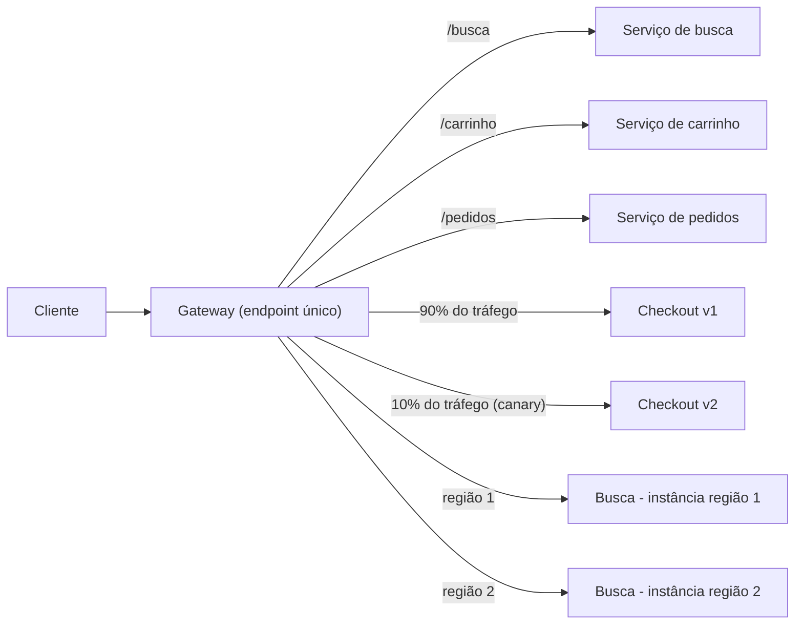

# Gateway Routing

## Descrição

O padrão Gateway Routing coloca um gateway na frente de um conjunto de aplicações, serviços ou implantações e expõe tudo por um único endpoint. O gateway examina cada requisição na camada 7 (caminho da URL, host, cabeçalhos, porta ou IP de origem) e a encaminha ao destino adequado no backend.

Com isso, o cliente conhece e conversa com um só endpoint. O gateway pode encaminhar para serviços distintos (busca, carrinho, checkout), para várias instâncias do mesmo serviço (balanceamento de carga e disponibilidade, inclusive entre regiões) ou para versões diferentes de um serviço (blue-green, canary, rollout gradual). A topologia do backend fica encapsulada no gateway, e mudanças nela se resumem a ajustes de configuração de roteamento.

Um proxy reverso comum, como o Nginx, já implementa o padrão. No Azure, por exemplo, o Application Gateway oferece roteamento regional e o Front Door oferece roteamento global.

## Problemas que resolve

- Clientes precisam conhecer o endpoint de cada serviço e mudar sempre que uma API é adicionada, removida, dividida ou consolidada.
- Instâncias sobem e descem de forma elástica, e o cliente teria de acompanhar esse registro e desregistro.
- Estratégias de implantação com várias versões convivendo (blue-green, canary) exigiriam alterar o cliente a cada mudança no percentual de tráfego.
- Fazer rollback de uma versão com problema, que sem o gateway pode exigir redistribuir clientes ou trocar DNS.
- Expor endpoints públicos a partir de endpoints internos ou virtuais, como IPs virtuais de cluster.

## Quando usar

- Um cliente consome vários serviços que podem ficar atrás de um gateway.
- Você quer simplificar os clientes com um único endpoint.
- É preciso rotear requisições de endpoints externos para endpoints virtuais internos.
- O cliente consome serviços em várias regiões para ganhar latência ou disponibilidade.
- Você quer desviar tráfego de regiões com maior emissão de carbono quando há alternativas no pool de backends.
- O número de instâncias do serviço varia ao longo do tempo.
- A estratégia de implantação exige que várias versões do serviço sejam acessadas ao mesmo tempo.

### Quando evitar

- Aplicações simples que usam apenas um ou dois serviços, em que o gateway só acrescenta um salto e mais um componente para operar.
- Cenários em que o salto extra de rede é inaceitável para a latência e não há ganho de roteamento que compense.
- Comunicação interna entre serviços que já resolve descoberta e balanceamento por outro mecanismo, como service mesh ou service discovery.

## Trade-offs

| Ganho | Custo / Risco |
| --- | --- |
| Cliente conhece um único endpoint e fica desacoplado da topologia do backend | O gateway pode virar ponto único de falha se não for redundante |
| Serviços podem ser divididos, consolidados ou substituídos sem mudar o cliente | O gateway pode virar gargalo e precisa escalar junto com a demanda |
| Rollouts graduais e rollback rápido por configuração | Mais um salto de rede, com algum acréscimo de latência |
| Tráfego enviado só a nós saudáveis e distribuído entre instâncias e regiões | Regras de roteamento mal configuradas afetam muitos serviços ao mesmo tempo |
| Ponto único para gerir domínios, certificados e criptografia em trânsito | Mais um componente para operar, monitorar e proteger |

- **Disponibilidade:** implante o gateway com redundância e tolerância a falhas e combine-o com health checks dos backends.
- **Escala e testes:** faça testes de carga no gateway para não provocar falhas em cascata nos serviços.
- **Escopo:** escolha um gateway global para implantações em várias regiões e um regional quando precisar de controle fino do balanceamento dentro de uma região.
- **Segurança:** o gateway é o endpoint público; restrinja o acesso direto aos backends para que só sejam alcançáveis pelo gateway ou por rede privada.
- **Responsabilidade:** mantenha no gateway apenas roteamento e evite colocar lógica de negócio nele.
- **Observabilidade:** registre métricas e logs por rota e por backend para diagnosticar erros e latência.

## Diagrama

O cliente envia todas as requisições para o gateway, que as roteia por caminho para serviços distintos, divide o tráfego entre versões de um mesmo serviço e distribui a carga entre instâncias em regiões diferentes.

## Padrões relacionados

- [Gateway Aggregation](./gateway-aggregation.md) — também usa um gateway, mas para combinar várias chamadas de backend em uma única requisição.
- [Gateway Offloading](./gateway-offloading.md) — transfere ao gateway responsabilidades transversais como TLS, autenticação e limitação de taxa.
- [Backends for Frontends](./backends-for-frontends.md) — cria gateways ou backends dedicados a cada tipo de cliente, cada um com suas regras de roteamento.
- [Geodes](../deployment-and-topology/geodes.md) — implantação multirregional ativa-ativa que costuma ficar atrás de um gateway global.
- [Strangler Fig](../integration-and-modernization/strangler-fig.md) — usa roteamento numa fachada para migrar funcionalidades aos poucos de um sistema legado para um novo.
- [Health Endpoint Monitoring](../resiliency/health-endpoint-monitoring.md) — fornece os sinais de saúde que o gateway usa para enviar tráfego só a instâncias saudáveis.
- [Gatekeeper](../security-and-access/gatekeeper.md) — põe um host dedicado entre clientes e serviços para validar e higienizar requisições, e pode ser combinado com o roteamento.

## Referência

- [Documentação no Azure Architecture Center](https://learn.microsoft.com/en-us/azure/architecture/patterns/gateway-routing)
