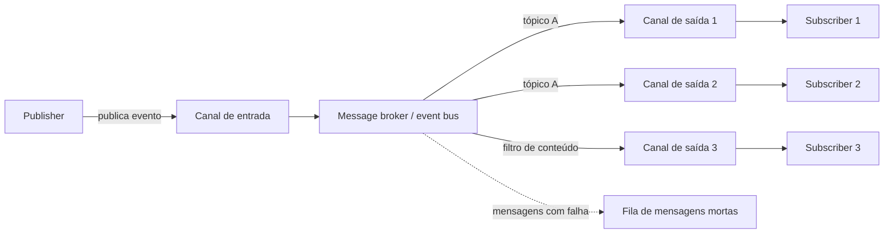

# Publisher-Subscriber

## Descrição

O padrão Publisher-Subscriber (pub/sub) permite que uma aplicação anuncie eventos de forma assíncrona a vários consumidores interessados, sem conhecer quem são eles. O remetente (*publisher*) empacota o evento em uma mensagem com formato conhecido e a envia a um único canal de entrada; a partir daí, um intermediário, como um message broker ou event bus, copia a mensagem para os canais de saída de cada consumidor (*subscriber*) interessado.

Cada subscriber decide de forma independente o que quer receber, normalmente assinando tópicos ou definindo filtros de conteúdo. Com isso, o publisher pode voltar ao seu trabalho logo após publicar, e novos consumidores podem ser adicionados ou removidos sem nenhuma mudança no remetente.

O broker também retém as mensagens enquanto um subscriber está indisponível, o que isola falhas, permite processamento adiado ou agendado e facilita a integração entre sistemas com plataformas, linguagens e protocolos diferentes, inclusive entre ambientes on-premises e nuvem.

No vocabulário do Enterprise Integration Patterns (Hohpe e Woolf), o mesmo padrão é o Publish-Subscribe Channel: o canal tem uma entrada e uma saída separada por assinante, e cada saída entrega uma cópia do evento a um único assinante, que a consome uma vez e a remove do seu canal. Como todo tráfego passa por esse ponto de fan-out, é também um local conveniente para espiar as mensagens para depuração, de forma semelhante a um Message Store, sem alterar as aplicações.

## Problemas que resolve

- Acoplamento direto: o remetente precisa conhecer a identidade e o endpoint de cada consumidor, entregar a cada um e tratar falhas individualmente.
- Adicionar ou remover consumidores exige alterar o remetente, o que impede que os times evoluam e implantem componentes de forma independente.
- Filas ponto a ponto atendem um único consumidor; suportar vários exige uma fila por consumidor, aumentando a complexidade de roteamento.
- Consumidores que só precisam de parte das informações não têm, em filas simples, um mecanismo nativo para filtrar por conteúdo ou categoria.
- O remetente fica bloqueado ou lento enquanto aguarda a entrega a vários destinos.
- Cada assinante deve receber e consumir cada evento uma única vez, sem que cópias se acumulem ou sejam processadas em duplicidade.
- Equipes precisam observar o tráfego do canal para depurar sem mexer no fluxo existente nem adicionar código de log em cada aplicação.
- A falha de um consumidor se propaga para o remetente ou para os demais consumidores.

## Quando usar

- Uma aplicação precisa difundir informações para um número significativo de consumidores.
- É preciso comunicar-se com aplicações ou serviços desenvolvidos de forma independente, possivelmente com plataformas, linguagens ou protocolos diferentes.
- O remetente pode enviar informações sem exigir resposta em tempo real dos consumidores.
- Os sistemas integrados aceitam um modelo de consistência eventual para seus dados.
- Os consumidores têm requisitos de disponibilidade ou janelas de funcionamento diferentes das do remetente.

### Quando evitar

- Há poucos consumidores e cada um precisa de informações bem diferentes; o broker adiciona complexidade sem benefício de escala, e comunicação direta ou filas separadas podem ser mais adequadas.
- A interação precisa ser quase em tempo real ou o publisher precisa de uma resposta síncrona; prefira request-reply.
- Os consumidores precisam processar mensagens em uma ordem específica e garantida.
- A operação exige uma transação atômica entre o publisher e seus consumidores; considere uma transação direta no banco ou o padrão Saga.

## Trade-offs

| Ganho | Custo / Risco |
| --- | --- |
| Desacoplamento entre publisher e subscribers, com evolução e implantação independentes | Mais um componente de infraestrutura (broker) para operar, monitorar e proteger |
| Publisher mais responsivo e escalável: publica uma vez e segue em frente | Latência adicional e consistência eventual entre os sistemas |
| Isolamento de falhas: o broker retém mensagens até o subscriber se recuperar | Mensagens acumuladas podem esgotar recursos do broker se os subscribers não acompanharem |
| Novos consumidores entram sem mudança no remetente | Rastreabilidade de ponta a ponta mais difícil; exige IDs de correlação |
| Filtragem por tópico ou conteúdo, entregando a cada um só o que interessa | Ordem de entrega não garantida e possibilidade de mensagens duplicadas |
| Alinhamento a modelos de cobrança por consumo e escala sob demanda | Canais unidirecionais: respostas exigem um canal de retorno separado |

- **Garantias de entrega:** *at-most-once* tem menor custo mas pode perder mensagens; *at-least-once* garante entrega mas gera duplicatas; *exactly-once* elimina duplicatas com mais coordenação e latência. Sem deduplicação no broker, torne os subscribers idempotentes.
- **Ordenação:** se a ordem importa, use partições ou sessões ordenadas, sabendo que isso limita a escala; de preferência, projete subscribers que tolerem qualquer ordem de chegada.
- **Granularidade de tópicos:** tópicos amplos são simples de gerenciar mas forçam filtragem no subscriber; tópicos estreitos reduzem filtragem mas multiplicam os tópicos. Assinaturas com curinga (ex.: `orders.*`) ajudam.
- **Segurança:** autentique e autorize publishers e subscribers por tópico, criptografe mensagens em trânsito e, se forem sensíveis, em repouso no broker. O broker também serve como fronteira de segmentação de rede.
- **Mensagens problemáticas:** desvie mensagens malformadas (poison messages) para uma fila de mensagens mortas (dead-letter) para análise.
- **Tamanho e validade:** para payloads grandes, armazene o conteúdo externamente e envie uma referência (Claim Check). Use carimbos de expiração e de liberação para descartar mensagens obsoletas ou agendar o processamento.
- **Evolução de esquema:** prefira mudanças retrocompatíveis (campos opcionais), versione em caso de quebra (ex.: `orders.v1`, `orders.v2`) e faça os subscribers ignorarem campos desconhecidos.
- **Backpressure:** use controle de fluxo do broker para limitar mensagens não confirmadas por subscriber e escale horizontalmente com Competing Consumers.
- **Tecnologia:** prefira produtos prontos de mensageria a construir o próprio broker. No Azure, por exemplo, Service Bus (tópicos e assinaturas), Event Grid (notificações push) ou Event Hubs (streaming); fora dele, RabbitMQ, Apache Kafka ou Redis.

## Diagrama

O publisher envia cada evento uma única vez ao canal de entrada; o broker copia a mensagem para o canal de saída de cada subscriber interessado, conforme tópicos ou filtros, e desvia mensagens que não podem ser processadas para uma fila de mensagens mortas.

## Padrões relacionados

- [Competing Consumers](./competing-consumers.md) — escala horizontalmente o processamento de cada assinatura com várias instâncias consumindo do mesmo canal.
- [Idempotent Consumer](./idempotent-consumer.md) — permite tratar com segurança as mensagens duplicadas da entrega at-least-once.
- [Claim Check](./claim-check.md) — evita os limites de tamanho de mensagem enviando apenas uma referência ao payload armazenado externamente.
- [Priority Queue](./priority-queue.md) — garante que mensagens de maior prioridade sejam processadas antes das demais.
- [Choreography](../distributed-coordination/choreography.md) — usa eventos publicados para que serviços coordenem um fluxo de negócio sem orquestrador central.
- [Saga](../distributed-coordination/saga.md) — coordena transações distribuídas quando é preciso consistência entre publisher e consumidores.
- [Event Sourcing](../data-management/event-sourcing.md) — os eventos armazenados costumam ser publicados para atualizar outros sistemas e visões.
- [Asynchronous Request-Reply](./asynchronous-request-reply.md) — alternativa quando o remetente precisa de uma resposta, já que os canais pub/sub são unidirecionais.
- [Queue-Based Load Leveling](./queue-based-load-leveling.md) — o buffer do broker absorve picos de carga entre publisher e subscribers.
- [Point-to-Point Channel](../../../architecture/eip/messaging-channels/point-to-point-channel.md) — no EIP, a alternativa em que cada mensagem vai a um único receptor.
- [Durable Subscriber](../../../architecture/eip/messaging-endpoints/durable-subscriber.md) — retém mensagens para assinantes que estão offline.
- [Message Channel](../../../architecture/eip/messaging-channels/message-channel.md) — o conceito geral de canal que este padrão especializa.
- [Event Message](../../../architecture/eip/message-construction/event-message.md) — o tipo de mensagem normalmente difundido por este canal.
- [Messaging Bridge](./messaging-bridge.md) — integra sistemas de mensageria diferentes quando publishers e subscribers usam brokers distintos.

## Referência

- [Documentação no Azure Architecture Center](https://learn.microsoft.com/en-us/azure/architecture/patterns/publisher-subscriber)
- [Página do padrão no Enterprise Integration Patterns](https://www.enterpriseintegrationpatterns.com/PublishSubscribeChannel.html)
