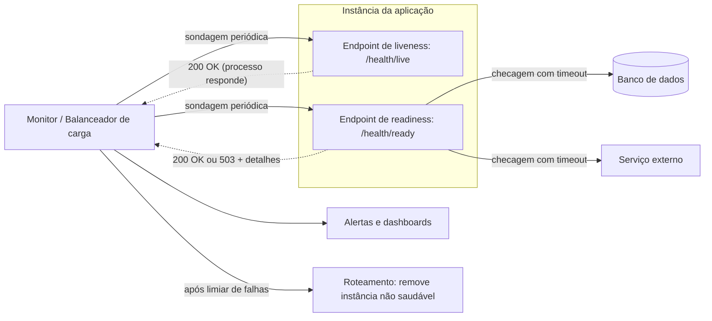

# Health Endpoint Monitoring

## Descrição

A aplicação expõe endpoints de saúde (por exemplo, `/health` via HTTPS ou o protocolo padrão de health checking do gRPC) que ferramentas externas consultam em intervalos regulares. Ao receber a requisição, a aplicação executa verificações funcionais, nela própria e nas dependências de que precisa, e devolve um indicador de status. A ferramenta de monitoramento avalia o código de status, o conteúdo da resposta e a latência de acordo com critérios de sucesso configurados.

As verificações podem ter profundidades diferentes. **Checagens rasas** (liveness) só confirmam que o processo responde, sem tocar em dependências, e evitam reinicializações desnecessárias quando um serviço externo cai. **Checagens profundas** (readiness) validam também as dependências obrigatórias e indicam se a instância consegue atender requisições de fato. É comum expor endpoints separados para cada sinal e dar à aplicação um tempo de inicialização antes de tratar a demora como falha.

No contexto de microsserviços, a instância pode continuar em execução sem conseguir atender requisições (por exemplo, por ter esgotado as conexões com o banco de dados). Por isso o handler do endpoint (tipicamente `/health`) costuma verificar a conexão com a infraestrutura de que o serviço depende, condições do host, como espaço em disco, e lógica específica da aplicação. O cliente da verificação pode ser um serviço de monitoramento, um service registry ou um balanceador de carga, que passa a rotear apenas para instâncias saudáveis.

Os resultados alimentam alertas, dashboards e ações de remediação controlada, como tirar uma instância doente do balanceador de carga ou fazer failover entre zonas e regiões. O padrão é uma peça de uma estratégia de observabilidade mais ampla: os resultados das sondagens devem ser combinados com métricas, logs, traces e SLOs em um modelo de saúde da carga de trabalho.

## Problemas que resolve

- Detectar que uma aplicação ou serviço ficou indisponível ou parcialmente degradado, inclusive quando a instrumentação interna não consegue reportar nada porque a aplicação está fora do ar
- Ter pouco controle direto sobre o ambiente de nuvem e depender de serviços de terceiros que podem falhar por latência de rede, throttling ou falhas transitórias
- Balanceadores e roteadores de tráfego mandarem requisições para instâncias que não conseguem atendê-las
- Não ter como verificar continuamente se o serviço cumpre os objetivos de nível de serviço (SLOs) acordados
- Uma instância em execução que não consegue atender requisições (por exemplo, sem conexões de banco disponíveis) continuar recebendo tráfego e sem disparar alerta
- Ter que diagnosticar no escuro qual componente ou dependência causou a degradação

## Quando usar

- Verificar se sites e aplicações web estão disponíveis e funcionando corretamente
- Monitorar serviços de camada intermediária ou compartilhados, para detectar e isolar falhas que podem afetar outras aplicações
- Dar sinais de saúde para balanceadores de carga, orquestradores e roteadores de tráfego (remoção de instâncias, autorrecuperação, failover)
- Validar a disponibilidade a partir de locais que representem os usuários, incluindo DNS, expiração de certificados TLS e conteúdo servido por CDN

### Quando evitar

- Os componentes não expõem uma interface de saúde compatível ou acessível à ferramenta de monitoramento. Nesse caso, prefira métricas de plataforma, alertas baseados em logs ou heartbeats internos
- Não há como produzir um sinal útil sem degradar a aplicação (consultas pesadas, chamadas caras ou testes de integração completos a cada sondagem). Nesse caso, use a telemetria que a aplicação já coleta, como taxas de erro e dados de dependências
- Basta confirmar que um processo ou host está de pé, sem lógica de aplicação nem cadeia de dependências para verificar. Uma sonda de transporte gerenciada pela plataforma resolve

## Trade-offs

| Ganho | Custo / Risco |
| --- | --- |
| Detecção rápida de indisponibilidade e degradação | Sondagens consomem CPU, memória e conexões que serviriam tráfego real |
| Roteamento apenas para instâncias saudáveis e autorrecuperação | Checagens profundas podem causar falhas em cascata ao tirar de serviço instâncias funcionais por causa de uma dependência lenta |
| Visibilidade padronizada da saúde de cada componente e dependência | Endpoints expostos aumentam a superfície de ataque e o risco de vazar informações sensíveis |
| Cache do status reduz o custo das verificações | O cache abre uma janela em que o status não reflete o estado real |
| Base para failover entre zonas e regiões | Exige capacidade redundante dimensionada para absorver o tráfego redirecionado |

- **Verificação periódica:** o intervalo entre sondagens deixa uma janela em que uma instância pode falhar e ainda receber requisições, e uma checagem pouco abrangente pode declarar saudável uma instância com problemas. Combine com métricas e retentativas no cliente.
- **Validação da resposta:** um HTTP 200 mostra disponibilidade básica, mas diz pouco sobre tendências e problemas que estão para acontecer. Avalie se vale validar também o conteúdo e a latência.
- **Granularidade:** defina quantos endpoints expor (serviços críticos vs. de menor prioridade, ou um por serviço central), cada um com sua expectativa de uptime e tempo de resposta.
- **Efeitos colaterais:** prefira verificações somente leitura. Transações sintéticas que alteram estado precisam de contas e dados de teste isolados e de limpeza ao final.
- **Mitigação de cascata:** use timeouts por dependência, lógica de circuit breaker e um status "degradado" (em vez de "não saudável") quando uma dependência opcional falhar. Configure limiares de falhas consecutivas para que falhas transitórias não disparem ações.
- **Frequência e custo:** o custo total depende do intervalo, da profundidade da checagem, do número de instâncias e dos locais de sondagem. Ajuste o TTL do cache ao atraso de detecção aceitável.
- **Segurança:** exija autenticação compatível com a ferramenta de monitoramento, restrinja o acesso de rede às origens de sondagem e devolva só o mínimo necessário, deixando diagnósticos detalhados atrás de autorização. Porta não padrão ou caminho difícil de adivinhar não é controle de acesso.
- **Confiabilidade do monitor:** verifique se o próprio agente de monitoramento funciona (autoteste, endpoint que devolve um valor conhecido) para evitar falsos positivos.

## Diagrama

O monitor consulta periodicamente o endpoint de liveness, que não toca dependências, e o de readiness, que verifica as dependências obrigatórias com timeouts. Quando a readiness falha repetidas vezes, o monitor ou balanceador gera alertas e para de mandar tráfego para a instância.

## Padrões relacionados

- [Circuit Breaker](./circuit-breaker.md) — evita que uma dependência instável derrube a checagem profunda e provoque falhas em cascata
- [Retry](./retry.md) — trata falhas transitórias. Os limiares de falha do monitor seguem a mesma lógica de tolerância
- [Gateway Routing](../gateways-and-edge/gateway-routing.md) — o roteamento pode usar os sinais de saúde para mandar requisições só a instâncias saudáveis
- [Geodes](../deployment-and-topology/geodes.md) — o failover entre regiões depende de sinais de saúde confiáveis de cada nó geográfico
- [Deployment Stamp](../deployment-and-topology/deployment-stamp.md) — cada stamp expõe endpoints de saúde que orientam o roteamento global e o failover
- [Sidecar](../integration-and-modernization/sidecar.md) — um sidecar pode implementar ou agregar as verificações de saúde sem mudar a aplicação
- [Cache-Aside](../data-management/cache-aside.md) — mesma ideia de guardar em cache o resultado de verificações caras para reduzir o custo das sondagens
- [Service Registry](../../../architecture/microservices/service-discovery/service-registry.md) — o registro invoca o endpoint de saúde para manter apenas instâncias saudáveis disponíveis
- [Application Metrics](../../../architecture/microservices/observability/application-metrics.md) — complementa o sinal de saúde com medições contínuas
- [Bulkhead](./bulkhead.md) — isolar recursos impede que a carga das sondagens dispute capacidade com o tráfego de produção

## Referência

- [Documentação no Azure Architecture Center](https://learn.microsoft.com/en-us/azure/architecture/patterns/health-endpoint-monitoring)
- [Health Check API no microservices.io](https://microservices.io/patterns/observability/health-check-api.html)
