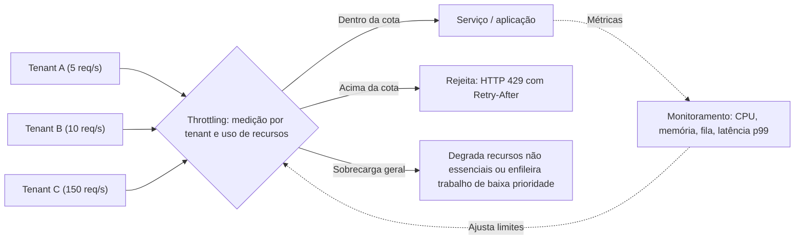

# Throttling

## Descrição

O padrão Throttling limita os recursos que uma instância da aplicação, um tenant ou um serviço inteiro pode consumir. Assim o sistema continua funcionando e cumprindo seus objetivos de nível de serviço (SLOs) sob carga repentina ou prolongada. Em vez de depender só de escalar (o que leva tempo e custa dinheiro), o serviço define um teto de uso e, quando ele é ultrapassado, passa a restringir as requisições de um ou mais consumidores.

Throttling é um ciclo de controle contínuo, não uma decisão isolada. O sistema mede a saturação em três camadas (utilização da infraestrutura, estado da aplicação e contadores por cliente/tenant), aplica limites em pontos bem definidos e ajusta esses limites conforme o tráfego muda. As estratégias mais comuns são: limites por principal (cliente, usuário ou tenant), degradação gradual de funcionalidades não essenciais, nivelamento de carga com fila, adiamento de operações de menor prioridade e redução das próprias chamadas de saída quando uma dependência está com problemas.

**Diferença para Rate Limiting:** no Throttling, quem impõe o limite é o **serviço**, que protege a si mesmo controlando quanto cada cliente ou tenant pode consumir (por exemplo, devolvendo HTTP 429 ou 503 com `Retry-After`). No [Rate Limiting](./rate-limiting-pattern.md), quem se limita é o **cliente**: ele controla o ritmo das próprias chamadas para não esbarrar nos limites de um serviço externo e evitar erros e retentativas. Os dois se complementam: um serviço que aplica throttling deve, por sua vez, respeitar o throttling das dependências que chama.

## Problemas que resolve

- Picos repentinos de demanda que esgotam CPU, memória, conexões ou banda antes que o autoscaling consiga adicionar capacidade.
- Um único tenant ou cliente ("vizinho barulhento") monopolizando recursos compartilhados e degradando os demais.
- Violação de SLOs/SLAs por lentidão ou queda generalizada quando a carga passa da capacidade.
- Custos sem limite superior causados por escalar indefinidamente para atender qualquer volume de demanda.
- Abuso automatizado (scripts, bots, integrações mal configuradas) consumindo o sistema com tráfego aparentemente legítimo.
- Sobrecarga que se propaga em cascata entre serviços quando ninguém sinaliza back-pressure.

## Quando usar

- Para manter o sistema dentro dos SLOs mesmo sob carga alta.
- Para impedir que um único tenant ou cliente monopolize os recursos da aplicação em ambientes multitenant.
- Para absorver rajadas de atividade enquanto o autoscaling ainda está provisionando capacidade.
- Para limitar o nível máximo de recursos (e, portanto, de custo) que o sistema precisa.
- Para oferecer níveis de serviço diferentes por plano ou contrato (cotas por tier).
- Para reduzir processamento de baixo valor em momentos de pico ou de alta intensidade de carbono da rede elétrica.

### Quando evitar

- Quando a carga é previsível e a capacidade provisionada atende com folga; os limites acrescentam complexidade sem benefício.
- Como substituto de proteção de borda contra DDoS/WAF: throttling na aplicação mede tráfego legítimo e não absorve ataques volumétricos.
- Como substituto de cache: o cache reduz a carga média, mas não limita o pico.
- Quando o custo de rejeitar uma requisição (autenticação pesada, parsing profundo) é parecido com o de atendê-la; nesse caso, antes é preciso tornar a rejeição barata.
- Quando a demanda cresce mais rápido do que qualquer escalonamento possível e recusar requisições é inaceitável para o negócio; aí a resposta é reserva de capacidade, não throttling.

## Trade-offs

| Ganho | Custo / Risco |
| --- | --- |
| Estabilidade e cumprimento de SLOs sob carga | Parte das requisições é rejeitada ou atrasada, e alguns clientes têm a experiência degradada |
| Isolamento entre tenants (evita vizinho barulhento) | Exige atribuir cada requisição a um principal e medir o consumo por ele |
| Teto claro de uso de recursos e custo previsível | Limites mal calibrados desperdiçam capacidade ou deixam o sistema saturar |
| Ganha tempo para o autoscaling agir | Se a demanda cresce mais rápido que a capacidade nova, o sistema ainda pode falhar |
| Proteção contra abuso automatizado | Limites aplicados em fronteiras muito amplas (ex.: gateway regional) afetam usuários que não causaram a carga |

Considerações adicionais:

- **Dimensão do limite:** limite o que satura primeiro (requisições em andamento, profundidade de fila, CPU, memória ou o limite de uma dependência), não necessariamente requisições por segundo.
- **Algoritmo:** token bucket aceita rajadas controladas; leaky bucket mantém vazão constante; janela fixa é simples, mas permite rajadas na virada da janela; janela deslizante suaviza isso ao custo de mais estado.
- **Contadores distribuídos:** contadores locais são rápidos, mas contam a menos quando o cliente atinge várias réplicas; um contador central (ex.: em um cache distribuído) é preciso, mas adiciona latência a cada decisão.
- **Descarte proativo:** comece a rejeitar uma fração crescente de requisições ao se aproximar do limite, usando a latência p99 em relação ao SLO como gatilho, em vez de esperar a saturação.
- **Resposta ao cliente:** devolva HTTP 429 (limite excedido) ou 503 (sobrecarga temporária) com `Retry-After` e contexto suficiente (qual limite, qual escopo) para o cliente se adaptar.
- **Propagação de back-pressure:** não esconda 429/503 das dependências com retentativas silenciosas ou erros 500 genéricos; isso amplifica retentativas e espalha a sobrecarga.
- **Custo por operação:** normalize limites pelo custo real (por exemplo, escritas mais restritas que leituras).
- **Configuração em tempo de execução:** permita ajustar limites sem novo deploy e considere limites adaptativos, sempre com um teto fixo.
- **Observabilidade:** a instrumentação contínua de desempenho é pré-requisito para detectar a carga, reagir rápido e voltar ao normal quando ela diminuir.

## Diagrama

O serviço mede o consumo de cada tenant e o uso global de recursos. Requisições dentro da cota seguem para a aplicação, as que excedem o limite recebem 429 com `Retry-After`, e, em sobrecarga geral, recursos não essenciais são degradados ou o trabalho de baixa prioridade é adiado. O monitoramento retroalimenta e ajusta os limites continuamente.

## Padrões relacionados

- [Rate Limiting](./rate-limiting-pattern.md) — contraparte do lado do cliente: o consumidor controla o próprio ritmo de chamadas para respeitar o throttling dos serviços que usa.
- [Queue-Based Load Leveling](../messaging/queue-based-load-leveling.md) — suaviza picos colocando o trabalho em fila, uma das estratégias de throttling.
- [Priority Queue](../messaging/priority-queue.md) — permite atender primeiro tenants ou operações de maior valor e descartar ou adiar o trabalho de menor prioridade.
- [Bulkhead](./bulkhead.md) — complementa o throttling limitando concorrência e isolando recursos em pontos de fan-out.
- [Retry](./retry.md) — clientes precisam honrar `Retry-After` e usar backoff para não transformar rejeições em tempestades de retentativas.
- [Circuit Breaker](./circuit-breaker.md) — interrompe chamadas a dependências sobrecarregadas, alinhado à redução das chamadas de saída.
- [External Configuration Store](../deployment-and-topology/external-configuration-store.md) — permite ajustar limites em tempo de execução, sem deploy.
- [Cache-Aside](../data-management/cache-aside.md) — reduz a carga média na origem, mas não substitui o throttling para limitar o pior caso.
- [Gateway Offloading](../gateways-and-edge/gateway-offloading.md) — centraliza a aplicação de cotas e limites em um gateway.

## Referência

- [Documentação no Azure Architecture Center](https://learn.microsoft.com/en-us/azure/architecture/patterns/throttling)
