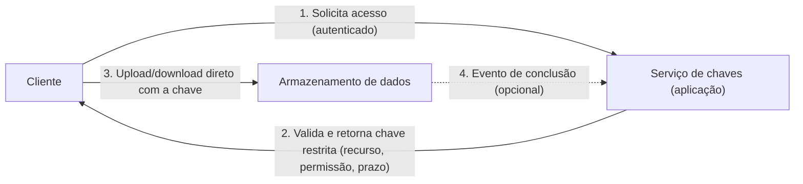

# Valet Key

## Descrição

O padrão Valet Key ("chave de manobrista") entrega ao cliente um token ou chave que dá acesso direto, mas restrito, a um recurso específico, como um arquivo num armazenamento de objetos ou uma fila. Assim, a aplicação deixa de intermediar a transferência de dados. Como a chave de manobrista de um carro, ela libera só o necessário: um recurso definido, operações predefinidas (por exemplo, apenas escrita) e um período de validade curto.

O fluxo é simples. O cliente se autentica na aplicação e pede acesso. A aplicação valida a requisição e gera uma chave assinada que o próprio repositório de dados consegue validar. Depois o cliente usa essa chave para ler ou gravar diretamente no repositório. Ao fim do prazo a chave expira, e a aplicação também pode revogá-la antes, por exemplo quando o cliente avisa que terminou a operação.

Com isso, a aplicação mantém o controle de quem acessa o quê e por quanto tempo, sem gastar computação, memória e banda para repassar os bytes. Também não é preciso criar usuários ou permissões permanentes no repositório para cada cliente.

## Problemas que resolve

- A aplicação consome CPU, memória e banda apenas para repassar uploads e downloads entre o cliente e o armazenamento.
- Expor credenciais do repositório aos clientes tira da aplicação o papel de gatekeeper e cria segredos de longa duração e difíceis de revogar.
- Uma camada de proxy acrescenta latência e um salto de rede, e precisa escalar junto com o volume de transferências.
- Transferir dados entre regiões ou redes através da aplicação gera custo adicional de tráfego.
- Criar e remover identidades ou permissões permanentes por cliente no repositório é trabalhoso e arriscado.

## Quando usar

- Quando clientes enviam ou baixam dados com frequência, principalmente arquivos grandes ou em grande volume.
- Quando a aplicação tem pouca capacidade de computação, por limite de hospedagem ou de custo, e há muitas transferências simultâneas.
- Para reduzir custo operacional e o número de instâncias de computação dedicadas a mover dados.
- Quando os dados ficam em um repositório remoto ou em outra região, e passar pela aplicação geraria tráfego extra.
- Quando clientes não confiáveis, como navegadores ou apps móveis, precisam de acesso pontual e temporário a recursos específicos.

### Quando evitar

- Quando os clientes já se autenticam de forma individual no recurso de destino com controle de acesso baseado em identidade.
- Quando a aplicação precisa processar os dados antes de armazená-los ou entregá-los, por exemplo para validar, transformar ou registrar cada acesso.
- Quando é obrigatório controlar quantas vezes a operação acontece ou manter trilha de auditoria, e o mecanismo de chave não oferece notificações ou eventos.
- Quando é preciso limitar o tamanho dos dados enviados, algo que em geral a chave não consegue impor.
- Quando a arquitetura existente torna difícil mudar a forma de entregar e receber dados.

## Trade-offs

| Ganho | Custo / Risco |
| --- | --- |
| Tira a transferência de dados da aplicação, que passa a precisar de menos recursos | Perde-se parte do controle sobre o uso: em geral não dá para limitar tamanho nem número de usos da chave |
| Acesso com escopo e prazo limitados, sem credenciais permanentes | Uma chave vazada dá acesso ao recurso enquanto for válida |
| Menos latência e menos saltos de rede entre cliente e dados | O serviço que emite as chaves vira um componente privilegiado e precisa de proteção rigorosa |
| Escala bem: emitir uma chave costuma ser só uma assinatura criptográfica | Uploads e downloads repetidos por erro do cliente podem gerar custos inesperados |
| Revogação e auditoria mais simples do que gerenciar usuários no repositório | Os dados enviados chegam sem passar pela aplicação e precisam ser validados depois |

- **Validade e escopo:** use prazos curtos, mas que permitam concluir a operação, e permita renovar a chave. Restrinja o recurso ao menor alvo possível (um item, não o contêiner inteiro) e as permissões ao mínimo, como "somente criar" para uploads, o que torna o token praticamente de uso único.
- **Relógios:** defina o início da validade um pouco antes do horário atual do servidor para tolerar diferenças de relógio nos clientes.
- **Entrega segura:** entregue a chave só para clientes autenticados e autorizados, sempre por HTTPS, e exija TLS no acesso direto ao repositório.
- **Logs:** URLs com chaves podem ficar gravadas em logs. Restrinja o acesso a esses logs ou atrase o envio deles para fora até as chaves expirarem.
- **Validação do conteúdo:** verifique e, se necessário, sanitize todo dado enviado antes de usá-lo, porque ele não passou pela aplicação.
- **Observabilidade:** registre a emissão das chaves e as operações no repositório e correlacione os dois. Use eventos do repositório para detectar o fim das operações, cobrar por volume e identificar falhas de autenticação.
- **Clientes web:** o acesso direto pelo navegador a outro domínio exige CORS configurado no repositório.

## Diagrama

O cliente obtém da aplicação uma chave com escopo, permissões e prazo limitados e transfere os dados direto com o armazenamento, que valida a chave sozinho. A aplicação só participa da autorização e, se quiser, recebe eventos para auditoria ou revogação.

## Padrões relacionados

- [Gatekeeper](./gatekeeper.md) — protege serviços com uma camada dedicada que valida as requisições. No Valet Key, a aplicação faz esse papel só na emissão da chave.
- [Static Content Hosting](../deployment-and-topology/static-content-hosting.md) — também tira o tráfego de conteúdo da aplicação. O Valet Key protege esse acesso direto quando o conteúdo não é público.
- [Gateway Routing](../gateways-and-edge/gateway-routing.md) — é a alternativa de proxy, em que todo o tráfego passa por um endpoint intermediário. Compensa só quando o intermediário agrega algo à transação.
- [Federated Identity](./federated-identity.md) — autentica o cliente no serviço que emite as chaves antes de qualquer acesso ser concedido.
- [Claim Check](../messaging/claim-check.md) — também guarda cargas grandes num armazenamento externo, e o Valet Key pode dar acesso temporário a elas.

## Referência

- [Documentação no Azure Architecture Center](https://learn.microsoft.com/en-us/azure/architecture/patterns/valet-key)
